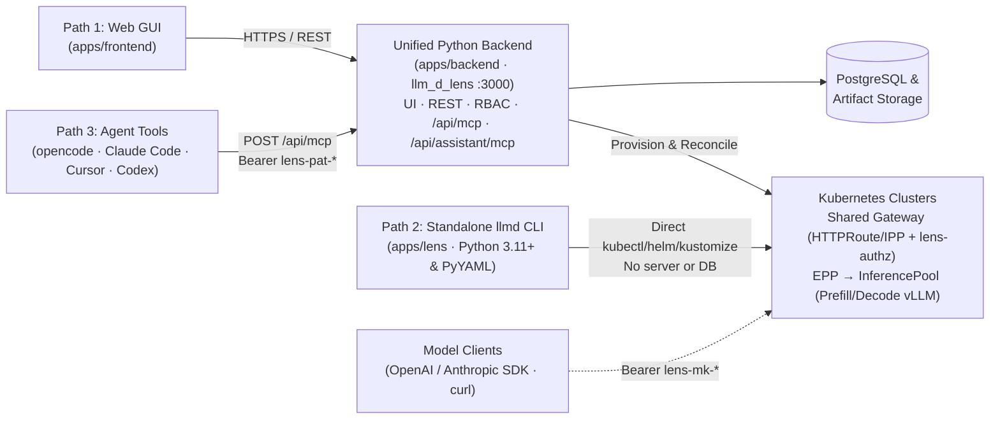

<!-- markdownlint-disable MD001 MD041 -->
<p align="center">
  
</p>

<h3 align="center">
The ultimate control plane for AI inference: Single-click deployment, automated benchmarking, and full-stack cluster monitoring.
</h3>

<p align="center">
| <a href="https://llm-d-incubation.github.io/llm-d-lens/"><b>Documentation</b></a> | <a href="https://llm-d-incubation.github.io/llm-d-lens/quickstart"><b>Quickstart</b></a> | <a href="https://llm-d-incubation.github.io/llm-d-lens/user-guide/model-market"><b>User Guide</b></a> | <a href="https://llm-d-incubation.github.io/llm-d-lens/architecture"><b>Architecture</b></a> |
</p>

---

## About

Lens is an open-source control plane for deploying and operating large language models on [llm-d](https://llm-d.ai/), the Kubernetes-native distributed inference stack, across your Kubernetes clusters. It plans and executes inference deployments, runs guided evaluations and trace replays, and keeps clusters, storage, and external providers under one roof, so a team can go from a catalog model to a benchmarked, production-serving deployment without stitching together separate tools.

Lens is built on llm-d with:

- Prefill/decode disaggregation, KV-cache-aware routing, KV cache offloading to CPU/SSD tiers, and latency-predicted routing that raise throughput and cut tail latency on the same accelerators
- Multi-cluster planning, approval, and execution with agentic, workload-guided placement
- A multi-protocol model service gateway (OpenAI chat completions and embeddings, Anthropic messages) behind `HTTPRoute` / Inference Payload Processor (`IPP`) → `EPP` → `InferencePool`, with per-model selection policies and `lens-authz`
- Role-based access control, per-cluster scoping, and audit logging across every page and API surface
- A bootstrap-and-maintain monitoring stack (Prometheus/Grafana) for accelerator utilization and deployment health

## Three Ways to Use Lens

Choose the interface that fits your workflow — all three operate on llm-d, and you can combine them (for example, provisioning with the Web GUI or Agent MCP while running namespace-scoped stacks with `llmd`):

| Path | Best for | Runtime & Dependencies | Auth / Scope | Reference |
| --- | --- | --- | --- | --- |
| **1. Web GUI** | Multi-cluster governance, visual planning (Manual & Agentic), guided Evaluation, Trace Replayer, Model Services, Observability, and built-in Lens Assistant | Unified Python FastAPI backend (`apps/backend`, `llm_d_lens` on `:3000`) serving `apps/frontend` + PostgreSQL | Session / RBAC across clusters | [Quickstart](https://llm-d-incubation.github.io/llm-d-lens/quickstart) · [Overview](https://llm-d-incubation.github.io/llm-d-lens/overview) |
| **2. Standalone `llmd` CLI** | Cluster-admin-free, namespace-scoped GitOps and terminal workflows directly against Kubernetes/OpenShift | `apps/lens` (`llm-d-lens-engine`), Python 3.11+ & `PyYAML` only — **no Lens server, DB, or Node required** (`kubectl`/`oc`, `helm`, `git`, `kustomize`) | User kubeconfig (`-n <namespace>`) | [CLI Reference](https://llm-d-incubation.github.io/llm-d-lens/cli-reference) |
| **3. Agent Tools (Lens MCP)** | Driving Lens end-to-end from coding/ops agents (`opencode`, Claude Code, Cursor, Codex) | Stateless Streamable HTTP `POST /api/mcp` on the Lens server (`46` task tools across `6` profiles) | `Authorization: Bearer lens-pat-*` (`mcp:tool:invoke` or `playground:chat:use`) | [MCP Integration](https://llm-d-incubation.github.io/llm-d-lens/mcp) |

> **Note on CLI entrypoints & MCP endpoints:** `llmd` (`lens.cli:main`) is the full standalone CLI; `lens` (`lens.__main__:main`) is currently a `--version`/`--help` stub only. External agents connect to `POST /api/mcp` (the Agent Task MCP), whereas the built-in Web UI Lens Assistant and agentic planner use `/api/assistant/mcp` internally. Once models are published, OpenAI/Anthropic clients call the cluster's Shared Gateway directly with `Authorization: Bearer lens-mk-*`.



In the Web GUI, Lens manages these areas from one console:

- **Model Catalog** — browse built-in or custom catalog models and start a deployment
- **Deployments** — plan, approve, and run inference deployments across clusters
- **Evaluation** — design benchmark experiments, run them against live deployments, and analyze or export results
- **Trace Replayer** — replay registered request traces against an endpoint to validate behavior and capacity
- **Model Services** — publish cluster deployments as gateway-served model endpoints (OpenAI chat completions and embeddings, Anthropic messages)
- **Clusters** — register, bootstrap, and monitor Kubernetes clusters (with full-admin or non-admin handoff workflows)
- **Storage** — manage volumes and file storage
- **Model Cache** — share model weights across deployments
- **External Providers** — connect external inference providers
- **Observability** — run the cluster monitoring stack
- **My Resources** — inspect callable endpoints (**Services**), issue personal **API Keys** (`lens-mk-*`), and track **Usage**
- **Lens Assistant** — an in-product assistant over the internal `/api/assistant/mcp` tool catalog
- **Administration** — manage users, groups, roles, identity providers, **Master Key**, **Audit Log**, **Sessions**, and **Model Usage**

## Getting Started

### Path 1: Web GUI (Server + Console)

On Ubuntu 22.04+ (x86_64), use the online installer without cloning the repository.
It provisions Node (for building the frontend), compatible Python, an embedded PostgreSQL database, TLS, and the unified Python application:

Set `VERSION` to `main` for the development version, or an actual release tag
(for example, replace `main` with `vX.Y.Z`):

With **curl**:

```bash
VERSION=main && curl -fsSL "https://raw.githubusercontent.com/llm-d-incubation/llm-d-lens/${VERSION}/scripts/LensInstaller-Ubuntu-x86_64-online.sh" | bash
```

Or with **wget**:

```bash
VERSION=main && wget -qO- "https://raw.githubusercontent.com/llm-d-incubation/llm-d-lens/${VERSION}/scripts/LensInstaller-Ubuntu-x86_64-online.sh" | bash
```

Press Enter to accept the defaults (install directory `$HOME/llm-d-lens`, unified app/API port `3000`). When it finishes, open the printed URL (`https://localhost:3000` by default) and sign in with the auto-generated admin credentials — the installer prints the path to the mode-600 file that holds them (`cat` that file to read the username and password; it's removed once you change the password).

The installer reads prompts from your terminal and, after validating the source
archive, saves a uniquely named installer copy in the current directory.
The downloaded script selects its version automatically.
Only releases containing the online installer are supported. Existing nonempty
install directories are rejected. See [Installation](https://llm-d-incubation.github.io/llm-d-lens/installation)
for prerequisites, proxy settings and options.

To install dependencies and run directly from the source checkout:

```bash
hack/lens-local.sh start
hack/lens-local.sh status
```

The source frontend runs on port `5173` and the unified Python backend (`llm_d_lens`) on `3000`. `hack/lens-local.sh` prepares dependencies, manages both processes and validates the Python MCP catalog. To constrain deployments to one node, use `hack/lens-local.sh restart --target-node node-a --kubeconfig "$HOME/.kube/config"`, or set `TARGET_NODE` and `KUBECONFIG`; no target-specific configuration file is needed. `npm run dev:web` also starts both development processes. For production, `npm run build` followed by `npm start` serves the built frontend, REST API, and MCP endpoints from Python on one port. See the [CLI Reference](https://llm-d-incubation.github.io/llm-d-lens/cli-reference) for every subcommand.

### Path 2: Standalone `llmd` CLI (No Server or DB Required)

Install the lightweight `llm-d-lens-engine` package (`Python 3.11+` and `PyYAML` only) and manage llm-d stacks directly inside a namespace:

```bash
python3 -m venv .venv
.venv/bin/pip install -e ./apps/lens
.venv/bin/llmd sources add llm-d https://github.com/llm-d/llm-d.git#main
.venv/bin/llmd plan optimized-baseline -n my-namespace --var INFRA_PROVIDER=ocp
.venv/bin/llmd standup optimized-baseline -n my-namespace --var INFRA_PROVIDER=ocp --expected-digest <digest> --wait
.venv/bin/llmd status optimized-baseline -n my-namespace
.venv/bin/llmd teardown optimized-baseline -n my-namespace
```

### Path 3: Agent Tools via Lens MCP (`POST /api/mcp`)

Create a Personal Access Token (`lens-pat-...`) under **Account → Personal access tokens** in the Web GUI, export `LENS_PAT`, and connect your agent to `http://<lens-host>:3000/api/mcp` (or `https://` when TLS is enabled). Example for **opencode** (`opencode.json`):

```json
{
  "mcp": {
    "lens": {
      "type": "remote",
      "url": "http://localhost:3000/api/mcp",
      "oauth": false,
      "headers": {
        "Authorization": "Bearer {env:LENS_PAT}"
      }
    }
  }
}
```

See [MCP Integration](https://llm-d-incubation.github.io/llm-d-lens/mcp) for **Claude Code**, **Cursor**, **OpenAI Codex CLI**, **MCP Inspector**, `LENS_MCP_PROFILES`, and all 46 task tools.

Build and test:

```bash
npm run build
npm run type-check
make test-js
make test-python
```

Visit the [documentation](https://llm-d-incubation.github.io/llm-d-lens/) to learn more:

- [Installation](https://llm-d-incubation.github.io/llm-d-lens/installation)
- [Quickstart](https://llm-d-incubation.github.io/llm-d-lens/quickstart)
- [User Guide](https://llm-d-incubation.github.io/llm-d-lens/user-guide/model-market)
- [CLI Reference](https://llm-d-incubation.github.io/llm-d-lens/cli-reference)
- [MCP Integration](https://llm-d-incubation.github.io/llm-d-lens/mcp)

## Contributing

We welcome and value any contributions. Read [CONTRIBUTING.md](CONTRIBUTING.md) and the [Code of Conduct](CODE_OF_CONDUCT.md) before opening an issue or pull request.

Before changing behavior, follow [AGENTS.md](AGENTS.md) and the [reuse-first workflow](docs/design/reuse-workflow.md): find existing implementations, compare contracts and callers, and record reuse or new-code rationale in the PR. All repository text and PR titles and descriptions must be English; run `npm run check:english` before committing.

## License

Lens is released under the [Apache 2.0 license](LICENSE). The project retains the upstream Apache 2.0 license and copyright notices.

## Contact Us

- For bugs and feature requests, use GitHub [Issues](https://github.com/llm-d-incubation/llm-d-lens/issues).
- For security reports, use GitHub's [Security Advisories](https://github.com/llm-d-incubation/llm-d-lens/security/advisories).
