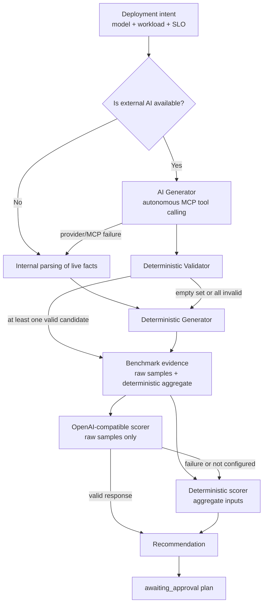
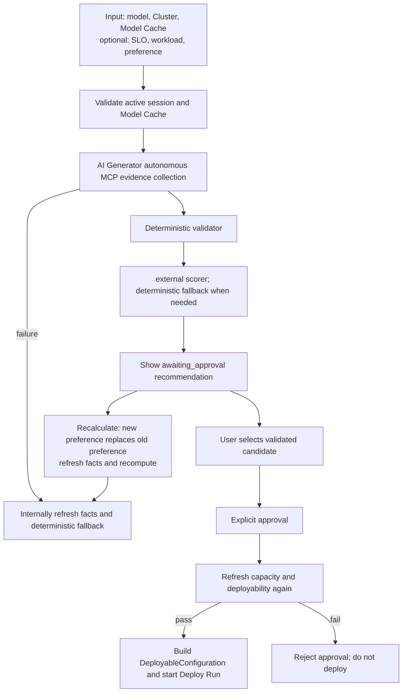
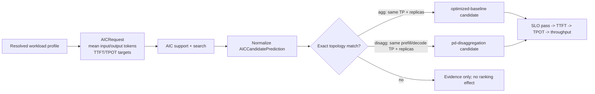
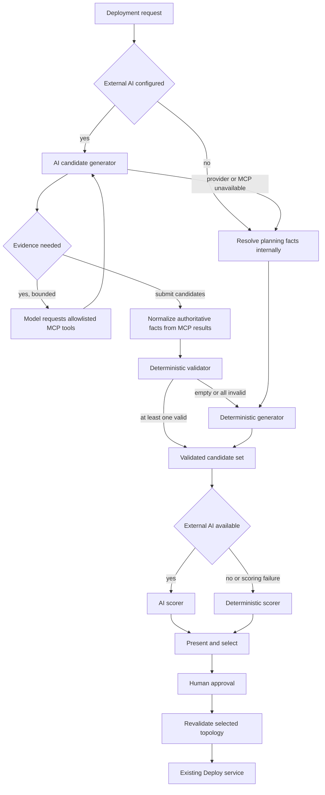

# Agentic Deployment Design

Agentic owns approval-gated candidate generation, validation, ranking and evidence use; Deploy owns execution. Architecture, AI generation and evidence are maintained together. Capacity estimation is a separate shared domain; see [Capacity planning](capacity-planner-integration-design.md).

This is the single canonical design for this module. Section numbers retain their
original part-local context; use the links below for unambiguous navigation.

| Part | Scope and status |
| --- | --- |
| [Architecture and workflow](#agentic-deployment-architecture-and-workflow) | Maintained planner architecture and approval boundaries. |
| [AI candidate generation](#agentic-deployment-ai-candidate-generation-and-scoring-design) | Generator, scorer, tool allowlist and fallback contracts. |
| [Planning evidence and RAG](#agentic-deploy-evidence) | Evidence authority, similarity and remaining work. |

<!-- design-part: architecture -->

## Agentic Deployment Architecture and Workflow

This document describes the planner layering, end-to-end workflow, current constraints, and
future evolution of Lens Agentic Deployment.
Agentic's responsibility is to generate constrained candidate proposals, perform deterministic
validation, score them, and orchestrate approval. It is not a general-purpose agent that generates
arbitrary Kubernetes configurations.

### Overall planner architecture



`AICandidateGenerator` runs first when external AI is configured. The model receives a restricted
MCP tool schema, and the first actual tool batch must and may only call cluster overview and AIC
candidate search in parallel. Cluster results are non-overridable hard constraints. AIC must be
attempted, but recommendations that are unavailable, have incomplete metrics, or fail explicit
SLOs are discarded; they do not block valid non-AIC candidates. The server normalizes facts from
that same MCP round, then `CandidateValidator` recomputes VRAM, GPU, and CPU buffer independently.
Only validated proposals may be displayed, scored, selected, or deployed. When some proposals are
invalid, the remaining valid candidates are kept and no fallback is triggered.

For each feasible provider, AI Generator must first propose the minimum-resource topology:
the lowest TP satisfying memory constraints and one replica per serving role. User preference
selects the provider/method only; it cannot independently justify more TP or replicas. Larger
topologies require explicit SLOs or complete AIC predictions demonstrating the additional need.

AIC applies only to aggregated and disaggregated topologies. For other guides, the AIC status is
`not_applicable`; a missing prediction is neutral information rather than evidence of failure.
Those guides are not filtered or down-ranked because of it, and cross-guide ordering still obeys
user preference and workload/guide fit first. AIC is only a secondary positive signal within
applicable and comparable topologies.

`DeterministicPlanner` continues to provide generation fallback when AI is absent,
provider/MCP is unavailable, AI output is invalid/empty, or all AI proposals are invalid, and it
always provides a stable scoring fallback.

`OpenAICompatiblePlanner` is an optional scoring layer. It does not generate, modify, or expand
candidate space. When configured and available, it receives every candidate passing provider/topology
and live-resource hard constraints, with at most five raw historical benchmark samples per candidate.
It must return the top three candidates (or all if fewer than three) with scores. The server validates
candidate bounds, uniqueness, score completeness, and highest-score consistency. The external layer
receives no `PerformanceScoreInput`, aggregate confidence, $N_{eff}$, benchmark SLO conclusions,
or deterministic ranking. On failure, use the deterministic result directly.

Live cluster capacity is always the highest-priority hard constraint. External AI may propose
candidates, but AIC, historical Simulation, and external AI cannot override the validator,
configuration contract, or approval, and cannot directly trigger deployment.

### End-to-end workflow



1. The user first chooses a model, target Cluster, and Model Cache storage in Model Market; the
   deployment name and vLLM parameters are submitted with the request.
   SLO, workload profile, and preference are optional inputs.
2. When creating a plan, the backend validates the active cluster session, and verifies that the
   selected storage is ready for the current cluster, has purpose `model-cache`, is not a
   dynamic-PVC volume. Planning and refinement do not require downloaded model files;
   approval checks model-cache readiness and resolves the current credential policy.
3. When external AI is configured, AI Generator starts from deployment intent and uses native tool
   calling to query cluster and AIC in parallel first; only after that may it query allowlisted
   historical evidence. Before submission it must obtain cluster overview and attempt at least one
   AIC search. The server normalizes facts from this MCP round, filters out invalid AIC
   predictions or those violating explicit SLOs, and then lets the validator independently filter
   candidates.
4. When AI is not configured, provider/MCP is unavailable, or output is invalid,
   `resolve_planning_facts()` refreshes facts through internal domain services and then runs the
   Deterministic Generator; when all AI candidates are invalid, it reuses already normalized MCP
   facts to generate deterministic candidates.
5. The server keeps two internal views for each validated candidate: candidate-level benchmark
   aggregates for the Deterministic scorer, and raw historical samples for the external scorer.
   If external scoring fails, use the Deterministic scorer with aggregate evidence.
6. The recommendation remains in `awaiting_approval`. The user may select a different validated
   candidate or click Recalculate. The new preference in Recalculate **replaces** the old
   preference and reloads live facts and candidates; it does not retain the previous round's
   preference. Refinement commits only after access revalidation and snapshot persistence;
   failures preserve the previous plan, and concurrent plan changes reject a stale refinement.
   Selecting an alternative updates decision SLO/evidence metadata without rewriting the
   earlier planning audit snapshot.
7. Deployment starts only after explicit user approval. Before approval, resources and candidate
   deployability are validated again to avoid using a stale plan. The service rechecks the plan
   version and leaves the approval state before submitting to Deploy. Failed or cancelled
   submissions leave a failed Agentic run, not an automatically retryable approval.

SLO conclusions require every requested latency metric at the requested statistic.
Missing historical or AIC metrics remain unknown, and TTFT/TPOT alone cannot prove
an end-to-end latency target. Historical PD similarity includes both prefill and
decode TP/replica dimensions; changing prefill cannot remain an exact measured match.

### UI inputs and interaction

The UI is only the input and review surface for the workflow above. The entry points are
`src/components/ModelMarketPage.jsx` and
`src/components/AgenticDeploymentWorkspace.jsx`:

- Model Cache storage sits directly below Cluster in Model Market and is shared by Manual and
  Agentic; users can enter Agentic mode first, and required-field validation runs only when
  generating a recommendation.
- The Agentic workspace provides Use case, optional SLO/workload/preference inputs, plus
  alternatives, score-source, and evidence display.
- The initial response shows the top three scored candidates; the external planner also returns
  at most three candidates.
- Users may only choose an existing deployable candidate; they cannot submit a new provider, TP,
  replica count, or CLI parameters through the UI or prompt.

### Implementation details and constraints

#### Live fact resolution

**Current implementation**

`llm_d_lens.agentic.facts.resolve_planning_facts()`:

1. Validates and reads the active cluster session;
2. Calls cluster overview to obtain per-GPU VRAM, free GPU count, and available CPU buffer;
3. Uses `resolve_workload_signals()` to normalize measured workload shape or Use case fallback;
4. Collects AIC support/search, total Deploy history count, and historical performance
   measurements plus persisted deployment topologies from completed Simulation runs of the same
   model;
5. Freezes the cluster snapshot and evidence IDs, then passes them to the planner.

AIC support/search resolves the system from registered hardware profile model patterns.
Unknown, ambiguous, or mixed systems leave AIC evidence unavailable; they do not select a default GPU.

Before freezing facts, a future step will generate versioned, uncertainty-aware
`UseCasePerformanceEstimate` values (TTFT, TPOT, workload capacity) from the user's use case,
resolved workload, target model, and accelerator. When workload is absent, a versioned use-case
mapping produces the query profile; missing required fields prevent historical records from
becoming high-similarity performance evidence. Explicit SLOs take precedence; estimates become
soft targets for generation, retrieval, and scoring only where corresponding SLOs are absent.
The retriever includes the weakest measured TTFT/TPOT/capacity fit relative to these targets in
`match_similarity`: matching model/hardware/workload cannot yield high similarity when performance
is far from the target. Estimates cannot override live capacity or the validator.

**Current fallback**

- When cluster overview lacks available GPU count or VRAM, planning fails; user-submitted resource
  values are not used to replace live facts.
- When AIC, Deploy history, or Simulation retrieval fails, the corresponding evidence is recorded
  as `unavailable`; live resource validation and deterministic planning continue.

For the same model, select at most three observations with the highest workload similarity,
carrying TTFT P95, TPOT P95, throughput, and provider/topology parsed from persisted deployment
configuration. These are independent planning evidence: they neither replace benchmark aggregates
nor narrow the external scorer's candidate set. History without persisted topology links cannot
generate candidates.

**Planned implementation**

- Normalize raw Deploy/Evaluate/Simulation results into versioned `BenchmarkRecord`.
- Introduce `BenchmarkEvidenceRetriever` to apply hardware, runtime version, and time decay, and
  generate candidate-level confidence, negative evidence, and traceable references.

#### Bounded candidates and hard constraints

**Current implementation**

`llm_d_lens.agentic.planner.DeterministicPlanner` generates only registered providers that can be
mapped to Deploy:

- `optimized-baseline`
- `pd-disaggregation`
- `tiered-prefix-cache`
- `precise-prefix-cache-routing`

AI generation, deterministic fallback, AIC load-target recommendations, historical
candidate seeds, and planner ranking exclude `baseline-vllm`. Aggregated AIC
recommendations use `optimized-baseline`. Existing saved configurations remain
readable and deployable; manual Standard vLLM deployment is unchanged.

Candidate enumeration uses fixed TP values: `1, 2, 4, 8, 16`; and fixed replica counts:
`1, 2, 4`. Every candidate must satisfy:

$$
footprint_{GiB} = 1.2 \times model\_weight_{GiB}
+ \max(1, context\_length / 4096)
$$

$$
footprint_{GiB} \leq 0.9 \times vram\_per\_gpu_{GiB} \times TP
$$

It must also satisfy required GPU count not exceeding the live free GPU count, and CPU buffer not
falling below the requested minimum. For PD candidates, required GPUs are computed across both
prefill and decode resources.

**Current fallback**

- When no candidate passes hard constraints, return `cannot_satisfy` together with all rejection
  reasons, without calling the external provider or deploying.
- Cache/routing candidates are always included in the bounded catalog; shared-prefix signals, Use
  case, and user preference affect only ranking or external model choice. When CPU buffer is
  insufficient, tiered-cache candidates are likewise judged undeployable.

**Planned implementation**

- Add second-pass validation for node/placement, runtime capability, storage, and the allowlist of
  vLLM parameters.
- Replace the current mutually exclusive `provider_ref` with “topology + capability set” to express
  combined optimizations such as PD + cache/offloading.

#### Deterministic ranking, workload, and AIC

**Current implementation**

Use case and workload shape affect only candidate priority; they are not hard thresholds for
candidate generation or resource validation. Explicit preference provider mapping takes precedence
over general workload heuristics; otherwise, when shared-prefix ratio is at least $0.5$, or the
user preference explicitly requests cache/routing, tiered cache/routing is preferred; when the
workload is prefill-heavy, PD is preferred; otherwise optimized baseline is preferred. When
workload shape is not measured, `code-generation` defaults to `shared_prefix_ratio=0.6`, and
`long-inputs` plus `summarization` default to `prefill_heavy=true`; old fields explicitly provided
by existing requests remain valid.

AIC integration is controlled and exact:



- AIC `agg` matches `optimized-baseline` candidates with the same TP and replicas.
- AIC `disagg` matches only `pd-disaggregation` whose prefill/decode TP and replicas are both
  identical.
- When TTFT/TPOT SLO is not set, all exactly matched AIC-predicted candidates rank ahead of purely
  workload-heuristic candidates, and are ordered by TTFT, TPOT, and throughput.
- When either TTFT or TPOT SLO is set, only AIC candidates with exact predictions that satisfy all
  configured targets rank first; then come candidates without AIC predictions; candidates whose AIC
  predictions clearly fail the SLO rank after them.
- Ties within the same tier are still broken by stable ordering of workload guide, GPU count, TP,
  and replicas.

**Current fallback**

- If AIC does not support the model, returns empty, call fails, metrics are missing, or results
  cannot be mapped exactly onto a Lens candidate, the existing workload heuristics and resource-cost
  ordering remain in place.
- Cache/routing guides do not gain ranking boosts from AIC predictions, preventing predictions for
  mismatched topologies from being mislabeled as fact.
- AIC predictions cannot make a candidate deployable if it failed checks on VRAM, free GPUs, or CPU
  buffer.

**Current benchmark integration**

- `BenchmarkEvidenceRetriever` computes model, hardware, workload, and configuration similarity,
  plus time/runtime decay. `BenchmarkPerformanceEvidence.score_inputs()` converts results into
  candidate-level `PerformanceScoreInput`.
- Deterministic scoring prioritizes blocking failures, historical SLOs, confidence, $N_{eff}$,
  and aggregate metrics over AIC. AI scoring receives sorted raw samples, not these aggregates.

**Planned implementation**

- Unify AIC, history, and Simulation into candidate-level `PredictionEvidence`, preserving source,
  schema/producer version, confidence, retrieval parameters, and refs.
- Add complete SLO hard gates, uncertainty penalties, conflict down-weighting, and Pareto frontiers
  to the stable deterministic layer.
- Build RAG projections for controlled cloud benchmark reports. Only retrieved, source-validated,
  fully parsed reports are temporarily normalized into `BenchmarkRecord` within the planning
  request; do not persist them. Compute the same `match_similarity` as local records and provide
  at most five sorted raw evidence samples per candidate.
- Let `UseCasePerformanceEstimate` constrain minimum viable topology during generation and act as
  a soft target where SLOs are absent. Include the weakest measured TTFT/TPOT/workload-capacity fit
  in `match_similarity`; uncertain estimates must not produce high-similarity evidence.

#### Optional OpenAI-compatible selection layer

**Current implementation**

`OpenAICompatiblePlanner` receives the complete catalog passing hard constraints and planning
facts without aggregate historical evidence. One strict JSON-schema call selects the top three
existing IDs (all if fewer than three) and scores each selected candidate. For providers lacking
full strict-schema support, schema-validation failure falls back to ordinary completion requiring
the same JSON shape. Plan creation shows only the top three scored candidates; recalculation with
a new preference reloads live facts. An exact AIC match does not suppress the external model call.
The server validates:

- the response satisfies strict schema;
- selected candidate IDs are unique, belong to the input catalog, and the count is within $[1,10]$;
  the score set must exactly match the set of selected IDs;
- the chosen ID must be the highest-scoring one; preserve the provider's `candidate_ids` order;
- the provider does not produce providers, TP, replicas, CLI parameters, or infrastructure actions.

The external prompt uses the same `offloading`, `distributed`, and `precise-caching` term mapping
as the deterministic layer, and requires that when the mapped provider has a valid candidate, its
best candidate score higher than candidates from other providers. This rule is currently prompt-
level guidance: the server validates output format, candidate bounds, and highest-score
consistency, but does not rewrite valid scores or ordering returned by the external provider.

**Current fallback**

- When `AGENTIC_OPENAI_BASE_URL`/`AGENTIC_OPENAI_MODEL` is not configured, the system directly uses
  `DeterministicPlanner`.
- On HTTP failure, timeout, invalid schema, incomplete scores, or illegal selections, it records
  `planner_fallback_reason` and falls back to deterministic ranking again.

**Planned implementation**

- Send schema-validated candidate-level history/AIC/Simulation evidence packets to the provider.
- The provider still retains only selection and explanation authority; it does not gain database,
  configuration-generation, Kubernetes, Deploy, or Evaluate write access.

#### Approval, configuration, and deployment

**Current implementation**

```mermaid
sequenceDiagram
    participant U as User
    participant A as Agentic Service
    participant C as Cluster Overview
    participant D as Deploy

    U->>A: POST plan request
    A->>C: read live capacity
    C-->>A: capacity snapshot
    A-->>U: awaiting_approval recommendation
    U->>A: POST approve
    A->>C: refresh live capacity
    alt candidate remains deployable
      A->>D: start run from DeployableConfiguration
        D-->>A: deployment run ID
        A-->>U: deploying
    else capacity changed or constraints fail
        A-->>U: reject approval; no deployment
    end
```

- Creating a plan has no side effects; it only writes in-memory Agentic run state, whose initial
  status is `awaiting_approval`.
- Before approval, live facts and candidates are regenerated, and the selected candidate is checked
  again against capacity constraints.
- After passing, `build_agentic_configuration()` constructs a `DeployableConfiguration`, and the
  system directly calls `DeploymentRunManager.start_run()`. Agentic does not construct or save an
  `officialGuide` Configuration artifact.
- The Deploy provider is responsible for its own rendering and deployment lifecycle; for Kustomize
  directory artifacts, the generic manifest adapter delegates to the registered Guide adapter
  instead of reading the directory as YAML files.
- Agentic run references the Deploy run ID and does not rebuild the Kubernetes or Deploy state
  machine.

**Current fallback**

- If resources have been consumed, VRAM/CPU buffer no longer satisfies constraints, or the selected
  candidate becomes invalid, approval is rejected and no artifact/Deploy run is created.
- `automatic` is rejected directly.

**Planned implementation**

- Persist Agentic runs instead of using the current in-process dictionary.
- Before approval, complete refresh validation for runtime/provider capability and Model Cache
  entry.
- Record artifact digests, approver identity, and more complete audit events.

#### Evaluate, feedback, and constrained tuning

**Current implementation**

- Agentic does not yet automatically create an Evaluate workflow.
- The execution policy already contains maximum optimization-iteration count, benchmark count, and
  total duration fields, but it does not start automatic benchmarking or tuning.

**Current fallback**

- After deployment, verification is still started manually from the existing Evaluate/Deployment
  workspace.
- Agentic does not automatically modify a saved artifact or start the next deployment round based
  on performance prediction.

**Planned implementation**

1. After Deploy becomes ready, call the existing Evaluate API to create a workflow carrying
   `BenchmarkPlan` and `BenchmarkSlaTargets`.
2. Read SLA results and generate a `passed`, `failed`, or `inconclusive` report, saving predicted
   and measured references.
3. Write the result back into `BenchmarkRecord`, so historical retrieval and threshold calibration
   have real closed-loop data.
4. Only when approval/policy permits and budget is not exhausted, choose the next-round candidate
   from the deterministically valid candidate set; every round generates a new artifact.

### Status snapshot

| Phase | Current status | Behavior on failure |
| --- | --- | --- |
| UI/API request | Implemented | Rejects plan creation on parameter validation failure |
| workload profile | First version implemented | Falls back to Use case hard thresholds when shape measurements are missing |
| live Cluster facts | Implemented | Fails when valid VRAM/GPU data cannot be obtained; does not trust old resource values |
| bounded candidates and hard constraints | Implemented | Returns `cannot_satisfy`; does not call provider/deploy |
| AIC exact-prediction ranking | First version implemented | Restores heuristic ranking when unsupported, failed, or unmatched |
| Benchmark aggregation and deterministic ranking | Implemented | Blocking failures may reject deterministic candidates; AI scoring retains every hard-constraint-valid candidate |
| same-model Simulation historical measurement and topology reuse | First version implemented | Keeps them only as scoring evidence when there is no matching/deployable topology |
| OpenAI-compatible constrained full-catalog selection | Implemented | Falls back to Deterministic on schema/network/configuration failure |
| user selection of validated candidate | Implemented | Rejects when status is not awaiting approval, or candidate is unknown/undeployable |
| manual approval and deployment | Implemented | Rejects approval when resource refresh fails or candidate becomes invalid |
| Evaluate/SLA/feedback tuning | Planned | Keeps manual Evaluate; does not auto-execute |
| Agentic run persistence | Planned | Agentic runs are not retained after current process restart |

<!-- /design-part: architecture -->

<!-- design-part: ai-generation -->

## Agentic Deployment AI Candidate Generation and Scoring Design

### Goal

Agentic Deployment maintains two candidate generators. When external AI is configured,
prefer AI Generator, whose model autonomously selects MCP tools through native tool calling
to gather evidence. Fall back to the existing Deterministic Generator when no provider is
configured, provider/MCP is unavailable, the result is empty, or all proposals fail validation.
Generation and scoring are separate stages; scoring failure does not regenerate candidates.

### Architecture



### Boundaries and trust model

- The normal AI path does not call `resolve_planning_facts` before generation. The model must
  call `get_cluster_overview`; the server normalizes hardware facts from this MCP round and
  validates candidates against the same snapshot.
- Without AI, or on AI/MCP failure, Deterministic Generator gets facts directly through internal
  `resolve_planning_facts`. Approval still refreshes hardware facts internally and revalidates.
- AI Generator outputs only `CandidateProposalSet`; it cannot score, select, render, approve, or deploy.
- AI sees only the explicitly reviewed planning-tool allowlist. Other MCP catalog tools are
  rejected before execution, even if the model guesses their names.
- `CandidateValidator` recomputes GPU, VRAM, and CPU buffer, checks PD fields, and deduplicates.
  Resource claims made by AI are not trusted.
- Only accepted candidates reach the scorer. Rejected candidates remain in the run for audit,
  but do not participate in scoring.
- `approve` reruns the same validator on the selected topology using fresh cluster facts,
  then delegates to the existing Deploy service.

### AI Generator prompt

The system prompt fixes these constraints: provider allowlist, one to ten candidates,
single-role and PD GPU formulas, VRAM/CPU/SLO/preference constraints, complete PD fields,
no fabricated evidence, no duplicate topologies, and no scoring or deployment. Generator
sends reviewed MCP catalog tools in provider-native schemas. Initial user content contains
only deployment intent:

```json
{
  "cluster_id": "target-cluster",
  "model": "model-identifier",
  "operator_preference": "original user preference",
  "deployment_intent": {}
}
```

The model requests tools through OpenAI `tool_calls` or Anthropic `tool_use`; the provider
client normalizes both protocols. MCP results return as the corresponding tool-result
messages. After collecting evidence, the model must call the local terminal tool
`submit_candidate_proposals`, whose arguments are strictly constrained by Pydantic JSON
Schema with unknown fields forbidden.

The backend no longer calls `get_cluster_overview` in advance. The first actual tool batch
must call only `get_cluster_overview` and `search_candidates(sourceIds=["aic"])` in parallel.
Only when ordinary search returns no AIC candidates should it call
`search_aic_with_relaxation(clusterId, workload, searchConfig)` (if available). This tool
extracts the available GPU budget from cluster overview, then calls
`POST /api/candidate-search/relaxed`. With the same model, ISL/OSL, hardware, and GPU budget,
the API tries original TTFT/TPOT limits, 1.25x limits, 1.5x limits, then no latency limits,
stopping at a complete, resource-feasible result. It returns `attempts`, `candidates`, an
`anchor` selected by relative violation of the original targets, `sloSatisfied`, and the
reason no anchor exists. It never fabricates performance predictions.

Results missing required metrics or complete topology cannot be anchors; if all searches
are empty, `anchor` is null. AI may propose scaling from a noncompliant anchor, keeping the
same mode and treating the anchor as a lower bound: first increase replicas for the relevant
role (DP in the current schema); if insufficient or infeasible, consider TP supported by the
current hardware/provider. In PD mode, prioritize prefill replicas for TTFT pressure and
decode replicas for TPOT pressure; never reduce either role's replicas or GPU allocation.
Neither increased replicas nor TP proves single-request TTFT/TPOT compliance; explicit AIC
estimates or benchmarks are still required. The server currently validates GPU/VRAM/CPU
resource constraints but does not enforce the direction of topology changes relative to
the scaling anchor. Prompt constraints are not performance guarantees.

Cluster overview must succeed before submission; otherwise reject the round and fall back.
After the first round, AI may autonomously use the reviewed planning tools below.

AIC applicability has three explicit states: a complete SLO-compliant prediction is
`applicable + valid`; supported aggregated/disaggregated topology without a valid prediction
is `applicable + unknown`; other guides are `not_applicable`. Only the first provides
secondary positive evidence; neither remaining state incurs a penalty. Unsupported guides
such as `tiered-prefix-cache` and `precise-prefix-cache-routing` are not discarded, down-ranked,
or marked SLO-violating for lacking AIC predictions. They remain ranked by preference,
workload/guide fit, history, and resource use.

- Configuration: `get_configuration_capabilities`, `list_configuration_artifacts`
- Historical plans/deployments: `list_agentic_plans`, `list_deployment_executions`
- Evaluation: `list_evaluate_runs`, `get_evaluate_run`, `list_evaluation_workflows`
- Simulation: `list_simulation_tasks`, `get_simulation_task`
- Model Cache: `list_model_cache_entries`

The tool loop permits at most four rounds, eight MCP calls, four concurrent calls per round,
and 200 KB of combined results. Names pass both catalog filtering and pre-execution allowlist
checks. No create/update/delete/deploy/approve/port-forward tools are exposed. Although
`search_candidates` uses POST, it is a reviewed exception with no persistence side effects.

### Fallback rules

| Condition | Generator behavior |
| --- | --- |
| External AI not configured | Use deterministic directly; do not record a fault |
| Some AI candidates valid | Retain valid candidates; no fallback |
| One AI candidate valid | Accept; diversity is not required |
| AIC unavailable, empty, incomplete, or failing explicit SLOs | Retry fixed relaxation steps; return nearest complete anchor or `no_complete_anchor`. Candidates passing cluster hard constraints may still be accepted without proven SLO compliance, but extrapolation is not prediction |
| Provider unavailable or timed out | Fall back to deterministic; record `provider_unavailable` |
| Required cluster MCP call fails | Resolve facts internally; fall back; record `mcp_unavailable` |
| Empty response, invalid structure, or empty candidates | Fall back; record `invalid_response` |
| Validator rejects every proposal | Fall back; record `all_ai_candidates_invalid` |
| AI does not obtain valid cluster overview | Treat as invalid response; resolve facts internally and fall back |
| Neither AI nor internal fallback obtains authoritative cluster facts | Fail the request; do not produce deployable candidates without trusted facts |

Generator and Scorer record their sources and fallbacks separately. AI scoring failure switches
to deterministic scoring without triggering generation again.

### Data contract

Add to `AgenticDeploymentRun`:

- `generator`: `ai-mcp` or `deterministic`
- `generator_model`
- `generator_fallback_reason`
- `generator_tool_trace`: optional tool names, argument/result SHA-256, duration, and status;
  do not save raw content
- `rejected_candidates`

Existing `planner`, `planner_fallback_reason`, and `decision_metadata` continue to describe
scoring, separating candidate origin from ranking origin.


### Verification

- Unit coverage for partial acceptance, all-rejected fallback, MCP/provider failures,
  strict schemas, and approval revalidation.
- Full Agentic Python suite.
- TypeScript checks, frontend build, and MCP catalog generation checks.
- `npm run reuse:check -- --base <task-start-commit>`.

<!-- /design-part: ai-generation -->

<!-- design-part: evidence -->

## Agentic Deploy Evidence

This document describes how Agentic Deploy handles structured and unstructured evidence, the current implementation, and next steps.

### Data and authority

#### Structured data

Structured data consists of `BenchmarkRecord`: model, hardware, runtime, workload, candidate configuration, measured performance metrics, outcome, and failure reason. Records reside in `agentic_benchmark_records` and are authoritative for performance numbers, failure facts, and candidate-level predictions.

Live cluster overview is also structured evidence, with the highest authority: it determines whether candidates satisfy current VRAM, GPU, CPU-buffer, and other hard constraints. Historical benchmarks, AIC, and AI cannot override live-resource conclusions.

#### Multi-source experiment planning

Creation and refinement share server-resolved evidence from authorized internal
experiments and approved public Prism experiments. Public experiments remain in
PostgreSQL `public_benchmark_records`; they are not document search results.
The actual authenticated principal needs global `benchmark-rag:query:read` to
retrieve public observations or access plans containing them. Internal experiments
retain their existing resource authorization.

`PlanningRequirements` preserves explicit workload, latency targets, provenance
and unknown fields. Form fields start blank: examples and AIC/use-case defaults
are not explicit requirements, and mean input length is not copied into P95.
Live hardware determines the public query's exact accelerator model; unknown or
mixed models are reported rather than replaced with a cross-hardware fallback.
Model aliases aid retrieval but do not prove unique identity or compatibility.

`ConfigurationCase` retains experiment/configuration/series identity, original
measurements, units, statistics, configuration, provenance, differences and
unknowns. Each SQL branch aggregates complete experiments before ranking and
selecting at most 50 cases. Explicit workload fit precedes comparable lower
latency; without explicit workload there is no workload penalty. Latency targets
select metric/statistic axes, not distance from the target. Different statistics
are not mixed; Pareto comparison requires equal available axes. Missing or
nonpositive latency is unknown. A case with neither comparable workload nor valid
latency is a labelled fallback reference, not low-latency evidence.

The shared evidence bundle keeps at most 10 complete cases within its
16,000-byte serialized budget, preserving experiment rank. Historical observations
inform candidate generation and selection, but do not prove current SLO compliance
or override live-resource validation. AIC estimates remain a distinct evidence type.
Source references stay in the server audit; model-facing aliases and explanations
must not be presented as independently verified source usage.

Planning consumes SQL experiments only. Public document ingestion, retrieval,
packet contracts and search UI are outside this capability. The existing private
diagnostic search adapter remains separate and unchanged.

The deployment workspace shows internal SQL experiments and public SQL observations
separately, including retrieval failures and unknowns.
No permission, no match and unavailable outcomes are not interchangeable.
Approval still revalidates resources and model-cache readiness and requires
explicit user approval; retrieval never authorizes deployment.

#### Unstructured data

Unstructured data includes deployment logs, profiling traces, artifact summaries, Guides, GitHub content, papers, planning-snapshot summaries, and planned raw benchmark reports from cloud storage. Searchable projections reside in OpenSearch; original artifacts remain in controlled filesystems, and cloud reports remain in their authorized storage locations.

Cloud benchmark report integration is not yet implemented. The plan is to index ACL-controlled summaries and object versions for discovery, then fetch the pinned source version under tenant/ACL controls and validate its content hash before use. Extract model, hardware, runtime, workload, topology, measured metrics, outcome, and provenance; validate units and required fields; normalize into request-local `BenchmarkRecord` objects. Reports with missing fields, unverifiable sources, or only estimates cannot become measured records. Unextracted or unvalidated report text is diagnostic only and cannot affect numeric prediction, failure blocking, or deterministic ranking. Qualified records still undergo structured benchmark compatibility filtering and similarity computation; retrieval alone does not establish performance.

Log, trace, artifact, and snapshot summaries serve diagnosis and explanation only. ACL-filtered, version-pinned Guide, GitHub, and paper summaries may also provide AI recommendation features for method applicability, compatibility constraints, and preference tradeoffs. Unstructured data is not authoritative for TTFT, TPOT, throughput, confidence, or SLOs; it cannot directly generate or block candidates or change deterministic ranking.

### Constructing evidence

#### Structured benchmark evidence

The server first applies coarse database filters for accelerator, backend, quantization, topology, per-GPU VRAM, and a safe time window. Retain both successful and failed records. `BenchmarkEvidenceRetriever` then computes model, hardware, use-case-derived workload, candidate-configuration, and SLO-performance similarity, plus time/runtime decay, producing two separate views:

| View | Contents | Consumer |
| --- | --- | --- |
| Raw samples | At most five relevant `BenchmarkRecord` objects per candidate, including measured metrics, outcome, failure reason, and `match_similarity` | AI scoring |
| Aggregate inputs | `PerformanceScoreInput` with predicted metrics, status, confidence, effective sample size, failure blocking, and refs | Deterministic Planner |

`match_similarity` expresses only the relevance of a historical record to the current target. It is not deployment success probability or a promise of current performance. Aggregate `confidence` and effective sample size belong only to the deterministic path.

The current request does not require direct workload input. Versioned `resolve_workload_signals()` maps use case to query profile $q$, including token lengths, concurrency, request rate, shared-prefix and prefill signals. Explicit workload overrides only corresponding fields and records provenance. If the mapping is unknown or cannot provide comparison fields, do not fabricate workload; related history cannot become high-similarity performance evidence.

For historical record $r$ passing database hard filters and current candidate query $q$, the retriever computes configuration/workload and performance-target similarity $S$:

$$
S = 0.20S_{model} + 0.15S_{hardware} + 0.15S_{workload} + 0.15S_{configuration} + 0.35S_{SLO}
$$

These weights reflect the decision value of measured historical performance rather than a fit to limited historical samples. $S_{SLO}$ has the largest individual weight, $0.35$, favoring records whose TTFT, TPOT, and workload capacity fit current targets; the weakest-component bound below prevents identical configurations with unsuitable performance from scoring highly. Model, hardware, and workload retain weights $0.20$, $0.15$, and $0.15$ so performance is interpreted in comparable environments and request shapes. Configuration has weight $0.15$ so TP, replicas, and optimizations influence ranking. Hard filtering already ensures accelerator, backend, quantization, topology, per-GPU VRAM, and time-window compatibility; these are not counted again.

These coefficients, subcomponent coefficients, time/runtime half-lives, minimum `match_similarity`, and failure-blocking thresholds are currently fixed and recorded with the schema version in planning snapshots. A future versioned `EvidenceSimilarityPolicy` should be selectable by tenant or deployment policy. Allow only server-allowlisted presets validated through offline replay; record policy ID and all parameters. Arbitrary per-prompt or UI weight tuning is forbidden. Before becoming default, a new policy must be compared with the default on ranking stability, SLO hit rate, and missed negative evidence in historical replay.

If quantization or model architecture differs, $S_{model}=0$; otherwise:

$$
S_{model} = 0.45S_{family} + 0.25 + 0.20e^{-0.8|\ln(p_r/p_q)|} + 0.10S_{tokenizer}
$$

$S_{family}$ is $1$ for the same model family and $0.15$ otherwise; $S_{tokenizer}$ is $1$ for the same tokenizer and $0.5$ otherwise. For MoE, $p$ prefers active parameter count. Hardware similarity compares GPU count only:

$$
S_{hardware} = 0.7 + 0.3e^{-|\ln(g_r/g_q)|}
$$

$S_{workload}$ averages five log-ratio scores for mean input, P95 input, mean output, concurrency, and request rate, plus two $1-|x_r-x_q|$ scores for shared-prefix and prefill fractions. Values in $q$ come from the use-case mapping or explicit overrides above. Candidate-configuration similarity is:

$$
S_{configuration} = 0.4e^{-|\ln(TP_r/TP_q)|} + 0.4e^{-|\ln(R_r/R_q)|} + 0.2J_{optimization}
$$

$J_{optimization}$ is the Jaccard overlap of the two optimization sets; database hard filtering already ensures identical topology.

Explicit user SLOs take precedence. Where corresponding targets are absent, TTFT, TPOT, and workload limits from `UseCasePerformanceEstimate` serve as uncertainty-aware soft targets. For each required latency limit $L$ and historical measured latency $m_r$, compute:

$$
s_{latency} = e^{-2\max(0, \ln(m_r/L))}
$$

This term is $1$ when the target is met, $0.25$ at twice the target latency, and quickly approaches $0$ for large deviations. Apply the same one-sided penalty to required workload capacity $c_q$ and historically supported capacity $c_r$:

$$
s_{capacity} = e^{-2\max(0, \ln(c_q/c_r))}
$$

$$
S_{SLO} = \min(s_{TTFT}, s_{TPOT}, s_{capacity})
$$

Take the minimum only over targets present in the request. If history lacks a metric required by an explicit SLO, the record cannot be high-similarity performance evidence, though it may remain diagnostic. If estimated targets are too uncertain or metrics unavailable, do not fabricate $S_{SLO}$: downgrade the evidence state so a high score without performance targets cannot replace records satisfying explicit SLOs.

$S$ is base similarity: it describes the fit of a benchmark's model, hardware, workload, configuration, and measured performance to the current target.

The current implementation also computes time and runtime decay:

$$
W = S \times D_{time} \times D_{runtime}
$$

$W$ is **match similarity** in this document. It adds time/runtime effects to base similarity $S$, including SLO-performance fit, and expresses how relevant the historical record is to the current decision. AI scoring reads raw samples ordered by $W$. Deterministic fallback uses $W$ for weighted metric averages, effective sample size, deterministic `confidence`, failure blocking, and SLO/performance ranking. AI does not receive those aggregates. The current payload field remains named `match_confidence`, but carries $W$, defined here as `match_similarity`.

#### Unstructured diagnostic evidence

Logs, traces, artifacts, and external materials become bounded `DiagnosticEvidenceProjection` objects with fixed `evidence_id`, content hash, source revision, tenant, ACL, and necessary runtime metadata. Before use, artifacts must pass source validation against their manifest and file SHA-256.

OpenSearch queries must apply tenant/ACL filters first. Use BM25 by default and kNN only when the caller explicitly supplies a vector. Projections are rebuildable. Unavailable OpenSearch, stale indexes, or no results yield empty features/diagnostics without affecting deterministic planning.

#### Two-stage retrieval of cloud benchmark reports

A future controlled importer will read historical reports from configured cloud locations periodically or on events, creating OpenSearch RAG projections for discovery only. It must validate source identity, tenant/ACL, report schema version, content hash, collection time, and artifact manifest. Deduplicate idempotently using stable source report ID and hash. Unverifiable reports get no projection; incompletely normalizable reports are explanatory only, not performance-planning inputs.

Stage one retrieves report projections with tenant/ACL filtering to locate potentially relevant originals. BM25/kNN hits indicate textual relevance, not benchmark comparability, `match_similarity`, or performance conclusions. External reports are not written into `agentic_benchmark_records`; projections retain only cloud URI, producer/schema version, hash, source report ID, and controlled metadata needed to fetch the original.

Stage two processes only retrieved reports. The server revalidates the source manifest/hash, ACL, and schema, then temporarily normalizes fully parseable reports to the same `BenchmarkRecord` shape as online collection within this planning request: model, accelerator/runtime, workload, candidate configuration, TTFT/TPOT/throughput, outcome, and failure reason. Temporary records are not persisted. Missing performance-comparison fields restrict a report to diagnosis/explanation; it cannot score candidates.

Temporary records passing stage two and local persisted records undergo identical hard filters and $S \rightarrow W$ computation, yielding `match_similarity` with the same meaning. For each hard-valid candidate, the raw-sample view gives AI scoring at most five benchmark evidence samples ordered together by descending $W$, each containing `match_similarity`, metrics, outcome, failure reason, and traceable source ref. There are no separate source quotas.

### Two consumption paths

#### Deterministic path

The deterministic path becomes the final decision path only when AI is unconfigured, generation/scoring fails, or the response is invalid. For each hard-valid candidate it computes $D_{time}$, $D_{runtime}$, and $W$ over all matched samples, then builds `PerformanceScoreInput`.

Aggregated history has only two roles:

1. If sufficiently many sufficiently similar failures exist, set `has_blocking_negative_evidence` and exclude the candidate to avoid recommending a known failing configuration again.
2. If successful history is numerous and similar enough to support stable performance conclusions, compare requested SLO compliance first; ties compare deterministic `confidence`, effective sample size, TTFT, TPOT, throughput, and error rate in that order.

Too few or insufficiently similar samples, missing metrics, or unresolved failure evidence do not imply a performance advantage or disadvantage. Rank that candidate using exact AIC matches and existing heuristics instead.

This path does not consume unstructured OpenSearch content and does not let AI rewrite failure blocking, SLO conclusions, or ranking.

#### AI path

AI generation and scoring are separate stages. The generator first retrieves historical benchmarks matching the model, available resources, and requested SLOs. Only verified candidate configurations and their controlled provenance may enter the generator prompt as candidate priors. Without qualifying history, omit priors and generate proposals from normal inputs. Every proposal must pass `CandidateValidator`.

For each feasible provider, AI Generator must first propose the minimum-resource topology: the lowest TP satisfying memory constraints and one replica per serving role. Explicit provider preference selects a method; it cannot independently increase TP or replicas. Additional resources require explicit SLOs or complete AIC predictions. Scaling from a relaxed-search anchor remains an estimate requiring validation.

AI scoring first shortlists at most ten hard-valid candidates: retain the best candidate per provider in deterministic order, then fill remaining places by rank. Only shortlisted candidates reach AI, each with at most five real historical benchmarks ordered by similarity. Raw benchmarks describe measured historical behavior: AI may compare TTFT, TPOT, throughput, outcome, and failure reason, for example avoiding candidates that previously caused OOM under similar workloads. ACL-filtered, bounded, version-pinned Guide/GitHub/paper feature packets are not yet integrated into AI scoring. Future packets may inform method prerequisites, version compatibility, and operator preference only; they are not measurements and cannot establish TTFT, TPOT, throughput, SLOs, or confidence.

AI cannot generate new candidates or interpret unstructured features as performance measurements. Responses may select only server-provided candidate IDs. Invalid, timed-out, or unavailable responses fall back to the deterministic path.

#### Generator prompt construction and example

Generation is a tool-calling stage, not a directly deployable configuration catalog. The first server-built user message contains only `cluster_id`, `model`, `operator_preference`, and `deployment_intent` stripped of live-resource/AIC/evidence fields. The system prompt fixes the provider allowlist/semantics, minimum-resource topology principle, PD field contract, and read-only MCP allowlist. It forbids inventing providers, hardware, AIC results, or benchmark facts, and forbids writes, deployment, approval, deletion, and port-forward operations.

The first round exposes only `get_cluster_overview` and `search_candidates`, requiring parallel calls; `sourceIds` must include `aic`. The server normalizes arguments using `cluster_id` and `sourceIds` and returns bounded results. Later calls remain restricted to allowlisted read-only tools. The model submits one to ten proposals only through `submit_candidate_proposals`; `CandidateValidator` independently recomputes memory, GPU, CPU buffer, PD completeness, and deduplication. The current implementation injects no historical benchmark prior. Future priors must be a separate bounded field containing validated candidates/provenance, without aggregate metrics, confidence, $N_{eff}$, SLO conclusions, or unauthorized data.

Illustrative first user message, without real credentials, tool results, or full internal facts:

```json
{
   "cluster_id": "cluster-a",
   "model": "meta-llama/Llama-3.1-8B-Instruct",
   "operator_preference": "Prioritize low latency; PD is allowed.",
   "deployment_intent": {
      "context_length": 8192,
      "model_weight_gib": 16.0,
      "ttft_slo_ms": 500,
      "tpot_slo_ms": 35,
      "workload": {
         "mean_input_tokens": 2048,
         "mean_output_tokens": 256,
         "prefill_heavy": true
      }
   }
}
```

After required MCP calls, the model may submit only through a schema-constrained tool call, for example:

```json
{
   "candidates": [
      {
         "provider_ref": "pd-disaggregation",
         "replicas": 1,
         "tensor_parallel_size": 2,
         "prefill_replicas": 1,
         "prefill_tensor_parallel_size": 2,
         "rationale": "Validated cluster capacity and a long-input workload support separating prefill and decode.",
         "evidence_ids": ["cluster-overview:cluster-a", "aic:search"]
      }
   ]
}
```

This example promises neither resource availability nor performance. `aic:search` may be cited only when AIC returns a complete prediction satisfying every explicit TTFT/TPOT SLO. The validator may reject any proposal.

#### Scoring prompt construction and example

Scoring is a single selection-only call. The server removes aggregate internal fields such as `planning_facts.performance_score_inputs`, then builds JSON context from `planning_facts`, `valid_candidates` with `deployable=true`, and optional `operator_preference`. Each candidate contains only validated topology, required GPUs, guide, exactly matched AIC `performance_estimate`, and at most five `historical_benchmarks` ordered by descending `match_similarity`. Explicit `not_applicable` AIC status must not reduce rank; a missing prediction is not zero. Aggregate `PerformanceScoreInput`, confidence, $N_{eff}$, blocking failures, deterministic rank, and internal SLO conclusions never reach the scorer.

The system prompt requires selection only from `valid_candidates`, respecting hard constraints first and treating operator preference as the primary scoring condition, informed by TTFT, TPOT, throughput, resources, AIC, and immutable history. It explains that `match_confidence` is historical relevance, not success probability or a performance guarantee. The model cannot rewrite metrics, outcome, configuration, or that score. Responses must satisfy the JSON schema for `candidate_id`, `candidate_ids`, `scores`, `confidence`, and `rationale`: return three candidates (all if fewer than three), scores in $[0, 1]$, and a highest-scoring provided ID as `candidate_id`. The server validates ID/score sets and highest-score consistency; failure uses deterministic fallback.

Example candidate in scoring context: historical values are measurements. The current `match_confidence` expresses configuration, workload, time, and runtime relevance without aggregate SLO conclusions. Incorporating SLO-performance fit into `match_similarity` is defined here but remains future implementation work:

```json
{
   "id": "pd-disaggregation-p1-tp2-d1-tp2",
   "provider_ref": "pd-disaggregation",
   "replicas": 1,
   "tensor_parallel_size": 2,
   "prefill_replicas": 1,
   "prefill_tensor_parallel_size": 2,
   "required_gpus": 4,
   "performance_estimate_applicability": "applicable",
   "performance_estimate": {
      "ttft_ms": 420,
      "tpot_ms": 28,
      "throughput_tokens_per_sec": 760
   },
   "historical_benchmarks": [
      {
         "benchmark_id": "benchmark-20260918-042",
         "match_confidence": 0.91,
         "outcome": "succeeded",
         "ttft_p95_ms": 430,
         "tpot_p95_ms": 30,
         "throughput_tokens_per_s": 735,
         "failure_reason": null
      },
      {
         "benchmark_id": "benchmark-20260912-007",
         "match_confidence": 0.74,
         "outcome": "failed",
         "failure_reason": "OOM"
      }
   ]
}
```

Minimal valid response example: `rationale` explains decisive differences without repeating every parameter or fabricating performance facts:

```json
{
   "candidate_id": "pd-disaggregation-p1-tp2-d1-tp2",
   "candidate_ids": [
      "pd-disaggregation-p1-tp2-d1-tp2",
      "optimized-baseline-tp2-r1",
      "precise-prefix-cache-routing-tp2-r1"
   ],
   "scores": {
      "pd-disaggregation-p1-tp2-d1-tp2": 0.91,
      "optimized-baseline-tp2-r1": 0.79,
      "precise-prefix-cache-routing-tp2-r1": 0.68
   },
   "confidence": 0.82,
   "rationale": "The preferred candidate fits the low-latency preference and has comparable AIC and historical measurements; the others are validated alternatives."
}
```

#### Use-case performance prediction inputs

At planning start, the server supplies the user use case, resolved workload, model metadata, and accelerator specifications to a versioned estimator for TTFT, TPOT, and workload limits such as supported concurrency/request rate. `UseCasePerformanceEstimate` must include estimator version, input refs, applicability, and uncertainty. Insufficient or out-of-domain input returns `unavailable`, not fabricated values.

Store the estimate separately from explicit SLOs, which always take precedence; estimates are soft targets only where corresponding targets are absent. Pass them to the generator to choose minimum-resource topology for expected workload, to the retriever for $S_{SLO}$, and to deterministic scoring for TTFT/TPOT/capacity comparison against candidate-level benchmark/AIC evidence. Estimates cannot override live hard constraints, legalize rejected candidates, or substitute for measured benchmarks; excessive uncertainty cannot produce high-similarity evidence. AI scoring receives only a validated estimate summary with uncertainty and cannot describe it as measured performance.

#### Unstructured features and diagnosis

The server builds AI feature packets only from version-pinned, ACL-filtered, length-bounded Guide, GitHub, and paper summaries. AI may use them for method applicability, version compatibility, and preference tradeoffs among existing candidates; it cannot convert them into performance measurements, SLOs, confidence, candidate rejection, or new configurations.

Logs, traces, artifacts, and snapshots remain diagnostic. All unstructured evidence only supplements explanations for existing candidates; it cannot generate candidates or affect the Deterministic Planner's numeric performance decisions.

### Current implementation and next steps

#### Implemented

- Historical-to-candidate similarity computes base $S$ and time/runtime decay to produce `match_similarity` $W$. AI scoring selects and orders bounded raw history per candidate using $W$.
- Historical benchmarks can be appended and filtered by current deployment conditions. Repeated failures or sufficiently supported stable performance conclusions inform deterministic fallback.
- AI scoring receives bounded raw history during plan creation; unavailable or invalid AI results use separate aggregated-history deterministic decisions.
- Candidate priors can be extracted from fully validated history, but do not affect generation by default. Enabling them first observes or validates before admitting candidates.
- Traceable planning snapshots retain the complete original `planner_prompt` and resolved
  `operator_preference`, and resources are checked again before approval. Generator and planner
  user messages start with a separate operator-preference section, followed by JSON context.
  Platform validity and hardware limits take precedence over explicit operator requirements,
  then soft preferences, performance evidence, and diversity. Diversity must not introduce
  operator-forbidden providers or topologies; the planner may return fewer than three options.
- Schema-version 2 snapshots include `generator.requests` and `planner.requests`. Each record
  contains the exact provider-native JSON body after message/tool conversion and structured-output
  changes, the API path, attempt number, timestamps, HTTP status, full raw response, and error
  type. All transport and output-format retries are retained, including invalid responses.
  Generator tool traces retain complete arguments/results, not only hashes.
- Stage audits are written before sending and after response/failure to
  `session-artifacts/agentic-planning/<run_id>/requests/<timestamp>-<stage>-<uuid>.json`.
  They survive cancellation, fallback, or failure before a run is created. Create and refinement
  use separate audit files; final snapshots remain append-only. Files are atomically replaced
  with mode `0600`. Prompt content is not redacted; authentication headers and API keys are not
  recorded. Treat audits as restricted application data, not shareable logs. Existing snapshots
  cannot reconstruct exchanges that were not recorded.
- Historical candidate seeds default off. Enabling `AGENTIC_BENCHMARK_SEEDS_ENABLED` defaults to `shadow`: record qualifying seed counts without merging. Only `AGENTIC_HISTORICAL_SEEDS_MODE=apply` admits seeds after `CandidateValidator`. Nullable prefill parameters can participate in ranking without comparing `None` against integers and interrupting planning.
- Snapshots separately save the selected candidate and its `evidence`, planning evidence, and `decision_evidence_ids`. The latter deduplicates cluster overview, applicable AIC refs, selected-candidate evidence refs, and historical sample IDs; it excludes unselected candidates. AI scoring scope is not the entire hard-valid catalog.
- Diagnostic RAG foundations support searchable logs/traces/artifacts with access controls and artifact-integrity checks. This RAG is not yet integrated into deployment planning or AI scoring and cannot affect candidate generation, selection, or performance decisions.

#### Incomplete work and next steps

1. Apply the same rule to plan creation and refinement: AI reads only raw history for its hard-valid shortlist; aggregation, failure blocking, and ranking remain in deterministic fallback.
2. Integrate complete actual workload into benchmark retrieval. Missing workload means unavailable historical evidence, not invented performance.
3. Add controlled Guide/GitHub/paper summaries to AI scoring with fixed versions, access scope, and length. Query failure omits those features without affecting other decisions.
4. Complete default-off historical priors with validated configuration/provenance only, no aggregate conclusions; record whether each plan used a prior.
5. Before cross-tenant benchmark queries, define ownership/authorization and verify tenant isolation.
6. After access boundaries are clear, expose logs/traces/artifacts for explanation only, not AI recommendation or deterministic performance ranking.
7. Record policies/switches in snapshots and replay history to compare deterministic decisions before/after priors.
8. Archive candidates, final selection, and rationale for each AI/deterministic decision. With access controls and pinned versions, index separately prepared, policy-approved projections of snapshots as RAG references for similar-decision context/explanation; do not expose complete private prompt audits or treat them as measurements or alter deterministic ranking.
9. Implement two-stage cloud-report retrieval: discovery-only RAG projections, then source validation and request-local `BenchmarkRecord` normalization. Do not persist records; use the same `match_similarity` as online records to supply at most five jointly ranked raw samples per candidate.
10. Implement/replay a versioned `EvidenceSimilarityPolicy` with configurable weights, decay, and thresholds, forbidding arbitrary per-request tuning.
11. Implement the use-case + accelerator/model estimator, passing uncertainty-aware TTFT, TPOT, and workload limits to generator/scorer as soft targets when explicit SLOs are absent. Verify it cannot bypass hard constraints or replace measurements.

<!-- /design-part: evidence -->
