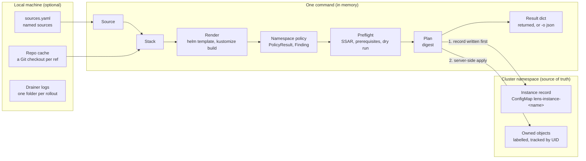
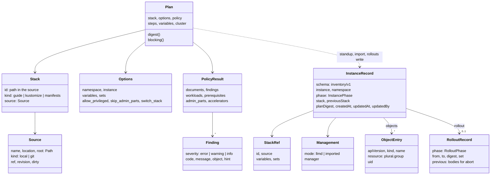
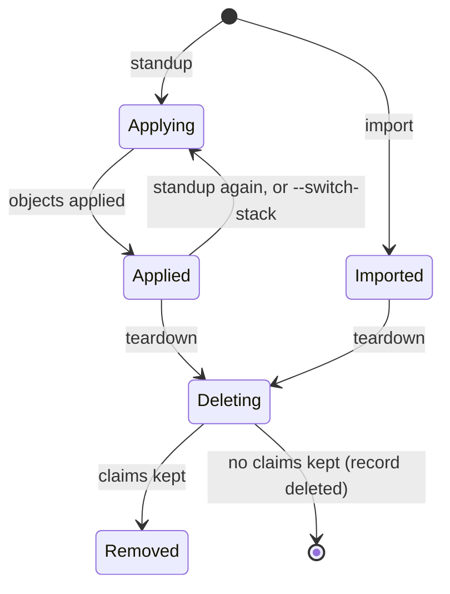
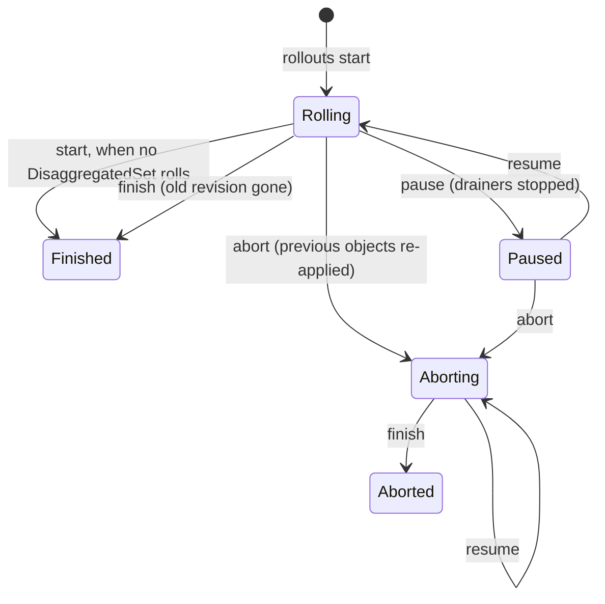

# Lens CLI design

| | |
| --- | --- |
| Status | Proposed (November 2026). The lifecycle described here is implemented by #107; the [proposed changes](#11-proposed-changes) are not. |
| Owner | Lens maintainers |
| Reviewers | TBD |
| Roadmap | [Revised roadmap after v0.1.0](https://github.com/llm-d-incubation/llm-d-lens/issues/15#issuecomment-6349264601) |
| Related | #107 (implementation), #73, #74, #76, #79 |
| Usage | [`apps/lens/README.md`](../../apps/lens/README.md) |
| Package boundary | [Repository layout](repository-layout.md) |

## 1. Summary

`llmd` is the command-line tool in the `lens` engine package (`apps/lens`). It
plans, stands up, rolls out and removes [llm-d](https://github.com/llm-d/llm-d)
guides inside one existing Kubernetes or OpenShift namespace, without
cluster-admin rights. Each instance is recorded in a ConfigMap in its own
namespace, so the cluster, not a workstation, holds the state.

This document specifies the CLI's architecture, state model, lifecycle and
command contracts, and maps them onto the roadmap. Most of it describes the
merged code. The main proposal is to give the persisted instance record
(`lens.llm-d.ai/inventory/v1`), an untyped `dict` today, typed definitions and a
published JSON Schema, using only the standard library.

**Scope:** `apps/lens` only. **Decision needed:** approve the typed record
([Proposed changes](#11-proposed-changes)) before `serve` or new lifecycle
operations build on it.

## 2. Motivation

The roadmap narrows Lens to one job: install and operate llm-d on a cluster that
someone else has built and administers, through a single CLI that is the backend
for the terminal, CI and the dashboard. Kubernetes RBAC is the only permission
model, and stack records live in the cluster.

Today, deploying from Lens needs the full service (database, auth, Node, a
supported OS) and assumes rights a namespace user often lacks. `llmd` serves the
roadmap's **persona A** first: a user with only the edit role in one namespace.

The CLI, a Python import and later a REST `serve` layer must all agree on what
an instance is. Today that agreement lives in code paths that build `dict`s by
hand (`lifecycle.standup`, `importing.import_stack`, `rollouts.engine.start`),
so the record's shape is only documented by reading them.

## 3. Goals, non-goals and anti-goals

### Goals

- Deploy an llm-d well-lit-path guide the way its README does, from the guide's
  own `guide.yaml`, inside one namespace.
- Report, never attempt, what needs an administrator.
- Keep the authoritative record of every instance in the cluster, so every
  command works from any machine and after a crash.
- Show every change before it is made (`plan`, `rollouts plan`) and refuse to
  apply anything other than what was reviewed (the digest).
- Name every datatype that carries CLI state, with its fields, types and
  invariants, and give the persisted record one typed definition and a
  machine-readable schema.
- Define one JSON contract shared by `llmd -o json`, the Python API and `serve`.
- Install with `pip` on any OS, with PyYAML as the only Python dependency.

### Non-goals

- Cluster-wide prerequisites (CRDs, operators, gateways): roadmap `prepare`.
- Gateway Mode and blue-green updates.
- A database. The cluster stays the source of truth for instances.
- Moving the legacy `apps/backend` guide deployments onto the engine, or
  changing its data model (`llm_d_lens/db`).
- Choosing a REST framework for `serve`.
- Benchmarks, BLIS sizing and the in-cluster Job.

### Anti-goals (failure even if everything works)

- `llmd` applies a cluster-scoped object, or an object outside the target
  namespace.
- `llmd` overwrites or deletes an object it did not create or record.
- The record stores Secret data.
- The engine imports `llm_d_lens`, FastAPI, the database layer or auth, or gains
  a runtime dependency beyond PyYAML.
- The CLI keeps Lens-maintained deployment templates instead of following the
  upstream `guide.yaml`.

## 4. Personas

| Persona | Rights | Coverage today |
| --- | --- | --- |
| A, bare namespace install | Edit role in one namespace | `plan`, `standup`, `status`, `import`, `rollouts`, `teardown` |
| B, cluster administrator | Cluster-wide | Receives `--admin-yaml` output; no `prepare` or gateway yet |
| C, performance engineer | Namespace | Not covered until `benchmark` lands |

## 5. Architecture

CLI state sits in three places, and only one of them must survive. A command
builds its values in memory from local sources, then writes the instance record
to the cluster before it applies any object.



Any machine with kube access can run `status`, `rollouts` or `teardown`, because
all three read the record, not local files.

Each command is a module under `lens/commands/` that builds a `Plan` (or reads a
record) and calls the engine in `lens/` and `lens/rollouts/`. External tools run
through one runner: `kubectl` (or `oc` with `--kube-cli oc`), `helm`, `git` and
`kustomize` (or `kubectl kustomize`).

### 5.1 Following a guide

`llmd` reads `guide.yaml` with the semantics of llm-d's `scripts/guide.py`
(`when:` filters, `skip_in`, `env.static`, `env.source`) and follows its
`deploy` steps without a shell:

| Guide step | What `llmd` does | Plan status |
| --- | --- | --- |
| `export NAME=...` | sets a variable; `--var NAME=VALUE` overrides it | — |
| `helm install` | `helm template` of the same chart, version and values; `--set` adds values | `followed` |
| `kubectl apply -k` / `-f` | `kustomize build`, or a read of the files | `followed` |
| namespace or Secret creation | left to the user; the plan checks the Secret exists | `yours` |
| CRDs from the network, operators | left to an administrator | `administrator` |
| a directory this checkout lacks for these variables | skipped | `other variant` |
| a pipe through `sed`/`envsubst`, a script | blocks, unless the guide's CI also skips it (`skip_in: [ci]`) | `not followed` |

Only Standalone Mode is followed. Against llm-d `595e7700`, 18 of 28 guides
follow without a blocking finding.

### 5.2 Namespace policy and preflight

`policy.py` turns rendered objects into what may be applied to one namespace:

- Every object is namespaced and lands in the target namespace. References to the
  namespace the stack was written for are rewritten.
- Cluster-scoped objects and SCC RoleBindings become *administrator parts*:
  never applied, written by `--admin-yaml FILE`, skipped by `--skip-admin-parts`.
- Privileged containers, host namespaces and hostPath volumes block until
  `--allow-privileged`.

`preflight.py` then checks the plan against the cluster, read-only: the APIs
exist, SelfSubjectAccessReviews allow every verb, prerequisites exist, no object
belongs to someone else, and a server-side dry run accepts the rest.

## 6. Core datatypes

Every command turns a `Source` and `Options` into a `Plan`. Standup, import and
rollouts then write one `InstanceRecord`, which every later command reads.



The in-memory types (top six) are already dataclasses. The persisted types are
only `dict`s today; `StackRef` and `Management` are the names this proposal
gives to sub-objects the code already writes.

### 6.1 Type reference

Six of the eight types are already typed in code; the two persisted ones
(`InstanceRecord`, `RolloutRecord`) are `dict[str, Any]`. Everything below is
read from `apps/lens/lens/` as merged.

| Type | Defined in | Form today | Lifetime | Key fields |
| --- | --- | --- | --- | --- |
| `Source` | `sources.py` | frozen dataclass | one command | `name`, `location`, `root: Path`, `kind: local\|git`, `ref`, `revision`, `dirty: bool` |
| `Stack` | `catalog.py` | frozen dataclass | one command | `id` (path in source, e.g. `guides/optimized-baseline`), `kind: guide\|kustomize\|manifests`, `source: Source` |
| `Options` | `plan.py` | dataclass | one command | `namespace`, `instance`, `allow_privileged`, `skip_admin_parts`, `switch_stack`, `variables: dict[str,str]`, `sets: list[str]` |
| `Plan` | `plan.py` | dataclass | one command | `stack`, `options`, `command`, `policy: PolicyResult`, `cluster`, `steps`, `variables`; derived `digest`, `blocking` |
| `PolicyResult` | `policy.py` | dataclass | inside `Plan` | `documents`, `findings`, `prerequisites`, `workloads`, `admin_parts`, `source_namespaces`, `accelerators: dict[str,int]` |
| `Finding` | `model.py` | frozen dataclass | inside `Plan` | `severity: error\|warning\|info`, `code`, `message`, `object`, `hint` |
| `InstanceRecord` | `inventory.py` (built in `lifecycle.py`, `importing.py`) | `dict` | persisted, until teardown | see [the field table](#instancerecord-fields) |
| `RolloutRecord` | `rollouts/engine.py` | `dict` inside the record | persisted, per rollout | see [the field table](#rolloutrecord-fields) |

The rollout planner has its own in-memory types, all dataclasses:
`RolloutPlan` (`rollouts/plan.py`) holds a `Plan`, the record, a `Change` and
the `Progress` before the rollout. `Change`, `SetChange` and `RoleChange`
(`rollouts/change.py`) describe what differs per DisaggregatedSet and role
(`kind: roll | scale | strategy | none`). `Drainer` (`rollouts/drainers.py`) is
one local drain process per role.

Derived views are computed on each read and never stored:
`status.instance_status` (health), `rollouts.progress.Progress` /
`RoleProgress` / `Group` (per DisaggregatedSet), and `Plan.summary()` (the
`llmd plan -o json` output).

### `InstanceRecord` fields

Stored as JSON under key `inventory.json` in ConfigMap
`lens-instance-<instance>`, in the instance's namespace.

| Field | Type | Set by | Invariant |
| --- | --- | --- | --- |
| `schema` | `"lens.llm-d.ai/inventory/v1"` | all writers | Must match, or the record is refused (`ConflictError`) |
| `instance` | `str` | standup, import | DNS label, at most 40 characters; equals the ConfigMap's instance label |
| `namespace` | `str` | standup, import | Equals the ConfigMap's namespace |
| `management` | `{mode: "llmd"\|"imported", manager?: str}` | standup, import | `imported` instances are never stood up or labelled |
| `phase` | `Applying\|Applied\|Imported\|Deleting\|Removed` | lifecycle ops | See [Instance lifecycle](#7-instance-lifecycle) |
| `stack` | `{id, source: Source.describe(), variables?, sets?}` | standup, import, rollout start | Changes only with `--switch-stack` or a rollout |
| `previousStack` | same shape as `stack` | standup or rollout start with `--switch-stack` | Kept across later standups |
| `planDigest` | `str` (hex) | standup, rollout start | Digest of namespace + instance + rendered objects |
| `objects` | `list[ObjectEntry]` | standup, import, rollout | Written before the first apply; teardown deletes newest first |
| `rollout` | `RolloutRecord` | rollout ops | At most one; see below |
| `createdAt`, `updatedAt` | ISO 8601 UTC (`Z`) | all writers | `updatedAt` set on every write |
| `updatedBy` | `str` | standup, import, scale | The kube user from `kubectl auth whoami` during the plan's cluster check |
| `overrides` | `{workload: int}` | scale, migrate | Replica counts set with `llmd scale`; every later plan sets them on the render. Absent when none differ from the files |
| `migration` | `MigrationRecord` | migrate | On both the source and the target record while a migration runs; see below |

`ObjectEntry` = `{apiVersion, kind, name, resource, uid?}`. `resource` is
`plural.group`; `uid` is set after apply and checked before any delete.

Example, after a `standup`:

```json
{
  "schema": "lens.llm-d.ai/inventory/v1",
  "instance": "baseline",
  "namespace": "team-a",
  "management": {"mode": "llmd"},
  "phase": "Applied",
  "stack": {
    "id": "guides/optimized-baseline",
    "source": {
      "name": "llm-d",
      "location": "https://github.com/llm-d/llm-d.git",
      "kind": "git",
      "ref": "main",
      "revision": "595e7700…",
      "dirty": false
    },
    "variables": {"INFRA_PROVIDER": "ocp"},
    "sets": ["router.monitoring.prometheus.auth.enabled=false"]
  },
  "planDigest": "…",
  "objects": [
    {"apiVersion": "apps/v1", "kind": "Deployment", "name": "…", "resource": "deployments.apps", "uid": "…"}
  ],
  "createdAt": "2026-11-04T10:00:00Z",
  "updatedAt": "2026-11-04T10:01:12Z",
  "updatedBy": "jane@example.com"
}
```

### `RolloutRecord` fields

| Field | Type | Meaning |
| --- | --- | --- |
| `phase` | `Rolling\|Paused\|Aborting\|Finished\|Aborted` | `Rolling`, `Paused`, `Aborting` count as in progress |
| `startedAt`, `startedBy`, `pausedAt`, `abortedAt`, `finishedAt` | ISO 8601 / `str` | Audit times |
| `from`, `to` | `Source.describe()` | The source ref before and after |
| `digest` | `str` | The rollout plan's digest |
| `set`, `fromRevision` | `str` | The DisaggregatedSet that rolls and its old revision |
| `objects` | `list[str]` (`Kind/name`) | What the rollout changes |
| `previous` | `list[{resource, document}]` | Bodies before the change; what `abort` re-applies. Never Secrets: a rollout that would change one is refused |
| `drain` | `str` | The `--drain` command template, or empty |
| `poolLabel` | `str` | The pod label a group must carry as `true` to count as serving; recorded so later rollout commands judge groups the same way. Absent when none |
| `steps` | `list` | Written as an empty list and never filled; see [Proposed changes](#11-proposed-changes) |

### `MigrationRecord` fields

| Field | Type | Meaning |
| --- | --- | --- |
| `role` | `source\|target` | Which side this record is |
| `workload` | `str` | The workload that moves a replica at a time (`NAME` or `SET/ROLE`) |
| `replicas` | `int` | The count the source had at `start` |
| `from`, `to` | `{namespace, instance, context}` | Both sides |
| `startedAt` | ISO 8601 | Audit time |
| `steps` | `list[{at, to, from}]` | Each step's counts after it: target `to`, source `from` |

## 7. Instance lifecycle

The record has two phase fields, and both are already written by the merged
code. `phase` tracks the instance; `rollout.phase` tracks the one rollout that
may run on an `Applied` or `Imported` instance. `Rolling`, `Paused` and
`Aborting` count as a rollout in progress, which blocks `--switch-stack` and a
second rollout.

`InstancePhase` (`record.phase`). `llmd teardown --forget` deletes the record
from any state and leaves the objects running. `Invalid` is not stored: `llmd
list` shows it for a ConfigMap that fails `inventory.parse`.



`RolloutPhase` (`record.rollout.phase`):



Health (`Ready`, `Progressing`, `Degraded`, `Failed`, `Unknown`, `Missing`) is a
third dimension. `llmd status` derives it from live objects on every read and
never stores it, so it is not a phase. Under this proposal the transitions above
become the allowed-transition table checked on each write.

## 8. Persistence and integrity

State is persisted in exactly two places, and only the in-cluster record is
needed for correctness. Losing the laptop loses registered source names and
drainer logs, never the knowledge of what an instance owns.

| Store | Path / object | Format | Written by | Needed for correctness |
| --- | --- | --- | --- | --- |
| Instance record | ConfigMap `lens-instance-<name>`, key `inventory.json`, labels `app.kubernetes.io/managed-by=llm-d-lens`, `lens.llm-d.ai/instance`, `lens.llm-d.ai/role=inventory` | JSON, sorted keys | `inventory.write` (server-side apply) | Yes |
| Source registry | `$LLMD_STATE_DIR` or `$LENS_DATA_DIR/llmd/sources.yaml`, with each source's layout (`stacks`, `exclude`, `companions`, `poolLabel`) | YAML, atomic write | `SourceRegistry` | No |
| Drainer logs | `$LENS_DATA_DIR/llmd/rollouts/<ns>/<instance>/drain-<role>.log` | text | `rollouts.drainers` | No |
| Repo cache | `$LENS_CACHE_DIR/repos` | Git checkouts | `sources.resolve_source` | No |

Local paths follow the [storage layout](storage-layout.md).

**Integrity rules already enforced:**

- A record is refused unless its `schema`, labels, name and namespace all agree,
  so an edited or foreign ConfigMap is never trusted.
- The record is written before the first apply (`phase: Applying`), so an
  interrupted standup can still be torn down.
- An object is deleted only while its live UID equals the recorded `uid` and,
  for `mode: llmd`, while it still carries the instance label.
- `PersistentVolumeClaim` entries are kept by `teardown` unless
  `--delete-volumes` is passed; the record then stays with `phase: Removed`.
- A plan's digest is SHA-256 over sorted JSON of namespace, instance and
  rendered objects. `--expected-digest` takes the full value or a prefix of at
  least 16 characters, and `standup` and `rollouts start` refuse any other render.
- A DisaggregatedSet body in `rollout.previous` is tens of kilobytes, well inside
  a ConfigMap's 1 MiB.

**Versioning.** The schema string `lens.llm-d.ai/inventory/v1` is the version.
Proposed rule: adding an optional field stays `v1`; renaming, removing or
changing a field's type, or changing the ConfigMap name or labels, makes `v2`.
Readers accept `v1` and `v2` for one release, and a write always uses the newest.
The labels and field manager (`llm-d-lens`) are part of the contract: `teardown`
and the ownership checks depend on them.

## 9. Command contracts

| Command | Reads | Writes | Refuses when |
| --- | --- | --- | --- |
| `sources add/list/remove` | `sources.yaml` | `sources.yaml` | the name or path is invalid |
| `stacks`, `render` | the source and its layout | nothing | the stack is not found; a short name that ends several listed stacks |
| `plan` | source, cluster (unless `--offline`) | nothing; `--admin-yaml` file | — (reports findings and the digest) |
| `standup` | plan, record | record, then objects | blocking findings; digest mismatch; objects owned by another tool |
| `import` | plan, live objects | record only | the instance is already recorded; an object of the stack is missing (`--dry-run` also shows drift) |
| `status`, `list` | record, live objects | nothing | the instance is not found |
| `rollouts plan` | record, plan of the new ref, live sets | nothing | — (reports refusals) |
| `rollouts start` | rollout plan | record, objects, drainer processes | blocking findings (a claim being deleted is one); digest mismatch; a rollout in progress; a Secret would change; another stack path without `--switch-stack` |
| `rollouts pause/resume/abort/finish` | record, progress | record, drainers, objects (`abort`) | no rollout in progress; `finish` before the roll completes |
| `scale` | record, plan, live workload | the scaled object, record (`overrides`) | blocking findings; a rollout in progress; lowering a DisaggregatedSet role without `--drain` or `--no-drain`; a failed drain command |
| `migrate plan` | both records, both plans | nothing | — (reports refusals) |
| `migrate start/step/finish` | both records, both plans, live workloads | target objects, both records, scaled objects; `finish` tears the source down | an unsettled source; another instance of that name in the target; a target not Ready before a step lowers the source; `finish` before the source is at 0 |
| `teardown` | record, live objects | deletes objects and record | a delete permission is missing (nothing is removed) |

**One JSON contract.** Every operation returns a JSON-serializable `dict`;
`llmd -o json` prints it, and `serve` would return it as the response body.
Failures map one-to-one (`lens/errors.py`):

| Error class | `code` | Exit code | HTTP status |
| --- | --- | --- | --- |
| `LlmdError` (base) | `error` | 1 | 500 |
| `UsageError` | `invalid_request` | 2 | 400 |
| `PolicyError` | `plan_blocked` | 3 | 422 |
| `ConflictError` | `conflict` | 4 | 409 |
| `CommandError` | `command_failed` | 5 | 502 |
| `NotFoundError` | `not_found` | 6 | 404 |
| `NotReadyError` | `not_ready` | 7 | 504 |

Gap: with `-o json`, the CLI still prints errors as text on stderr.
`LlmdError.as_problem()` exists but no command emits it.

## 10. Security

- Kubernetes RBAC is the only permission check. `llmd` asks the API server
  (SelfSubjectAccessReview) instead of assuming rights.
- Nothing privileged or outside the namespace is applied without an explicit
  flag, and cluster-scoped objects never are.
- Secret data is never written to the record or to local state.
- Guide steps run without a shell; an unsupported step blocks instead of being
  approximated.

## 11. Proposed changes

Six changes, all inside `apps/lens` and all standard library, so the
PyYAML-only dependency rule holds. None changes the record's JSON on disk;
existing `v1` records stay readable.

1. **Type the persisted record.** Add `lens/records.py` with frozen dataclasses
   `InstanceRecord`, `ObjectEntry`, `Management`, `StackRef` and
   `RolloutRecord`, each with `from_dict()` (validating) and `to_dict()`.
   `inventory.parse` returns an `InstanceRecord`; `lifecycle`, `importing` and
   `rollouts.engine` build one instead of a literal `dict`.
2. **Make phases enums.** `InstancePhase` (`Applying`, `Applied`, `Imported`,
   `Deleting`, `Removed`) and `RolloutPhase` (`Rolling`, `Paused`, `Aborting`,
   `Finished`, `Aborted`) as `StrEnum` (Python 3.11+), with the allowed
   transitions as a table checked on write. `Finding.severity` and `Stack.kind`
   become enums too.
3. **Publish a JSON Schema.** Ship `lens/schemas/inventory-v1.schema.json` and
   add `llmd schema inventory` to print it. A test checks that it matches
   `records.py` both ways; `jsonschema` is a dev-only dependency for that test.
4. **Emit errors in JSON.** With `-o json|yaml`, print `as_problem()` on stdout
   and keep the exit code. The CLI and `serve` then return the same error body.
5. **Type operation results.** Give each op's return value a small dataclass
   (`StandupResult`, `TeardownResult`, `InstanceStatus`, …) with `to_dict()`, so
   the `-o json` output is a documented contract, not whatever the handler built.
6. **Remove or fill `rollout.steps`.** It is written empty and never filled;
   either record each step (time, groups replaced per role) or drop the field.

Changes 1 and 3 add files under `apps/lens/lens/`; each needs approval in its
implementation PR.

Sketch of change 1 (shape only; field names are today's):

```python
class InstancePhase(StrEnum):
    APPLYING = "Applying"
    APPLIED = "Applied"
    IMPORTED = "Imported"
    DELETING = "Deleting"
    REMOVED = "Removed"


@dataclass(frozen=True)
class ObjectEntry:
    api_version: str  # JSON: apiVersion
    kind: str
    name: str
    resource: str  # plural.group
    uid: str = ""


@dataclass(frozen=True)
class InstanceRecord:
    SCHEMA: ClassVar[str] = "lens.llm-d.ai/inventory/v1"

    instance: str
    namespace: str
    management: Management
    phase: InstancePhase
    stack: StackRef
    plan_digest: str
    objects: tuple[ObjectEntry, ...]
    created_at: str
    updated_by: str = ""
    updated_at: str = ""
    previous_stack: StackRef | None = None
    rollout: RolloutRecord | None = None

    @classmethod
    def from_dict(
        cls, data: dict[str, Any]
    ) -> InstanceRecord: ...  # raises ConflictError

    def to_dict(self) -> dict[str, Any]: ...  # camelCase keys, as stored today
```

## 12. Alternatives considered

### Where the record lives

| Option | Why not |
| --- | --- |
| State on the workstation | Lost with the machine; a second operator or CI cannot see it. |
| Helm releases as the record | Guides mix Helm and kustomize; imported stacks would change owner. |
| A CustomResourceDefinition | Server-side validation and `kubectl get lensinstances`, but installing a CRD needs cluster-admin, which the engine is built to avoid. |
| Labels on objects only | Imported objects are never labelled, and UIDs and rollout history need somewhere to live. |

### How the record is typed

| Option | For | Against | Verdict |
| --- | --- | --- | --- |
| Stdlib dataclasses + hand-written JSON Schema (proposed) | No new runtime dependency; matches the existing frozen dataclasses | Validation code written by hand; schema can drift (a test guards it) | Recommended |
| Pydantic models | Validation and JSON Schema for free; FastAPI already speaks it | Adds a runtime dependency to an engine meant to install with PyYAML only, including in-cluster Jobs | Reconsider if `serve` adopts FastAPI |
| `TypedDict` only | Zero runtime cost; types the existing `dict`s in place | No runtime validation; records edited by hand in the cluster pass silently | Too weak for a record the cluster can change |
| Protobuf / gRPC types | Strong cross-language contract | New toolchain; no non-Python consumer today | Rejected |

## 13. Roadmap status

"Done" means merged in #107; "partial" means part of the scope exists, possibly
under another command.

| Release | Roadmap scope | Status in `llmd` |
| --- | --- | --- |
| v0.1.1 | Engine library, command structure, JSON output | Done: the `lens` package, `llmd` subcommands, `-o json\|yaml` (errors still text; [§9](#9-command-contracts)) |
| v0.1.1 | CI on kind with llm-d-inference-sim | Not started: tests use an in-memory cluster (`tests/fakes.py`) with real git, Helm and kustomize |
| v0.1.2 | Stack record in the cluster | Done: [§6](#6-core-datatypes); typing it is [proposed change 1](#11-proposed-changes) |
| v0.1.2 | `check`, admin and non-admin | Partial: the non-admin checks run inside `plan`; no separate `check`, no quota check, no admin mode |
| v0.1.3 | `plan` for optimized-baseline from `guide.yaml` | Done, with a digest and `--offline`; verified against llm-d `595e7700`, not yet the v1.0.0 tag |
| v0.1.4 | `standup`, `teardown` in standalone mode | Done |
| v0.1.4 | `validate` (smoke test through the router) | Not started: `status` reports workload health, not request success |
| v0.2.0 | `prepare`, admin and non-admin | Partial: `--admin-yaml` writes what an administrator must apply |
| v0.2.0 | `serve`, the dashboard on the CLI backend | Not started: `apps/backend` still reads guides itself (`deploy/guide_bundle.py`, `configuration/guide_settings.py`) |
| v0.3.0 | `update` with rolling updates and snapshots | Partial: `rollouts` rolls DisaggregatedSets in place and `abort` restores `rollout.previous` |
| v0.3.0 | More well-lit paths and accelerators | Partial: 18 of 28 guides follow; the rest block on unsupported steps |
| Later | Gateway mode, blue-green updates | Not started |
| Later | `benchmark`, BLIS in `plan`, in-cluster Job | Not started |

`sources`, `import`, PR-ref rollouts, `--switch-stack`, `scale`, `migrate` and
companions go beyond the roadmap's operation list. They serve teams that already
deploy guides or their own kustomize stacks by hand and want to test llm-d
changes before they merge, size a stack to the accelerators they get, or move it
without an outage. A source's layout (`llmd sources add --stacks`, `--exclude`,
`--companion`, `--pool-label`) lets the same commands serve a checkout laid out
differently from llm-d, with no layout built into the code.
