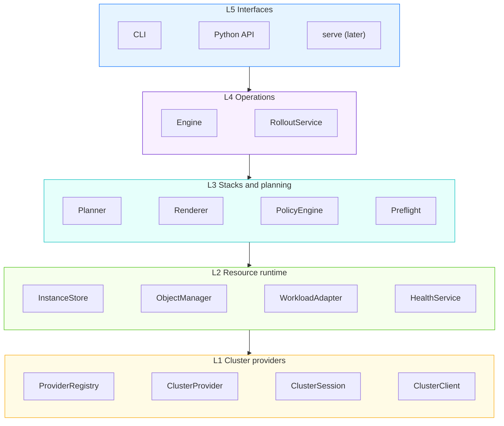
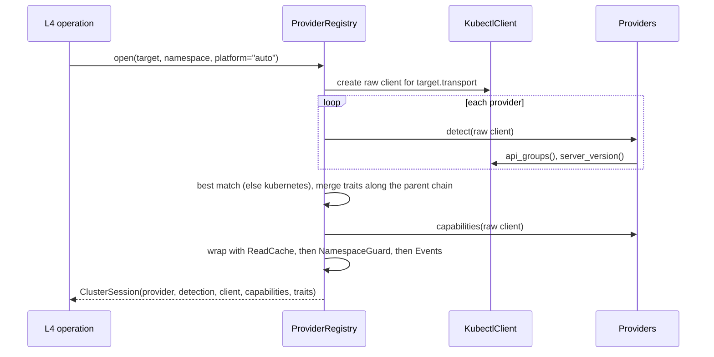
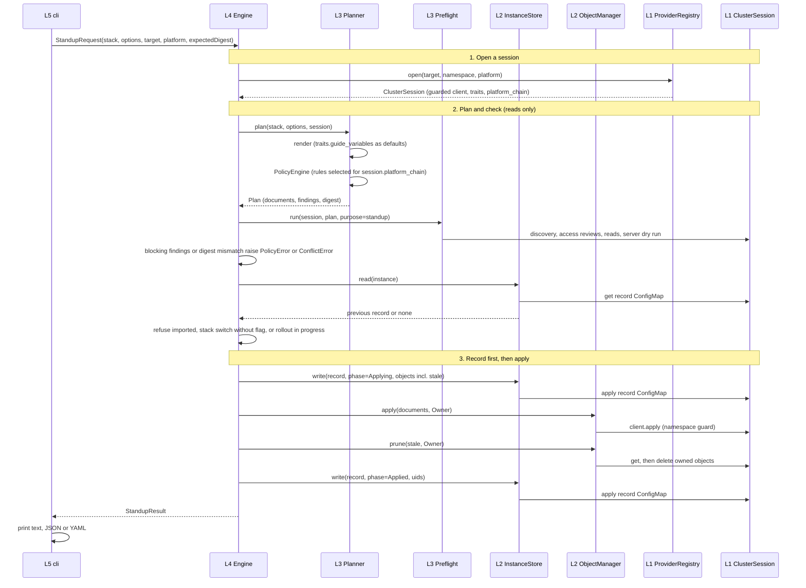

# RFC: Layered architecture for the Lens engine

| | |
| --- | --- |
| Status | Draft (November 2026) |
| Owner | Lens maintainers |
| Reviewers | TBD |
| Scope | `apps/lens` only |
| Builds on | [Lens CLI design](lens-cli-design.md) (state model, lifecycle, command contracts) |
| Related | [Repository layout](repository-layout.md), [Hardware plugin architecture](hardware-plugin-architecture.md) |

## 1. Summary

The `lens` engine (`apps/lens/lens/`) is a flat package of about thirty
modules. It works, but it has no layers: Kubernetes access, platform-specific
rules (OpenShift), workload-specific rules (DisaggregatedSet, LeaderWorkerSet),
planning, lifecycle operations and the CLI reference each other freely.

This RFC proposes five layers with a strict downward dependency rule; each
layer uses only the layers below it:

| Layer | Package | In one line |
| --- | --- | --- |
| L5 Interfaces | `lens.interfaces` | The CLI (later `serve` and MCP): turn input into requests, print results |
| L4 Operations | `lens.ops` | One `Engine` facade with typed requests and results: standup, import, teardown, status, scale, rollouts, migrate |
| L3 Stacks and planning | `lens.stacks`, `lens.planning` | Render a stack, apply the namespace policy, run preflight, produce a plan and its digest |
| L2 Resource runtime | `lens.runtime` | Reusable cluster-object capabilities: instance records, object ownership, workload semantics, health, drift |
| L1 Cluster providers | `lens.cluster` | Reach and describe one cluster of any Kubernetes distribution |

L1 is the bottom layer, the foundation every other layer builds on. It defines the
`ClusterClient` interface (transport-neutral reads, writes, discovery and
access checks), its implementations (`KubectlClient`, `OcClient`, later
`RestClient`, which execute tools through the shared process runner), a pluggable
`ClusterProvider` per distribution (vanilla Kubernetes, OpenShift, GKE, EKS,
AKS, k3s, ...), and `ClusterSession`, which binds a guarded client to one
namespace. Layers L2 to L4 call the `ClusterClient` interface only through a
session, never a raw implementation. Distribution differences reach them only
as declared `PlatformTraits` (data) and as platform extensions registered in
the layer that runs them, never as `if platform == ...` branches.

The proposal changes no behavior, no CLI output and no persisted record format,
except for one optional record field and one optional CLI flag. It is delivered
in seven incremental phases, each guarded by the existing test suite.

**Decision needed:** approve the layer model, the dependency rule and the
cluster provider API (sections [5](#5-architecture) to
[6.1](#61-l1-cluster-provider-layer)) before phase P2 starts.

## 2. Motivation

### 2.1 Problems in the current code

**Cluster access has no boundary.** `kube.py` holds one class, `Kube`, that is
at once the kubectl/oc transport, the API discovery cache, the read cache
(`prefetch`/`forget`), the single-namespace guard (`_require_in`,
`_namespaced_resource`) and the in-cluster detection. `--kube-cli oc` mixes two
independent facts: *how* the engine talks to the API server and *what kind* of
cluster it is.

**Platform knowledge is scattered.** OpenShift rules live in four modules:

| Module | OpenShift knowledge |
| --- | --- |
| `policy.py` | SCC RoleBindings as administrator parts (`SCC_CLUSTER_ROLE_PREFIX`), Route host removal, `security.openshift.io` / `config.openshift.io` / `operator.openshift.io` as cluster-scoped groups |
| `importing.py` | `compared()` ignores the `<sa>-dockercfg-*` pull Secret OpenShift injects |
| `kube.py` | `securitycontextconstraints` in `_CLUSTER_SCOPED_PLURALS` |
| `health.py` | Pods refused by an SCC never exist, so health must explain it |

Every new distribution (GKE, EKS, AKS, k3s, Rancher) would add branches to the
same modules.

**Workload knowledge is duplicated.** DisaggregatedSet and LeaderWorkerSet
semantics (pod templates, roles, replica fields, selectors, readiness,
revisions) are encoded separately in `health.py`, `overrides.py`, `policy.py`
(`POD_TEMPLATE_KEYS`, `pod_templates`), `rollouts/change.py`,
`rollouts/progress.py` and `scaling.py`.

**Dependencies point the wrong way.**

| From | To | Why it is wrong |
| --- | --- | --- |
| `lifecycle`, `importing`, `scaling`, `rollouts.engine`, `rollouts.plan` | `preflight.resources` | Mapping a kind to its resource name is a cluster-access concern, not a preflight check |
| `rollouts.change`, `rollouts.engine` | `importing.comparable`, `importing.drift` | Drift comparison is a shared runtime concern |
| `scaling` | `rollouts.drainers` | Draining is shared by scale and rollouts |
| `commands.migrate` | `commands.standup.stand_up_companions` | Business logic lives in the CLI layer and is reused across commands |
| `lens.kube.Kube.progress` | (callback set by `commands.Context`) | UI concerns are attached to the transport object |

**Contracts are implicit.** Records are untyped `dict`s and operation results
are whatever each handler builds; [Lens CLI design §11](lens-cli-design.md#11-proposed-changes)
already proposes typing them. That work has no agreed home in the package.

### 2.2 Why now

The roadmap adds `prepare`, `validate`, `serve`, `benchmark`, gateway mode and
blue-green updates, and users ask for clusters other than OpenShift and kind.
Each of these is cheaper with a stable provider API and a reusable runtime than
with the flat package.

## 3. Goals and non-goals

### Goals

- A layered package with a dependency rule enforced by a test.
- A bottom-layer cluster provider API that lets a new Kubernetes distribution
  be added as a plugin, without editing policy, preflight, import, health or
  operation code.
- Separate *transport* (kubectl, oc, REST) from *platform* (distribution).
- One implementation point for each safety invariant, starting with "never
  write outside the target namespace".
- Extension points, with defined interfaces, for workloads, renderers, policy
  rules, preflight checks and rollout strategies.
- One `Engine` facade with typed requests and results shared by the CLI, the
  Python API and a future `serve`.
- Incremental delivery with no behavior change per phase.

### Non-goals

- Changing what any command does, its flags (except the new optional
  `--platform`) or its JSON output.
- Cluster provisioning (creating GKE/EKS clusters). Providers describe and
  access an existing cluster.
- Hardware profiles. They stay in `apps/backend/src/llm_d_lens/hardware/`; the
  engine stays vendor-neutral and reads accelerator resource names from pod
  templates as it does today.
- Choosing a REST framework for `serve`.

## 4. Terminology

| Term | Meaning |
| --- | --- |
| Transport | How the engine reaches the API server: the `kubectl` CLI, the `oc` CLI, or (later) direct REST calls |
| Platform | The Kubernetes distribution: `kubernetes`, `openshift`, `gke`, ... |
| Cluster provider | A plugin that detects a platform, creates a client for it and declares its traits and capabilities |
| Capabilities | What this particular cluster serves (API groups and derived features), found by discovery |
| Platform traits | What a platform changes in the engine's behavior as plain data: extra cluster-scoped kinds and default guide variables |
| Platform extension | A policy rule, preflight check, drift filter or health hint registered in its own layer for a set of platforms |
| Session | A cluster client bound to one namespace, one provider, its capabilities, its traits and its platform chain |
| Layer | A group of modules with a fixed position in the dependency order |

## 5. Architecture

### 5.1 Layers



Packages per layer are listed in the [Summary](#1-summary). Only L1 knows
platform names; only L3 and L4 know llm-d, while L2 knows workload kinds but
not where objects come from.

### 5.2 Package layout

```text
lens/
  cluster/     client.py  kubectl.py  rest.py (later)  decorators.py
               capabilities.py  provider.py  registry.py  session.py  extensions.py
               providers/  kubernetes.py  openshift.py
  runtime/     records.py  store.py  objects.py  access.py  drift.py  health.py  drain.py
               workloads/  base.py  deployment.py  statefulset.py  leaderworkerset.py  disaggregatedset.py
  stacks/      sources.py  catalog.py  guides.py  companions.py
               render/  base.py  guide.py  kustomize.py  manifests.py
  planning/    findings.py  plan.py  overrides.py
               policy/  engine.py  rules/
               preflight/  runner.py  checks/
  ops/         engine.py  requests.py  results.py
               standup.py  teardown.py  importing.py  status.py  scale.py  migrate.py
               rollouts/  service.py  plan.py  change.py  strategies/in_place_disaggregatedset.py
  interfaces/  cli/  (serve/ later)
  cli.py  __main__.py   (entry points kept; they delegate to interfaces/cli)
```

The console scripts `lens` and `llmd` and the public import `lens.cli:main`
stay where `pyproject.toml` declares them. Shared helpers (errors, the process
runner, the event sink, YAML I/O, paths) are not a layer and are not shown;
any layer may use them, but they import no layer and hold no domain knowledge.

## 6. Component APIs

Signatures are normative for names, parameters and return types; bodies and
private helpers are left to implementation. All types use the standard library
(`typing.Protocol`, `dataclasses`, `enum.StrEnum`). Signatures use two shared
helper types: `Runner` (executes an external tool; tests replace it with the
in-memory cluster) and `EventSink` (receives progress events; the CLI prints
them on stderr, replacing today's `Kube.progress` callback).

### 6.1 L1 Cluster provider layer

L1 is the base API for reaching and managing a cluster of any Kubernetes
distribution. It has two orthogonal parts: the **client** (transport) and the
**provider** (platform).

#### 6.1.1 `ClusterClient`

```python
# cluster/client.py
@dataclass(frozen=True)
class Target:
    """Which credentials and transport to use. Empty fields mean the transport's defaults."""
    kubeconfig: str = ""
    context: str = ""
    transport: str = "kubectl"          # "kubectl" | "oc" | "rest"


@dataclass(frozen=True)
class ApiResource:                      # moved unchanged from kube.py
    group: str
    version: str
    kind: str
    plural: str
    namespaced: bool

    @property
    def qualified(self) -> str: ...     # "deployments.apps"


@dataclass(frozen=True)
class AccessCheck:
    verb: str
    group: str
    resource: str                       # plural
    namespace: str


class ApplyMode(StrEnum):
    SERVER_SIDE = "server-side"         # objects llmd owns; field manager "llm-d-lens"
    CLIENT_SIDE = "client-side"         # imported instances; keeps the team's own `kubectl apply` working


class ClusterClient(Protocol):
    """Transport-neutral access to one cluster. Carries no policy."""

    target: Target

    # identity
    def current_context(self) -> str: ...
    def server(self) -> str: ...
    def server_version(self) -> Mapping[str, str]: ...      # /version: gitVersion, platform, ...
    def default_namespace(self) -> str: ...
    def whoami(self) -> str: ...

    # discovery (readable by every authenticated user)
    def api_groups(self) -> frozenset[str]: ...
    def resources(self, api_version: str) -> Mapping[str, ApiResource] | None: ...
    def resource_for(self, api_version: str, kind: str) -> ApiResource | None: ...

    # authorization
    def can(self, checks: Sequence[AccessCheck]) -> list[bool | None]: ...

    # reads
    def namespace_state(self, namespace: str) -> Literal["exists", "missing", "unknown"]: ...
    def list(
        self,
        resource: str,
        namespace: str,
        *,
        names: Sequence[str] = (),
        label_selector: str = "",
        field_selector: str = "",
    ) -> list[dict[str, Any]]: ...
    def get(self, resource: str, name: str, namespace: str) -> dict[str, Any] | None: ...
    def logs(
        self, pod: str, container: str, namespace: str, *, previous: bool = False, tail: int = 20
    ) -> str | None: ...

    # writes
    def apply(
        self,
        documents: Sequence[dict[str, Any]],
        namespace: str,
        *,
        mode: ApplyMode,
        dry_run: bool = False,
        force_conflicts: bool = False,
    ) -> list[dict[str, Any]]: ...
    def delete(self, resource: str, name: str, namespace: str, *, wait: bool = False) -> bool: ...
```

Error contract: transport failures raise `CommandError`; a missing object on
`get` returns `None`; `delete` of a missing object returns `False`.

Implementations:

| Class | Transport | Notes |
| --- | --- | --- |
| `KubectlClient` | `kubectl` through the shared `Runner` | Today's `Kube` without caches, guards or progress |
| `OcClient` | `oc` | Subclass of `KubectlClient` with another executable |
| `RestClient` (later) | HTTPS with `urllib` | For in-cluster Jobs without a CLI; uses the ServiceAccount token |

#### 6.1.2 Client decorators

Each decorator implements `ClusterClient` and wraps another one. The order is
fixed by `ProviderRegistry.open`:

```text
KubectlClient -> ReadCacheClient -> NamespaceGuardClient -> EventsClient
```

```python
# cluster/decorators.py
class ReadCacheClient(ClusterClient):
    """Discovery cache for the session's lifetime; object cache filled by prefetch and dropped
    by any write or by forget()."""
    def prefetch(self, items: Sequence[tuple[str, str]], namespace: str) -> None: ...
    def forget(self) -> None: ...


class NamespaceGuardClient(ClusterClient):
    """The single implementation of the namespace invariant: apply and delete refuse a
    cluster-scoped resource or an object naming another namespace (PolicyError), and every
    call is bound to one namespace."""
    def __init__(self, inner: ClusterClient, namespace: str, scope: "ScopeResolver"): ...


class EventsClient(ClusterClient):
    """Emits progress events for slow calls (apply, delete, prefetch)."""
    def __init__(self, inner: ClusterClient, events: EventSink): ...
```

#### 6.1.3 `Capabilities` and `PlatformTraits`

```python
# cluster/capabilities.py
@dataclass(frozen=True)
class Capabilities:
    """What this cluster serves, by discovery. Computed once per session."""
    platform: str                       # provider name that matched
    version: str                        # server gitVersion
    api_groups: frozenset[str]
    features: frozenset[str]

    def has(self, feature: str) -> bool: ...
```

Feature names are a closed, documented vocabulary owned by L1. Initial set:

| Feature | Derived from |
| --- | --- |
| `server-side-apply` | Server version |
| `gateway-api` | `gateway.networking.k8s.io` served |
| `inference-extension` | `inference.networking.k8s.io` or `inference.networking.x-k8s.io` served |
| `leaderworkerset` | `leaderworkerset.x-k8s.io` served |
| `disaggregatedset` | `disaggregatedset.x-k8s.io` served |
| `prometheus-operator` | `monitoring.coreos.com` served |
| `routes` | `route.openshift.io` served |
| `scc` | `security.openshift.io` served |

```python
# cluster/provider.py
@dataclass(frozen=True)
class PlatformTraits:
    """What a platform changes above L1, as plain data. Holds no type of a higher layer;
    behavior is contributed as platform extensions (section 6.1.5)."""
    cluster_scoped_kinds: frozenset[tuple[str, str]] = frozenset()   # (group, kind); "*" for a whole group
    guide_variables: Mapping[str, str] = field(default_factory=dict)  # defaults only; --var always wins

    def merged(self, child: "PlatformTraits") -> "PlatformTraits": ...
    # union of sets; child mapping values override parent values


@dataclass(frozen=True)
class Detection:
    matched: bool
    confidence: int                     # 0-100
    evidence: tuple[str, ...]           # e.g. ("API group security.openshift.io is served",)


class ClusterProvider(Protocol):
    name: str                           # stable id: "kubernetes", "openshift", "gke", ...
    parent: str | None                  # "kubernetes" for every distribution; None for the root

    def detect(self, client: ClusterClient) -> Detection: ...
    def default_transport(self) -> str: ...                 # "kubectl" for most; may be "oc"
    def capabilities(self, client: ClusterClient) -> Capabilities: ...
    def traits(self) -> PlatformTraits: ...                 # own traits; the registry merges the parent chain
```

`detect` must be read-only, fast and use only what an authenticated user may
read: API discovery and `/version`. Reading Nodes, Namespaces or cluster-scoped
custom resources is not allowed.

Built-in providers:

| Provider | Parent | Detection evidence | Traits (L1 data) | Extensions (registered in their own layer) |
| --- | --- | --- | --- | --- |
| `kubernetes` | none | Always matches with confidence 0 (fallback) | Built-in cluster-scoped table from today's `policy.CLUSTER_SCOPED` | none |
| `openshift` | `kubernetes` | `security.openshift.io` or `route.openshift.io` served | `security.openshift.io/*`, `config.openshift.io/*`, `operator.openshift.io/*` cluster-scoped; `guide_variables = {"INFRA_PROVIDER": "ocp"}` | `SccBindingRule`, `RouteHostRule` (L3 policy); `DockercfgPullSecretFilter` (L2 drift); `SccAdmissionHint` (L2 health) |

Candidates outside this RFC, as examples of the extension path: `gke`
(`gitVersion` contains `-gke.`), `eks` (`-eks-`), `aks`, `k3s` (`+k3s`), `kind`.

#### 6.1.4 `ProviderRegistry` and `ClusterSession`

```python
# cluster/registry.py
ENTRY_POINT_GROUP = "lens.cluster_providers"


class ProviderRegistry:
    """Discovers providers through importlib.metadata entry points. Built-in providers are
    registered the same way, in apps/lens/pyproject.toml. Third-party providers load only when
    their distribution is on an allowlist."""

    def __init__(self, *, allow: Iterable[str] = ()) -> None: ...
    def providers(self) -> list[ClusterProvider]: ...
    def get(self, name: str) -> ClusterProvider: ...                        # NotFoundError
    def traits(self, name: str) -> PlatformTraits: ...                     # merged along the parent chain
    def detect(self, client: ClusterClient) -> tuple[ClusterProvider, Detection]: ...
    def open(
        self,
        target: Target,
        namespace: str,
        *,
        platform: str = "auto",
        runner: Runner,
        events: EventSink = NULL_SINK,
    ) -> "ClusterSession": ...
```

`detect` picks the matched provider with the highest confidence; a tie goes to
the deeper provider in the parent chain; no match returns `kubernetes`.

```python
# cluster/session.py
@dataclass
class ClusterSession:
    """The only cluster handle above L1."""
    provider: ClusterProvider
    detection: Detection
    client: ClusterClient               # always wrapped by NamespaceGuardClient
    namespace: str
    capabilities: Capabilities
    traits: PlatformTraits              # merged
    platform_chain: tuple[str, ...]     # matched provider first, then its parents, e.g. ("openshift", "kubernetes")

    def resource_name(self, document: Mapping[str, Any]) -> str: ...   # replaces preflight.resources
    def resource_names(self, documents: Sequence[Mapping[str, Any]]) -> list[str]: ...
    def scope(self, api_version: str, kind: str) -> bool | None: ...  # discovery, then traits table
    def actor(self) -> str: ...                                         # cached whoami
    def describe(self) -> dict[str, Any]: ...                           # context, server, platform, evidence


@dataclass
class AdminSession:
    """A session without the namespace guard, for a future `prepare`. Constructed only by an
    operation that declares it needs cluster-wide rights; never handed to other operations."""
    provider: ClusterProvider
    client: ClusterClient
    capabilities: Capabilities
    traits: PlatformTraits
    platform_chain: tuple[str, ...]
```

`migrate` opens two sessions, one per side; no other special case is needed.

#### 6.1.5 Platform extensions

Behavior a platform adds above L1 (a policy rule, a preflight check, a drift
filter, a health hint) is a type of the layer that runs it. Putting such
behavior in `PlatformTraits` would make L1 depend on L2 and L3, so each
extension is registered in its own layer and declares the platforms it applies
to:

```python
# cluster/extensions.py (L1: generic, knows no extension type)
class PlatformScoped(Protocol):
    platforms: frozenset[str]           # e.g. {"openshift"}; {"kubernetes"} applies everywhere


def for_platform(items: Iterable[T], chain: Sequence[str]) -> list[T]:
    """The items whose platforms intersect the session's platform_chain, in registration order.
    The only place that matches platform names; callers never compare them."""
```

| Extension | Interface owned by | Entry point group | Consumer |
| --- | --- | --- | --- |
| Policy rule | `planning/policy` (L3), `PolicyRule` | `lens.policy_rules` | `PolicyEngine` |
| Preflight check | `planning/preflight` (L3), `PreflightCheck` | `lens.preflight_checks` | `Preflight` |
| Drift filter | `runtime/drift` (L2), `DriftFilter` | `lens.drift_filters` | `DriftService` |
| Health hint | `runtime/health` (L2), `HealthHint` | `lens.health_hints` | `HealthService` |

Each interface extends `PlatformScoped`. A distribution package registers its
provider in `lens.cluster_providers` and its extensions in the groups above;
built-in extensions of the engine itself declare `platforms = {"kubernetes"}`.
Because every chain ends with `kubernetes`, built-in extensions apply to every
cluster, and an unknown cluster gets exactly the built-in behavior.

### 6.2 L2 Resource runtime layer

L2 offers reusable cluster-object capabilities with no knowledge of guides or
sources. Every service takes a `ClusterSession`.

#### 6.2.1 Typed records and `InstanceStore`

`runtime/records.py` implements changes 1 and 2 of
[Lens CLI design §11](lens-cli-design.md#11-proposed-changes) (`InstanceRecord`,
`StackRef`, `Management`, `ObjectEntry`, `RolloutRecord`, `MigrationRecord`,
`InstancePhase`, `RolloutPhase`) with one addition:

| Field | Type | Set by | Invariant |
| --- | --- | --- | --- |
| `platform` | `str`, optional | standup, import | The provider name of the session that wrote the record. Optional, so the schema stays `lens.llm-d.ai/inventory/v1` |

```python
# runtime/store.py
class InstanceStore:
    def __init__(self, session: ClusterSession) -> None: ...
    def read(self, instance: str) -> InstanceRecord | None: ...
    def require(self, instance: str) -> InstanceRecord: ...                   # NotFoundError
    def list(self) -> list[InstanceRecord | InvalidRecord]: ...
    def write(self, record: InstanceRecord) -> InstanceRecord: ...            # validates the phase transition
    def delete(self, instance: str) -> None: ...
```

The ConfigMap name, labels, data key and field manager stay exactly as today.

#### 6.2.2 `ObjectManager`

Extracted from `lifecycle.py`; owns the ownership semantics.

```python
# runtime/objects.py
@dataclass(frozen=True)
class Owner:
    instance: str
    mode: Literal["llmd", "imported"]


@dataclass(frozen=True)
class DeleteReport:
    deleted: list[str]
    skipped: list[str]                  # UID or label no longer matches
    missing: list[str]


class ObjectManager:
    def __init__(self, session: ClusterSession) -> None: ...
    def apply(
        self, documents: Sequence[dict[str, Any]], owner: Owner, *, dry_run: bool = False
    ) -> list[ObjectEntry]: ...         # mode from owner: llmd -> server-side, imported -> client-side
    def is_owned(self, entry: ObjectEntry, live: Mapping[str, Any] | None, owner: Owner) -> bool: ...
    def prune(self, stale: Sequence[ObjectEntry], owner: Owner, *, keep_kinds: frozenset[str]) -> list[str]: ...
    def delete_owned(self, entries: Sequence[ObjectEntry], owner: Owner) -> DeleteReport: ...  # newest first
```

#### 6.2.3 `WorkloadAdapter`

One plugin per workload kind replaces the duplicated DisaggregatedSet and
LeaderWorkerSet logic.

```python
# runtime/workloads/base.py
@dataclass(frozen=True)
class PodTemplateRef:
    role: str                           # "" for single-role workloads
    path: tuple[str, ...]               # where the template sits in the object
    template: Mapping[str, Any]
    pods_per_replica: int | None        # group size; None when unknown


@dataclass(frozen=True)
class WorkloadHealth:
    state: Literal["Ready", "Progressing", "Degraded", "Failed", "Unknown"]
    ready: int
    desired: int
    reasons: tuple[str, ...]


class WorkloadAdapter(Protocol):
    kinds: frozenset[tuple[str, str]]   # (group, kind)

    def pod_templates(self, obj: Mapping[str, Any]) -> Iterator[PodTemplateRef]: ...
    def roles(self, obj: Mapping[str, Any]) -> list[str]: ...
    def replicas(self, obj: Mapping[str, Any], role: str = "") -> int | None: ...
    def set_replicas(self, obj: dict[str, Any], replicas: int, role: str = "") -> None: ...
    def pod_selector(self, obj: Mapping[str, Any], role: str = "") -> str: ...
    def health(self, obj: Mapping[str, Any], pods: Sequence[Mapping[str, Any]]) -> WorkloadHealth: ...
    def progress(
        self, obj: Mapping[str, Any], pods: Sequence[Mapping[str, Any]]
    ) -> "WorkloadProgress | None": ...  # rollouts; None when the kind has no grouped roll


class WorkloadRegistry:                 # entry point group "lens.workloads"
    def for_object(self, obj: Mapping[str, Any]) -> WorkloadAdapter | None: ...
    def kinds(self) -> frozenset[tuple[str, str]]: ...
```

Built-in adapters: Deployment, StatefulSet, DaemonSet, Job, LeaderWorkerSet,
DisaggregatedSet. Policy (privileged and accelerator scans), overrides, health,
scale and rollout progress use the registry. For template-based scans and
overrides, preserve today's standalone Pod and ReplicaSet handling and the
recursive traversal from `policy.pod_templates()` as an L2 fallback when
`for_object()` returns `None`, including discovery in CronJobs and unknown
custom resources. A missing adapter must not suppress existing safety checks,
prerequisite checks or accelerator accounting. The fallback discovers templates
only; it does not grant health, scale or rollout support to unregistered kinds.

#### 6.2.4 Other runtime services

```python
# runtime/health.py
class HealthService:
    def __init__(self, session: ClusterSession, workloads: WorkloadRegistry) -> None: ...
    def instance(self, record: InstanceRecord) -> "InstanceHealth": ...      # applies the platform's health hints
    def wait_ready(self, record: InstanceRecord, *, timeout: float) -> "InstanceHealth": ...  # NotReadyError


# runtime/drift.py
class DriftFilter(PlatformScoped, Protocol):
    def normalize(self, live: dict[str, Any]) -> dict[str, Any]: ...


class DriftService:
    def __init__(self, filters: Sequence[DriftFilter]) -> None: ...        # for_platform(registered, session.platform_chain)
    def comparable(self, document: Mapping[str, Any]) -> dict[str, Any]: ...
    def compare(self, desired: Mapping[str, Any], live: Mapping[str, Any]) -> list[str]: ...  # differing paths


# runtime/access.py
class AccessService:
    def __init__(self, session: ClusterSession) -> None: ...
    def denied(self, verbs: Iterable[str], resources: Iterable[str]) -> list[str]: ...  # "verb resource"


# runtime/drain.py
class DrainRunner:
    def command(self, template: str, values: Mapping[str, str]) -> list[str]: ...
    def start(self, name: str, argv: Sequence[str], log: Path, cwd: str) -> "Drainer": ...
    def run(self, argv: Sequence[str], *, timeout: float) -> None: ...      # CommandError on failure
```

### 6.3 L3 Stacks and planning layer

L3 turns a source and options into a `Plan`. It is the only layer that knows
guide semantics.

```python
# stacks/render/base.py
@dataclass(frozen=True)
class RenderRequest:
    namespace: str
    variables: Mapping[str, str]        # user --var merged over traits.guide_variables
    sets: Sequence[str]
    tools: "Tools"


class Renderer(Protocol):               # entry point group "lens.renderers"
    kind: str                           # "guide" | "kustomize" | "manifests"
    def render(self, stack: Stack, request: RenderRequest, *, runner: Runner) -> "Rendered": ...
```

```python
# planning/policy/engine.py
class PolicyStage(IntEnum):
    CLASSIFY = 1    # keep, drop, or move to administrator parts
    REWRITE = 2     # namespace references, Route hosts
    ANALYZE = 3     # privileged, prerequisites, accelerators, workloads
    LABEL = 4       # ownership labels; ordering for apply


class PolicyRule(PlatformScoped, Protocol):
    name: str
    stage: PolicyStage
    def apply(
        self, documents: list[dict[str, Any]], context: "PolicyContext", result: "PolicyResult"
    ) -> list[dict[str, Any]]: ...


class PolicyEngine:
    def __init__(self, rules: Sequence[PolicyRule], workloads: WorkloadRegistry) -> None: ...
    def apply(self, documents: list[dict[str, Any]], context: "PolicyContext") -> "PolicyResult": ...
```

Rules run by stage, then in registration order. The engine's built-in rules
(`platforms = {"kubernetes"}`) are registered first, then the rules of
distribution packages; `PolicyEngine` receives the rules
`for_platform(...)` selected for the session's `platform_chain` (or, offline,
for the chain of `--platform`). Built-in rules: namespace rewrite, cluster
scope to administrator parts, privileged and host access, prerequisites,
monitor Secrets, labels, apply order. `PolicyContext` gains
`scope: ScopeResolver` from the session (or from the offline traits table)
and keeps every field it has today. `PolicyResult` is unchanged; `Finding`
keeps its fields and moves to `planning/findings.py`.

```python
# planning/preflight/runner.py
class PreflightCheck(PlatformScoped, Protocol):
    name: str
    purposes: frozenset[str]            # subset of {"standup", "import", "rollout"}
    def run(
        self, session: ClusterSession, plan: "Plan", record: InstanceRecord | None
    ) -> list[Finding]: ...


class Preflight:
    def __init__(self, checks: Sequence[PreflightCheck]) -> None: ...  # for_platform(registered, session.platform_chain)
    def run(self, session: ClusterSession, plan: "Plan", *, purpose: str) -> None: ...
```

Built-in checks, in order, match today's `preflight()`: namespace, APIs,
prefetch, permissions, prerequisites, ownership of existing objects, server
dry run. A check that returns an error finding for `namespace` or `apis` stops
the run, as today.

```python
# planning/plan.py
class Planner:
    def __init__(
        self, renderers: "RendererRegistry", policy: PolicyEngine, providers: ProviderRegistry
    ) -> None: ...
    def plan(
        self,
        stack: Stack,
        options: Options,
        *,
        runner: Runner,
        session: ClusterSession | None = None,
        platform: str = "",
    ) -> Plan: ...
```

Offline (`session=None`) the planner uses the traits of `platform`, or of
`kubernetes` when it is empty. `Plan`, `Options`, the digest and
`Plan.summary()` keep their current fields; `summary()["cluster"]` gains
`platform` and `evidence` when a session was used.

### 6.4 L4 Operations layer

```python
# ops/engine.py
class Engine:
    """The one entry point for the CLI, the Python API and a future serve layer."""

    def __init__(
        self,
        *,
        runner: Runner | None = None,
        events: EventSink = NULL_SINK,
        providers: ProviderRegistry | None = None,
        state_dir: Path | None = None,
    ) -> None: ...

    def session(self, target: Target, namespace: str, *, platform: str = "auto") -> ClusterSession: ...

    def plan(self, request: "PlanRequest") -> Plan: ...
    def standup(self, request: "StandupRequest") -> "StandupResult": ...
    def import_stack(self, request: "ImportRequest") -> "ImportResult": ...
    def teardown(self, request: "TeardownRequest") -> "TeardownResult": ...
    def status(self, request: "StatusRequest") -> "InstanceStatus": ...
    def list_instances(self, request: "ListRequest") -> list["InstanceSummary"]: ...
    def scale(self, request: "ScaleRequest") -> "ScaleResult": ...

    @property
    def rollouts(self) -> "RolloutService": ...
    @property
    def migrations(self) -> "MigrationService": ...
```

Requests are frozen dataclasses that hold user intent only: a `Target`, a
namespace, a platform choice and the operation's options. Results are frozen
dataclasses with `to_dict()` whose output equals today's `-o json` output;
this realizes change 5 of [Lens CLI design §11](lens-cli-design.md#11-proposed-changes).
Errors stay the existing `LlmdError` hierarchy.

Companion stacks (`stand_up_companions`, today in `commands/standup.py`) move
into `ops/standup.py` so `standup` and `migrate` share them.

```python
# ops/rollouts/service.py
class RolloutStrategy(Protocol):        # entry point group "lens.rollout_strategies"
    name: str                           # built-in: "in-place-disaggregatedset"
    def supports(self, change: "Change", caps: Capabilities) -> bool: ...
    def plan(self, session: ClusterSession, plan: Plan, record: InstanceRecord) -> "RolloutPlan": ...
    def start(self, session: ClusterSession, rollout: "RolloutPlan", options: "RolloutOptions") -> "RolloutResult": ...
    def pause(self, session: ClusterSession, record: InstanceRecord) -> "RolloutResult": ...
    def resume(self, session: ClusterSession, record: InstanceRecord, options: "RolloutOptions") -> "RolloutResult": ...
    def abort(self, session: ClusterSession, record: InstanceRecord) -> "RolloutResult": ...
    def finish(self, session: ClusterSession, record: InstanceRecord) -> "RolloutResult": ...


class RolloutService:
    def __init__(self, strategies: Sequence[RolloutStrategy], ...) -> None: ...
    def plan(self, request: "RolloutPlanRequest") -> "RolloutPlan": ...   # picks the first strategy that supports the change
    def start(self, request: "RolloutStartRequest") -> "RolloutResult": ...
    def pause(self, request: "RolloutRequest") -> "RolloutResult": ...
    def resume(self, request: "RolloutRequest") -> "RolloutResult": ...
    def abort(self, request: "RolloutRequest") -> "RolloutResult": ...
    def finish(self, request: "RolloutRequest") -> "RolloutResult": ...
```

`RolloutRecord` gains an optional `strategy` field; a record without it means
`in-place-disaggregatedset`.

### 6.5 L5 Interfaces layer

`interfaces/cli` keeps one module per command group with
`register(subparsers) -> {name: handler}`. A handler only:

1. converts `argparse.Namespace` into a request,
2. calls the `Engine`,
3. prints the result (`text`, `json`, `yaml`) or the error.

With `-o json|yaml`, errors print `LlmdError.as_problem()` on stdout (change 4
of [Lens CLI design §11](lens-cli-design.md#11-proposed-changes)). A future
`serve` maps the same requests from HTTP bodies and the same error classes to
HTTP statuses.

New option on every command that takes target arguments:

| Flag | Environment | Default | Meaning |
| --- | --- | --- | --- |
| `--platform NAME` | `LLMD_PLATFORM` | `auto` | Force a provider instead of detecting one; offline plans use it to choose traits |

`--kube-cli` keeps its meaning (transport) and its values.

## 7. Component interactions

### 7.1 Opening a session



Discovery results are cached in the `ReadCacheClient`, so detection costs one
`/apis` read and one `/version` read per session.

### 7.2 `llmd standup`



The Engine talks to L1 only to open the session: it is the one place that
knows the user's target and namespace. Every later step receives that session,
and every cluster call of L2 and L3 goes through its guarded client.

## 8. Compatibility

| Surface | Change |
| --- | --- |
| CLI commands and flags | Unchanged; adds optional `--platform` / `LLMD_PLATFORM` |
| `-o json` output | Unchanged keys; `plan` adds `cluster.platform` and `cluster.evidence` |
| Instance record | Optional `platform` and `rollout.strategy`; schema stays `lens.llm-d.ai/inventory/v1` |
| ConfigMap name, labels, field manager | Unchanged |
| Python imports | Old module paths (`lens.kube`, `lens.policy`, ...) re-export the new locations for one release, then are removed |
| Dependencies | Unchanged: PyYAML only |

## 9. Migration plan

Each phase is one pull request with no behavior change; the existing tests
must pass unmodified except for import paths.

| Phase | Content | Moves |
| --- | --- | --- |
| P1 | Move domain constants out of the shared helpers (`model.py`, `yamlio.py`) to the modules that own them (table below), `Finding` to `planning/findings.py`; add the `EventSink` helper; add the layer import test; old paths re-export | `model`, `yamlio` |
| P2 | `ClusterClient`, `KubectlClient`, the three decorators, `ClusterSession`; `preflight.resources` becomes `ClusterSession.resource_names`; `EventSink` replaces `Kube.progress` | `kube.py` |
| P3 | `ClusterProvider`, `ProviderRegistry`, `platform_chain`, `for_platform`, the four extension groups, `kubernetes` and `openshift` providers, `--platform`; OpenShift rules leave `policy`, `importing`, `kube`, `health` and become `openshift` extensions | OpenShift code |
| P4 | `WorkloadAdapter` and registry; remove duplicated DisaggregatedSet and LeaderWorkerSet logic | `health`, `overrides`, `policy.pod_templates`, `rollouts/progress`, `scaling` |
| P5 | Typed records and `InstanceStore` (Lens CLI design §11 changes 1 to 3) | `inventory.py` |
| P6 | `ops/` with `Engine`, typed requests and results; thin CLI; companions move to ops; JSON errors | `lifecycle`, `importing`, `scaling`, `migration`, `status`, `commands/*` |
| P7 | `RolloutStrategy` and `RolloutService`; current behavior becomes `in-place-disaggregatedset` | `rollouts/` |

P1 to P3 deliver the provider extension point; P4 to P7 deliver the reusable
upper layers. Every phase that adds or moves files needs maintainer approval in
its pull request, as the repository rules require.

Domain constants that P1 moves out of the shared helpers, by the rule that a
type lives in the lowest layer that consumes it:

| Today | Moves to | Reason |
| --- | --- | --- |
| `model.Finding` | `planning/findings.py` (L3) | Produced only by L3 (guides, render, policy, overrides, preflight, companions) and L4 (rollout planning); `LlmdError.details` carries plain dicts, so errors do not need the type |
| `MANAGED_BY_LABEL`, `MANAGED_BY_VALUE`, `INSTANCE_LABEL`, `FIELD_MANAGER`, `KEPT_KINDS` | `runtime/objects.py` (L2) | Ownership semantics |
| `validate_instance_name`, `MAX_INSTANCE_LENGTH` | `runtime/records.py` (L2) | Constraint of the instance record name |
| `validate_namespace` | `cluster/session.py` (L1) | A session's namespace |
| `yamlio.digest_matches`, `SHORT_DIGEST` | `planning/plan.py` (L3) | Plan review rule; the hash function itself stays a helper |
| `yamlio.kubectl_objects` | `cluster/kubectl.py` (L1) | Parses kubectl output |
