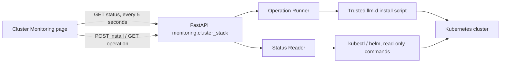
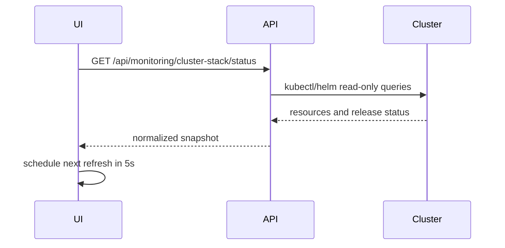
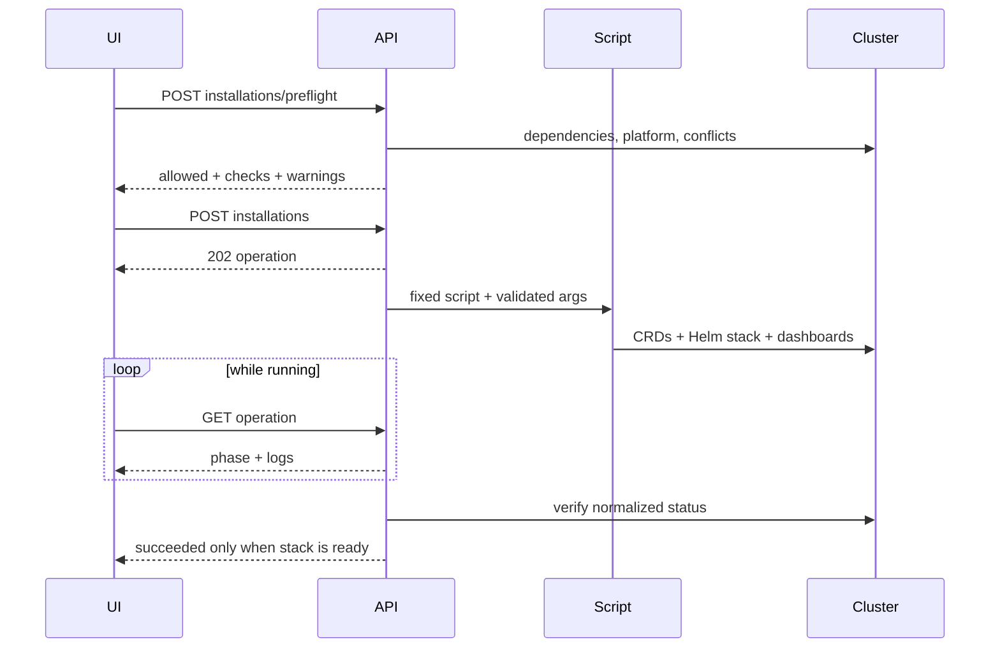
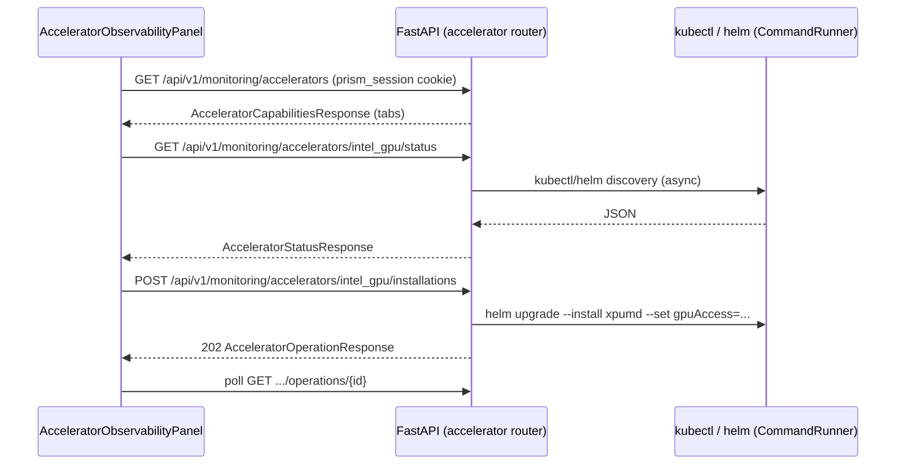

# Observability Design

The monitoring domain owns cluster-stack and accelerator observability as separate services within one module design. Hardware-specific contributions follow the [hardware profile registry](hardware-plugin-architecture.md); service boundaries remain separate even though their design is consolidated.

This is the single canonical design for this module. Section numbers retain their
original part-local context; use the links below for unambiguous navigation.

| Part | Scope and status |
| --- | --- |
| [Cluster monitoring stack](#cluster-monitoring-stack-service-design) | Shared Prometheus/Grafana infrastructure, discovery and operations. |
| [Accelerator observability](#accelerator-observability-services) | Exporter/provider lifecycle, UI and confirmed Gate A decisions. |

<!-- design-part: cluster-stack -->

## Cluster Monitoring Stack Service Design

### 1. Background and Goals

`llm-d-monitoring-enable.md` describes the complete llm-d monitoring enablement flow. This design first implements the **cluster monitoring stack service** within it: maintaining the Prometheus, Grafana, and related Kubernetes resources created by the llm-d upstream script
`guides/recipes/observability/install-prometheus-grafana.sh`.

The **cluster stack** here refers specifically to cluster-level Prometheus/Grafana infrastructure, and does not represent monitoring for a particular llm-d guide instance. A separate
**deployment monitoring service** will be added later to manage instances deployed through llm-d guides within a namespace, along with their ServiceMonitor, PodMonitor, scrape targets, and business metrics.

MVP goals:

1. Lens can identify whether the monitoring stack exists in the current Kubernetes cluster.
2. The page refreshes component status every 5 seconds and displays aggregated results such as `ready`, `degraded`, and `absent`.
3. When the stack does not exist, users can deploy it from Lens by calling the upstream script.
4. Deployment runs as an asynchronous task, and the frontend can continuously view phases, logs, and final results.
5. The backend provides explicit Pydantic DTOs, stable error codes, and testable Kubernetes command boundaries.

The MVP does not include:

- Creating ServiceMonitor, PodMonitor, and router Helm values in llm-d workload namespaces.
- Prometheus metric queries, Grafana dashboard embedding, or tracing management.
- Automatic uninstall, automatic repair of a degraded stack, or automatic upgrade of an existing Helm release.
- Allowing users to submit arbitrary script paths, command arguments, or kubeconfig file paths.

### 2. Upstream Script Constraints

The design follows the current behavior of the script on the llm-d `main` branch:

- The default namespace is `llm-d-monitoring`.
- The Helm release is fixed as `llmd`.
- The installed chart is `prometheus-community/kube-prometheus-stack`.
- Central mode is used by default, and Prometheus discovers ServiceMonitor, PodMonitor, and PrometheusRule across namespaces.
- Individual mode, TLS, specifying a namespace, specifying a kubeconfig, and CRD-only installation are supported.
- llm-d dashboards are loaded during installation.
- If the cluster already has a Prometheus Operator or node-exporter, the script may reuse or disable the corresponding component, so “no operator/node-exporter in this namespace” cannot be treated directly as a fault.
- When the script detects that the `llmd` release already exists, it returns immediately and does not repair or upgrade it.
- On OpenShift, built-in user workload monitoring is used and the script does not install that stack; the MVP reports it as `unsupported` and does not show an install button.

The upstream script will not be copied into Lens. At runtime, an environment variable points to a trusted, version-controlled llm-d checkout:

```text
LLM_D_REPO_ROOT=/path/to/llm-d
```

The backend only allows execution of the fixed relative path
`${LLM_D_REPO_ROOT}/guides/recipes/observability/install-prometheus-grafana.sh`,
and validates at startup or during preflight that the file exists, is within the repo root, and is executable. Lens does not download remote scripts during requests.

### 3. Overall Architecture



Backend modules:

```text
llm_d_lens/monitoring/
  __init__.py
  kubernetes.py                 # secure kubectl/helm execution boundary shared by both services
  cluster_stack/
    __init__.py
    errors.py                   # cluster stack domain errors
    models.py                   # ClusterStack* API DTO
    discovery.py                # Prometheus/Grafana stack resource discovery
    operations.py               # stack installation tasks, logs, concurrency control
    service.py
    router.py
    test_*.py
  guide_deployments/            # implemented later; not to be confused with the Kubernetes Deployment type
    __init__.py
    errors.py
    models.py                   # DeploymentMonitoring* API DTO
    discovery.py                # guide instance, monitor CR, and scrape target discovery
    operations.py               # enabling/repairing monitoring for a deployment
    service.py
    router.py
    test_*.py
```

`llm_d_lens/api/main.py` registers `cluster_stack.router` and, in the future,
`guide_deployments.router` separately. The two share only common Kubernetes execution facilities and do not share state machines, DTOs, or domain services, preventing the Helm release state of the cluster stack from contaminating the monitoring enablement state of guide deployments.

The API namespace is fixed by layer:

```text
/api/monitoring/cluster-stack/...   # Prometheus/Grafana base stack
/api/monitoring/deployments/...     # future: llm-d guide instances in a single namespace
```

The browser calls the FastAPI monitoring routes directly; Vite proxies `/api/*`
to that same service in development. Authentication is unified under the Lens login session: see
[`auth-rbac-design.md`](auth-rbac-design.md) (session cookie + roles/scopes; `monitoring:*` permission codes). Local development can allow access with `PRISM_AUTH_MODE=disabled` / `PRISM_ALLOW_UNAUTHENTICATED=true`. The earlier `X-Prism-Github-Token` header and `SIMULATION_ALLOW_UNAUTHENTICATED` have both been deprecated/removed.

#### 3.1 Responsibility Boundaries Between the Two Monitoring Services

| Dimension | Cluster monitoring stack | Deployment monitoring |
|---|---|---|
| Managed object | Prometheus, Grafana, Operator, CRD, dashboard loader | An instance deployed by an llm-d guide within a namespace |
| Identifier | kube context + monitoring namespace | kube context + workload namespace + guide deployment/release |
| Installation source | `install-prometheus-grafana.sh` | the guide's monitoring component, router monitoring values |
| Primary state | whether the stack is available | whether monitor CR exists, whether scrape targets are up, whether role metrics are available |
| mutation | install cluster stack | enable/repair monitoring for a deployment |
| API/DTO prefix | `ClusterStack*` | `DeploymentMonitoring*` |

deployment monitoring may depend on cluster stack `ready`, but it may only read that state through a public service interface and must not directly call
`cluster_stack.discovery` or modify stack operations. Even if external Prometheus is supported in the future, deployment monitoring can replace its dependency implementation without changing the cluster stack module.

### 4. Status Discovery and Aggregation

#### 4.1 Discovery Order

Each status query executes a set of read-only commands with timeouts, by default 10 seconds per command and 20 seconds for the whole query:

1. `kubectl cluster-info`: distinguish unreachable vs. unauthorized.
2. Detect OpenShift `clusterversion`.
3. `helm status llmd -n <namespace> -o json`: confirm the release and Helm status.
4. Read Pod, Deployment, StatefulSet, and Service in the namespace once using `app.kubernetes.io/instance=llmd`.
5. Read the Prometheus CR, required CRDs, and ConfigMaps with `grafana_dashboard=1`.
6. Normalize raw resources into component status, without returning full Kubernetes manifests to the frontend.

The namespace must comply with Kubernetes DNS name rules. The MVP uses the current kube context of the service process and does not accept a kubeconfig path in the request.

#### 4.2 Components

| Component | Primary evidence | Required |
|---|---|---|
| Prometheus | Prometheus CR, StatefulSet/Pod, Service | Required |
| Grafana | Deployment/Pod, Service | Required |
| Prometheus Operator | Deployment/Pod, may be in another namespace | Required but external allowed |
| Alertmanager | StatefulSet/Pod | Optional |
| kube-state-metrics | Deployment/Pod | Optional |
| node-exporter | DaemonSet/Pod | Optional, external reuse allowed |
| llm-d dashboards | ConfigMaps with `grafana_dashboard=1` and names matching repo `grafana/dashboards/*.json` | desired comes from the repo directory; if `LLM_D_REPO_ROOT` is configured, absence causes `degraded` |
| monitoring CRDs | ServiceMonitor, PodMonitor, PrometheusRule CRD | Required |

Component status:

```text
ready | progressing | degraded | missing | external | unknown
```

For workload components, `ready`/`desired` means the **container** ready count / total count
for all Pods of that component (for example alertmanager `2/2`, grafana `3/3`), rather than the workload replica count; when no Pod exists, it falls back to the replica count.

Pod diagnostics must retain `phase`, ready container count, restart count, and up to 3 waiting/termination reasons. Sensitive environment variables, Secrets, the full Pod spec, and logs do not enter the response.

#### 4.3 Aggregated Stack Status

```text
unknown      query not yet completed
absent       Helm release does not exist, and there are no core resources belonging to llmd
installing   there is an active installation task in the current namespace, or core workloads are rolling toward ready
ready        Helm deployed, Prometheus/Grafana/CRD ready, operator ready or external
degraded     release exists, but a required component is missing/degraded, or Helm status is abnormal
unsupported  environments not supported by the current installer, such as OpenShift
unreachable  Kubernetes API unreachable or credentials lack permissions
```

If the release does not exist but residual core resources are detected, the status is `degraded` rather than `absent`, and the installation operation returns a conflict to avoid overwriting resources of unknown origin.

The response contains `observed_at` and `stale`. After a frontend request fails, the last successful snapshot is retained, but it must be shown as stale and must not continue to appear healthy.

### 5. Backend API

Base path: `/api/monitoring/cluster-stack`. Time is uniformly UTC ISO 8601. Unknown fields are rejected by Pydantic.

#### 5.1 Get Status

```http
GET /api/monitoring/cluster-stack/status?namespace=llm-d-monitoring
```

`200 ClusterStackStatusResponse`:

```json
{
  "cluster": {
    "context": "kind-llm-d",
    "reachable": true,
    "platform": "kubernetes"
  },
  "namespace": "llm-d-monitoring",
  "release": {
    "name": "llmd",
    "status": "deployed",
    "chart": "kube-prometheus-stack-72.6.2",
    "revision": 1
  },
  "status": "ready",
  "message": "Monitoring stack is ready",
  "components": [
    {
      "name": "prometheus",
      "status": "ready",
      "kind": "workload",
      "ready": 2,
      "desired": 2,
      "source": "llmd",
      "diagnostics": []
    },
    {
      "name": "prometheus_operator",
      "status": "external",
      "kind": "workload",
      "ready": 1,
      "desired": 1,
      "source": "cluster",
      "diagnostics": []
    }
  ],
  "active_operation_id": null,
  "observed_at": "2026-08-13T08:10:00Z",
  "stale": false
}
```

#### 5.2 Pre-installation Check

```http
POST /api/monitoring/cluster-stack/installations/preflight
Content-Type: application/json
```

```json
{
  "namespace": "llm-d-monitoring",
  "mode": "central",
  "enable_tls": false
}
```

`200 ClusterStackPreflightResponse` returns:

- `allowed`
- current stack status
- `checks`: kubectl, helm, cluster reachability, script, namespace/release conflicts, platform
- `warnings`: for example, an external operator/node-exporter was detected
- `command_preview`: the redacted fixed script and arguments, for confirmation only

The frontend must successfully complete preflight before enabling Install. The backend runs preflight again before the real installation and cannot trust stale results.

#### 5.3 Create Installation Task

```http
POST /api/monitoring/cluster-stack/installations
Content-Type: application/json
Idempotency-Key: <uuid>
```

The request body is the same as preflight. Success returns `202 ClusterStackOperationResponse`.

Installation parameter mapping:

| DTO | Script argument |
|---|---|
| `namespace` | `--namespace <namespace>` |
| `mode=individual` | `--individual` |
| `enable_tls=true` | `--enable-tls` |

The MVP page defaults to and recommends `central`. individual mode requires an additional note: the workload namespace still needs the `monitoring-ns` label configured, and that action is outside the scope of this task.

#### 5.4 Query Task

```http
GET /api/monitoring/cluster-stack/operations/{operation_id}
```

Returns the task phase and recent logs:

```json
{
  "operation_id": "01k2...",
  "kind": "install",
  "status": "running",
  "phase": "waiting_for_components",
  "namespace": "llm-d-monitoring",
  "started_at": "2026-08-13T08:10:00Z",
  "finished_at": null,
  "exit_code": null,
  "logs": [
    {
      "sequence": 18,
      "timestamp": "2026-08-13T08:10:08Z",
      "level": "info",
      "message": "Waiting for Prometheus instance"
    }
  ],
  "error": null
}
```

Task status:

```text
queued -> running -> succeeded
                  -> failed
```

Phases:

```text
preflight | invoking_installer | installing_crds | installing_chart |
loading_dashboards | waiting_for_components | verifying | completed
```

Upstream text output cannot reliably serve as the sole basis of the state machine. `phase` may be updated based on recognized logs, but the final `verifying` step must re-run status discovery; only when the stack aggregates to `ready` is the task marked `succeeded`. If the script exits with 0 but the stack is degraded, the task is `failed` with error code `INSTALL_VERIFICATION_FAILED`.

#### 5.5 DTO Draft

Use the following core models in `models.py`:

```python
MonitoringStackStatus = Literal[
    "unknown",
    "absent",
    "installing",
    "ready",
    "degraded",
    "unsupported",
    "unreachable",
]
ComponentStatus = Literal[
    "ready",
    "progressing",
    "degraded",
    "missing",
    "external",
    "unknown",
]
OperationStatus = Literal["queued", "running", "succeeded", "failed"]
MonitoringMode = Literal["central", "individual"]


class ClusterStackInstallRequest(BaseModel):
    model_config = ConfigDict(extra="forbid")
    namespace: str = "llm-d-monitoring"
    mode: MonitoringMode = "central"
    enable_tls: bool = False


class ComponentDiagnostic(BaseModel):
    severity: Literal["info", "warning", "error"]
    code: str
    message: str
    resource: str | None = None


class ClusterStackComponent(BaseModel):
    name: str
    status: ComponentStatus
    kind: Literal["workload", "configmap", "crd"] = "workload"
    ready: int | None = None
    desired: int | None = None
    source: Literal["llmd", "cluster", "none"]
    diagnostics: list[ComponentDiagnostic] = Field(default_factory=list)
```

In the actual implementation, `ClusterSummary`, `HelmReleaseSummary`, `ClusterStackStatusResponse`,
`PreflightCheck`, `ClusterStackPreflightResponse`, `OperationLogEntry`, and
`ClusterStackOperationResponse` should also be defined, with `default_factory` used for all lists. Do not use broad names such as
`MonitoringStatus` or `MonitoringService`, to avoid future confusion with `DeploymentMonitoringStatus`.

#### 5.6 HTTP and Domain Errors

| HTTP | code | Scenario |
|---:|---|---|
| 400 | `PREFLIGHT_FAILED` | dependencies or configuration not satisfied |
| 401/403 | `UNAUTHORIZED` / `FORBIDDEN` | insufficient operator permissions |
| 404 | `OPERATION_NOT_FOUND` | task does not exist |
| 409 | `ALREADY_INSTALLED` | stack is already ready |
| 409 | `INSTALLATION_IN_PROGRESS` | a task already exists for the same cluster/namespace |
| 409 | `RESIDUAL_RESOURCES_FOUND` | release missing but core residual resources exist |
| 422 | FastAPI validation | namespace or DTO invalid |
| 502 | `CLUSTER_QUERY_FAILED` | kubectl/helm returned an unparsable error |
| 503 | `CLUSTER_UNREACHABLE` | cluster unreachable |
| 504 | `COMMAND_TIMEOUT` | command or installation timed out |

Domain errors return a uniform response:

```json
{
  "detail": {
    "code": "ALREADY_INSTALLED",
    "message": "Monitoring stack is already installed",
    "retryable": false
  }
}
```

### 6. Installation Task Implementation

#### 6.1 Concurrency and Idempotency

- Use an in-process async lock keyed by `(kube context, namespace)`.
- Only one mutation operation is allowed for the same key.
- `Idempotency-Key` maps to the same operation for 24 hours, preventing duplicate installation from browser retries.
- Check status once before installation begins and again after acquiring the lock.
- Do not use `shell=True`; pass arguments as an array to `asyncio.create_subprocess_exec`.
- The default overall installation timeout is 15 minutes and can be adjusted through a server-side environment variable; the request cannot override it.

#### 6.2 Task Storage

Task metadata and limited logs are written to:

```text
MONITORING_OPERATION_ROOT/
  <operation-id>.json
  <operation-id>.log
```

The JSON uses a temporary file plus atomic rename. Each task retains at most 2,000 lines or 2 MiB of redacted logs, with a default retention of 7 days. After a service restart, leftover `queued/running` tasks are marked as `failed`,
with code `SERVICE_RESTARTED`; cluster status is then rediscovered so the UI can see whether the actual stack is already ready. The MVP does not blindly resume the installer script.

#### 6.3 Security and Logging

- repo root, operation root, and command timeout can only be set by server-side environment variables.
- namespace is strictly validated; mode and boolean options are mapped from enums, and passing through extra parameters is forbidden.
- Do not pass user-controlled environment variables to the script; use only the minimal environment constructed by the backend.
- Remove ANSI control sequences from logs.
- Secret contents, tokens, kubeconfig contents, and the Grafana admin password are not returned to the frontend.
- Do not provide an arbitrary `kubectl` API.
- mutation endpoints must require authentication, be rate-limited, and record actor, cluster context, namespace, operation ID, and result; the token itself must not be logged.
- The Express monitoring proxy applies its own per-client-IP limit of 1,000 requests per minute before signing or forwarding requests, including when the router is mounted without the main server's global API limiter. Excess requests return HTTP 429 with standard rate-limit and retry headers without reaching the upstream; the main server's aggregate API limit remains in force.

### 7. Frontend Design

#### 7.1 Navigation and Files

Add under **Utility suite** in `LeftNavigation.jsx`:

```text
Monitoring infrastructure
```

The view ID is `cluster-monitoring-stack`, using the `Activity` or `Gauge` icon. Register
`ClusterMonitoringStackDashboard` in `App.jsx`. Future deployment monitoring uses a separate view
`deployment-monitoring` and will not reuse the current page state.

```text
src/components/ClusterMonitoringStack/
  ClusterMonitoringStackDashboard.jsx
  ClusterStackSummary.jsx
  ClusterStackComponentTable.jsx
  InstallClusterStackModal.jsx
  ClusterStackOperationProgress.jsx
  clusterMonitoringStackBackend.js
  useClusterMonitoringStackStatus.js

src/components/DeploymentMonitoring/       # future
  DeploymentMonitoringDashboard.jsx
  deploymentMonitoringBackend.js
```

The page reuses existing `PageHeader`, `Panel`, `StatCard`, `Badge`, `StatusChip`, `Button`,
`Modal`, `Input`, `Select`, `Checkbox`, `LoadingState`, and `EmptyState`.

#### 7.2 Page Layout

1. **Page header**
   - Title: Cluster Monitoring
   - Current kube context, namespace.
   - Last refresh time, auto-refresh status, and manual Refresh.

2. **Summary cards**
   - Stack status.
   - Ready components.
   - Helm release/revision.
   - Active operation.

3. **Component status table**
   - Component, Status, Ready/Desired, Source, Diagnostics.
   - degraded/missing rows can be expanded to view structured diagnostics.
   - Status always uses both text and icon, not color alone.

4. **Installation empty state**
   - Show Install monitoring stack only when status is `absent`.
   - The modal configures namespace, central/individual, and TLS.
   - Show preflight checks and warnings, then create the task after confirmation.

5. **Task progress**
   - Show phase, duration, and recent logs.
   - Refresh status immediately after success.
   - On failure, retain logs and stable error codes, and provide Retry preflight rather than directly resubmitting.

6. **degraded state**
   - Show diagnostics and manual refresh.
   - The MVP does not show a “reinstall” button because the upstream script does not repair an existing release.

#### 7.3 Near-real-time Refresh

The MVP uses authentication-friendly polling rather than EventSource:

- When the page is visible and there is no installation task: request status every 5 seconds.
- While an installation task is running: request operation every 2 seconds and status every 5 seconds.
- Pause when the page is hidden; refresh immediately when it becomes visible again.
- At most one status request at a time; a new refresh aborts the old request.
- Use backoff of 5, 10, 20, and 30 seconds after consecutive failures.
- Retain the last successful data and mark it `stale`, displaying the connection error.

This avoids placing a GitHub token in the URL and avoids adding SSE reconnection protocol complexity in the first phase. If the number of clusters or clients grows in the future, it can later be upgraded to SSE/WebSocket.

#### 7.4 Frontend API Adapter

`clusterMonitoringStackBackend.js` exposes only:

```js
getClusterStackStatus(namespace, { signal })
preflightClusterStackInstall(request, { signal })
installClusterStack(request, idempotencyKey)
getClusterStackOperation(operationId, { signal })
```

It uniformly parses FastAPI `detail`, preserving `code`, `message`, and `retryable` for the UI; non-2xx responses must not be converted into an empty state.

### 8. Key Flows

#### 8.1 Status Refresh



#### 8.2 Install When Missing



### 9. Tests and Acceptance

#### 9.1 Backend Unit Tests

- conversion from kubectl/helm JSON to component DTOs.
- aggregation for ready, absent, residual, degraded, and external operator.
- namespace validation and fixed parameter mapping.
- preflight for OpenShift, missing script, missing helm/kubectl, cluster unreachable.
- concurrent installation and idempotency key for the same namespace.
- script timeout, non-zero exit, exit 0 but verification failure.
- log ANSI cleanup, size limits, and sensitive information filtering.

Command execution is tested through injected runners and does not require the test environment to connect to a real cluster.

#### 9.2 API Tests

- successful DTOs and HTTP error mappings for status, preflight, install, and operation.
- unknown fields return 422.
- nonexistent operation returns 404.
- when there is an active operation, status is installing and returns the operation ID.

#### 9.3 Frontend Tests

- absent shows the install entry; ready/degraded do not.
- installation cannot be confirmed when preflight does not pass.
- polling, visibility pause, abort, and backoff.
- refresh status after operation success.
- stale snapshot, error codes, and component diagnostics are visible.
- status text, keyboard interaction, modal focus, and narrow-screen layout.

#### 9.4 MVP Acceptance Scenarios

1. Open the page on an empty cluster, and `absent` appears within 5 seconds.
2. Click Install, preflight succeeds, and after confirmation a `202` is returned; the page continuously shows phases and logs.
3. After installation completes, the page becomes `ready` without refreshing the browser.
4. After deleting or breaking the Grafana Pod, the page shows `installing` or `degraded` within 10 seconds; after recovery it returns to `ready`.
5. When the cluster is unreachable, display `unreachable`, installation is disallowed, and the old healthy snapshot is marked stale.
6. When the cluster already has an external operator/node-exporter, the core stack is not falsely reported as faulty.
7. If two browsers install into the same namespace at the same time, at most one task runs the script.

### 10. Later Phases

- Manage PodMonitor, ServiceMonitor, and router monitoring values for workload namespaces.
- Query Prometheus `/api/v1/targets` and display llm-d scrape target health.
- Controlled access entry points for Grafana/Prometheus.
- Explicit repair/upgrade flows for a degraded stack.
- Multi-cluster registry and server-managed kubeconfig.
- SSE push, alert history, and audit pages.

<!-- /design-part: cluster-stack -->

<!-- design-part: accelerator -->

## Accelerator observability services

- **Status:** Draft — Gate A review decision confirmed (see §10), pending implementation.
- **Change directory:** `observability-design.md`
- **Reference architecture:** `llm_d_lens/monitoring/cluster_stack/` (backend),
  `src/components/ClusterMonitoringStack/` (frontend).
- **Upstream documentation:**
  - XPUM Daemon Helm chart: https://github.com/intel/xpumanager/blob/main/xpumd/charts/xpumd/README.md
  - XPUM monitoring guide: https://github.com/intel/xpumanager/blob/main/xpumd/docs/MONITORING.md

---

### 1. Background and goals

The current cluster monitoring stack manages only one thing: the Prometheus/Grafana
"Cluster infrastructure" stack (see the "Observability services" section in
`ClusterMonitoringStackDashboard.jsx`). That panel contains a reserved, disabled
"Deployment monitoring" card, and there is no concept at all of
**accelerator-level** observability.

This change introduces accelerator observability as a **peer capability** of the
existing cluster monitoring stack, under the same monitoring domain, and reuses the
same `/api/v1/monitoring/*` proxy path. The first concrete backend is
**Intel GPU**, monitored through the Intel XPUM Daemon (`xpumd`) Helm chart.

User-facing requirements:

- Add an **"Accelerator Observability services"** panel **below** the "Live
  infrastructure state" section of the monitoring dashboard.
- Use **Tabs** to distinguish different hardware; for now, keep only one tab:
  **Intel GPU**.
- Under Intel GPU, support **two access modes**: `dra` (K8s DRA GPU driver) and
  `plugin` (K8s GPU device plugin). Of the chart's supported `gpuAccess` values,
  these are the only two we need to implement; `i915` / `xe` / `none` are out of
  scope.
- The API and backend architecture must align with the existing monitoring
  architecture (router → service → discovery/operations, Pydantic DTOs, domain
  errors, `CommandRunner` asynchronous execution).

#### Non-goals

- v1 does not implement other accelerator providers such as NVIDIA/AMD (the
  registry is the extension point).
- No per-deployment llm-d instance monitoring (this still belongs to the reserved
  "Deployment monitoring" tab / Planned placeholder).
- Do not accept kubeconfig from the browser; discovery logic, like `cluster_stack`,
  runs entirely on the server side based on the current kube context.

---

### 2. Accelerator abstraction (extension point)

To make the panel truly support multiple hardware types, the backend uses an
`AcceleratorType` literal to establish a small **provider registry**. Each provider
implements the same interface as the `cluster_stack` service, so adding new
hardware only requires registering a provider rather than duplicating routes.

```
AcceleratorType = Literal["intel_gpu"]            # v1; future: "nvidia_gpu", "amd_gpu", ...
GpuAccess       = Literal["dra", "plugin"]        # v1; the chart also allows "i915"/"xe"/"none"
```

One provider exposes four asynchronous capabilities:

| Capability | Conceptual signature | Intel GPU implementation |
|---|---|---|
| `discover_status(namespace, runner)` | `AcceleratorStatusResponse` | Query the xpumd DaemonSet + Pods + optional ServiceMonitor/Grafana dashboard |
| `preflight(request)` | `AcceleratorPreflightResponse` | Check kubectl/helm, DRA admin-access label, chart availability, and stack status |
| `install(request, idempotency_key)` | `AcceleratorOperationResponse` | Execute tracked asynchronous `helm upgrade --install xpumd … --set gpuAccess=<dra\|plugin>` (idempotent: install when missing, reconcile when `degraded`) |
| `get_operation(operation_id)` | `AcceleratorOperationResponse` | Read the persisted operation status |

The discovery/install logic of the `intel_gpu` provider is the focus of this
proposal. The registry is intentionally lightweight: a dictionary
`{ "intel_gpu": IntelGpuProvider() }`, plus a capabilities interface for the
frontend to render tabs.

---

### 3. Backend architecture

Add package `llm_d_lens/monitoring/accelerator/`, corresponding one-to-one with
`llm_d_lens/monitoring/cluster_stack/`:

```
llm_d_lens/monitoring/accelerator/
├── __init__.py        # exports router
├── errors.py          # AcceleratorError (same shape as ClusterStackError)
├── models.py          # Pydantic DTOs (StrictModel, extra="forbid")
├── registry.py        # provider registry + AcceleratorProvider protocol
├── intel_gpu.py       # Intel GPU (xpumd) provider: discovery + preflight + install argv
├── operations.py      # AcceleratorOperationManager (persistent async helm upgrade --install)
├── router.py          # FastAPI routes, prefix /api/v1/monitoring/accelerators
└── service.py         # orchestration: resolve provider, validate, dispatch
```

#### 3.1 Reuse instead of duplication

- Reuse `llm_d_lens/monitoring/kubernetes.CommandRunner` directly to execute all
  `kubectl` / `helm` subprocess calls.
- `operations.py` generalizes `ClusterStackOperationManager`—the same
  `OperationStore` (JSON files under `LENS_DATA_DIR/metadata/monitoring/operations`),
  the same idempotency-key semantics, the same log redaction and `_MAX_LOG_LINES` /
  byte limits. If needed, it can inherit or reuse the cluster_stack manager and
  replace the verifier; the external interface remains consistent.
- The error model stays consistent: `AcceleratorError(code, message, retryable, status_code)`,
  providing `.detail() -> {"code", "message", "retryable"}`.

#### 3.2 Route registration

Add in `llm_d_lens/api/main.py`:

```python
from llm_d_lens.monitoring.accelerator import router as accelerator_router

...
app.include_router(accelerator_router)
```

The existing `server/monitoring.ts` proxy already forwards the entire
`/api/v1/monitoring/*` namespace to the upstream Python API, so **no proxy changes
are required**. The new routes automatically inherit the existing
`requireMonitoringOperator` authorization (GitHub token → `user`/`admin`
permission).

---

### 4. Data models (Pydantic DTOs)

All models use `StrictModel` (`extra="forbid"`) consistently with
`cluster_stack.models`.

```python
AcceleratorType = Literal["intel_gpu"]
GpuAccess = Literal["dra", "plugin"]
AcceleratorStatus = Literal[
    "unknown", "absent", "installing", "ready", "degraded", "unsupported", "unreachable"
]
ComponentStatus = Literal[
    "ready", "progressing", "degraded", "missing", "external", "unknown"
]
OperationStatus = Literal["queued", "running", "succeeded", "failed"]
```

#### 4.1 `AcceleratorCapability` (tab metadata)

```python
class AcceleratorCapability(StrictModel):
    type: AcceleratorType  # "intel_gpu"
    display_name: str  # "Intel GPU"
    access_modes: list[GpuAccess]  # ["dra", "plugin"]
    release_name: str  # "xpumd"
    default_namespace: str  # "intel-xpumd"


class AcceleratorCapabilitiesResponse(StrictModel):
    accelerators: list[AcceleratorCapability]
```

This is the data source for the frontend to render tabs and discover which access
modes are available. The order of `accelerators` is the tab order.

#### 4.2 `AcceleratorInstallRequest`

```python
class AcceleratorInstallRequest(StrictModel):
    accelerator: AcceleratorType  # "intel_gpu"
    access_mode: GpuAccess = "dra"
    namespace: str = "intel-xpumd"

    @field_validator("namespace")
    def validate_namespace(cls, v: str) -> str:
        return validate_namespace(v)  # reuse K8s DNS label validation
```

Prometheus / Grafana are **always enabled** (Decision 4): xpumd does not deploy an
independent monitoring stack; instead it reuses the existing Cluster infrastructure
Prometheus and Grafana—`prometheus.release` uses the cluster stack release (`llmd`),
and `grafana.namespace` uses the cluster stack namespace (`llm-d-monitoring`); see
the install command in §6.2. Therefore the request body no longer exposes
`enable_prometheus` / `enable_grafana` switches.

#### 4.3 `AcceleratorStatusResponse`

```python
class AcceleratorComponent(StrictModel):
    name: str  # "xpumd", "prometheus_service_monitor", "grafana_dashboard", "gpu_nodes"
    status: ComponentStatus
    kind: Literal["workload", "configmap", "crd", "node"] = "workload"
    ready: int | None = None
    desired: int | None = None
    diagnostics: list[ComponentDiagnostic] = Field(default_factory=list)


class AccessModeAvailability(StrictModel):
    mode: GpuAccess  # "dra" | "plugin"
    available: bool  # whether the environment has the corresponding K8s resources
    detected: bool  # whether actually detected, as distinct from unknown/not checked
    message: str | None = None  # reason when unavailable


class AcceleratorStatusResponse(StrictModel):
    accelerator: AcceleratorType
    access_mode: GpuAccess | None = (
        None  # current or most recently installed mode; None when absent/unknown
    )
    access_modes: list[AccessModeAvailability] = Field(default_factory=list)
    cluster_reachable: bool
    context: str | None = None
    namespace: str
    release: HelmReleaseSummary  # reuses cluster_stack.models.HelmReleaseSummary
    status: AcceleratorStatus
    message: str
    components: list[AcceleratorComponent] = Field(default_factory=list)
    active_operation_id: str | None = None
    observed_at: datetime
    stale: bool = False
```

Intel GPU component semantics (see §6.1):

| Component | Status derivation |
|---|---|
| `xpumd` | DaemonSet `desiredNumberScheduled` vs `numberReady` |
| `prometheus_service_monitor` | ServiceMonitor generated by xpumd and scraped by the existing Cluster infra Prometheus; `missing` means not yet generated |
| `grafana_dashboard` | Grafana dashboard ConfigMap generated by xpumd and loaded by the existing Cluster infra Grafana; `missing` means not yet generated |
| `gpu_nodes` | Nodes labeled `intel.feature.node.kubernetes.io/gpu=true`; `ready` when ≥1 |

#### 4.4 Preflight / operation models

`AcceleratorPreflightCheck`, `AcceleratorPreflightResponse`, `OperationLogEntry`,
`OperationError`, and `AcceleratorOperationResponse` are structured copies of the
corresponding cluster_stack models (`PreflightCheck`,
`ClusterStackPreflightResponse`, `OperationLogEntry`, `OperationError`,
`ClusterStackOperationResponse`), where `kind: Literal["install"]`, and the
operation response also adds `access_mode`.

#### 4.5 Observability link models

- `ObservabilityLink` —
  `{ kind: Literal["prometheus" | "grafana"], label, available, service, namespace, port, local_port, message }`,
  representing a navigable observability entry. `port` is the remote service port
  (9090/80), and `local_port` is the locally forwarded listening port (see §6.3).
- `AcceleratorLinksResponse` — `{ accelerator, links: list[ObservabilityLink] }`.

---

### 5. API design

Prefix: `/api/v1/monitoring/accelerators`. Authorization is inherited from
`server/monitoring.ts` (`requireMonitoringOperator`). All routes return the DTOs
above and convert `AcceleratorError` into `HTTPException` through shared
`_http_error`.

| Method | Path | Request | Response | Purpose |
|---|---|---|---|---|
| GET | `/api/v1/monitoring/accelerators` | — | `AcceleratorCapabilitiesResponse` | List supported accelerators (tabs) |
| GET | `/api/v1/monitoring/accelerators/{accelerator}/status?namespace=&access_mode=` | query | `AcceleratorStatusResponse` | Current xpumd deployment / health status |
| POST | `/api/v1/monitoring/accelerators/{accelerator}/installations/preflight` | `AcceleratorInstallRequest` | `AcceleratorPreflightResponse` | Preflight + command preview |
| POST | `/api/v1/monitoring/accelerators/{accelerator}/installations` | `AcceleratorInstallRequest` + `Idempotency-Key` header | `AcceleratorOperationResponse` (202) | Start tracked `helm upgrade --install` (install or repair) |
| GET | `/api/v1/monitoring/accelerators/{accelerator}/operations/{operation_id}` | — | `AcceleratorOperationResponse` | Poll install progress |
| GET | `/api/v1/monitoring/accelerators/{accelerator}/links` | — | `AcceleratorLinksResponse` | Return navigable Prometheus / Grafana links (port-forward tunnel) |

`{accelerator}` must be a registered `AcceleratorType`; otherwise return
`404 { "code": "ACCELERATOR_NOT_SUPPORTED", ... }`.

#### 5.1 Status semantics (Intel GPU)

- `unreachable` — `kubectl cluster-info` failed (same as cluster_stack).
- `absent` — no `xpumd` Helm release and no xpumd DaemonSet.
- `installing` — there is an active install operation for `(context, namespace)`.
- `ready` — release is `deployed`, the `xpumd` component is `ready`, and enabled
  Prometheus/Grafana components are `ready` (if not enabled, they are treated as
  satisfied).
- `degraded` — xpumd exists but is not fully ready, or an enabled optional
  component is missing/degraded.
- `unsupported` — reserved for platforms that cannot run xpumd; in v1 it is not
  used except for unreachable clusters.

#### 5.2 Preflight checks (Intel GPU)

1. `kubectl` is available.
2. `helm` is available (and try to detect whether `oci://ghcr.io/intel` is
   reachable).
3. The `cluster` is reachable.
4. `access_mode_pods` — validate that the K8s resources for the selected
   `access_mode` already exist (Decision 2):
   - `dra`: detect DaemonSet `intel-gpu-resource-driver-kubelet-plugin`
     (namespace `intel-gpu-resource-driver`) ready; otherwise `failed`, prompting
     the user to deploy the DRA driver first.
   - `plugin`: detect DaemonSet `intel-gpu-plugin` (label `app=intel-gpu-plugin`)
     ready, and that its pod spec container args include `-enable-monitoring`;
     otherwise `failed`, prompting the user to deploy the GPU device plugin first
     and add that flag. The Intel GPU plugin only registers the
     `gpu.intel.com/monitoring` extended resource when started with
     `-enable-monitoring`; if missing, xpumd will remain `Pending`
     (`Insufficient gpu.intel.com/monitoring`).
5. `access_label` — when `access_mode == "dra"`, require the namespace label
   `resource.kubernetes.io/admin-access=true` (the chart README requires this
   label for DRA monitoring).
6. `gpu_nodes` — at least one node has the label
   `intel.feature.node.kubernetes.io/gpu=true` (or NFD is enabled). If missing,
   warn only; otherwise xpumd will remain `Pending`.
7. `monitoring_stack` — reuse `cluster_stack.get_status()` to verify the Cluster
   infrastructure is `ready` (Decision 4). If not ready, return `failed`: xpumd's
   ServiceMonitor / dashboard must be scraped by the existing Prometheus / Grafana
   and do not deploy an independent monitoring stack.
8. `stack_state` — allow install/repair when `absent` or `degraded`; when `ready`,
   return `ALREADY_INSTALLED` (409). Installation always uses
   `helm upgrade --install`, so `degraded` (for example missing ServiceMonitor /
   dashboard) can be reconciled.

`command_preview` is the `helm upgrade --install` argv that will be executed (see
§6.2), for review.

---

### 6. Intel GPU provider details (`xpumd`)

#### 6.1 Discovery

Discovery runs the following commands through `CommandRunner` and aggregates them
into `AcceleratorStatusResponse` (all supported calls use `-o json`):

```text
kubectl config current-context
kubectl cluster-info
helm status xpumd -n <namespace> -o json
helm list -n <namespace> --filter ^xpumd$ -o json
kubectl get daemonsets,services -n <namespace> -l app.kubernetes.io/name=xpumd -o json
kubectl get servicemonitors -n <namespace> -o json                 # when prometheus is enabled
kubectl get configmaps -n <namespace> -l grafana_dashboard=1 -o json  # when grafana is enabled
kubectl get nodes -l intel.feature.node.kubernetes.io/gpu=true -o json
kubectl get daemonsets --all-namespaces -l app=intel-gpu-plugin -o json
kubectl get daemonsets --all-namespaces -l app.kubernetes.io/name=intel-gpu-resource-driver -o json
```

Automatic access mode detection (Decision 2)—generate
`access_modes: list[AccessModeAvailability]` based on the actual environment, and
the frontend uses this to enable/disable/warn:

| Mode | Availability condition | Detection method |
|---|---|---|
| `dra` | DaemonSet `intel-gpu-resource-driver-kubelet-plugin` (ns `intel-gpu-resource-driver`) ready | `kubectl get daemonsets --all-namespaces` matching name/label |
| `plugin` | DaemonSet `intel-gpu-plugin` (label `app=intel-gpu-plugin`) ready, and container args include `-enable-monitoring` | same as above |

`access_mode` (currently effective / most recently installed mode) is inferred,
when detectable, from the xpumd DaemonSet pod spec / chart values (the chart injects
a DRA claim or device-plugin resource); otherwise it remains `None`.

The `prometheus_service_monitor` and `grafana_dashboard` components are generated
by xpumd, but consumed by the existing Cluster infrastructure Prometheus / Grafana
(Decision 4); discovery locates them using the cluster stack namespace/release,
rather than creating new ones.

#### 6.2 Install command

The chart version is fixed to `2.1.0` (Decision 3). Prometheus / Grafana are always
enabled and reference the existing Cluster infrastructure release / namespace
(Decision 4); no independent monitoring stack is deployed:

```text
helm upgrade --install xpumd oci://ghcr.io/intel/xpumanager/charts/xpumd \
  --version 2.1.0 \
  --set gpuAccess=<dra|plugin> \
  --set-string 'nodeSelector.intel\.feature\.node\.kubernetes\.io/gpu=true' \
  --set prometheus.monitor=true \
  --set prometheus.release=<cluster-stack release: llmd> \
  --set grafana.dashboards=true \
  --set grafana.namespace=<cluster-stack namespace: llm-d-monitoring> \
  --set config.service.pipelines.metrics.exporters={intel_xpu_info,prometheus} \
  --namespace <namespace>
```

`config.service.pipelines.metrics.exporters={intel_xpu_info,prometheus}` is
**required**: by default, the chart's metrics pipeline exports only to
`intel_xpu_info` (a local gRPC socket used by the `xpumd` CLI). Although the
Prometheus exporter (`0.0.0.0:8080`) is already defined, it is not wired into the
pipeline, so the port does not listen and ServiceMonitor scraping fails
(`connection refused`, target `down`). Once connected, port 8080 exposes
`/metrics`, and Prometheus can scrape `hw_*` metrics.

Use `helm upgrade --install` (instead of `helm install`) to guarantee idempotency:
install when the release does not exist, reconcile by upgrade when it exists but is
`degraded` (for example missing ServiceMonitor / Grafana dashboard), and block when
`ready` via the preflight `stack_state` check (409 `ALREADY_INSTALLED`).

Here, `<cluster-stack release>` / `<cluster-stack namespace>` are obtained from
`cluster_stack.get_status()` detection (default `llmd` / `llm-d-monitoring`),
consistent with the deployment performed by `install-prometheus-grafana.sh`; both
can be overridden by configuration, but default to following the cluster stack.

When `access_mode == "dra"`, the service layer first ensures that the namespace has
the required label (creating the namespace and applying
`resource.kubernetes.io/admin-access=true` if necessary). Installation runs as a
tracked asynchronous operation (subprocess, streamed logs, phase transitions:
`preflight` → `installing_chart` → `waiting_for_pods` → `verifying` →
`completed`), using exactly the same mechanism as `ClusterStackOperationManager._run`.

#### 6.3 Prometheus / Grafana links (port forwarding)

The Cluster infrastructure Prometheus and Grafana services are both ClusterIP and
cannot be accessed directly from the browser; therefore the link buttons in the
"Dashboards" area navigate through a `kubectl port-forward` tunnel established by
the backend, rather than configuring NodePort / Ingress.

- Add a shared backend module `llm_d_lens/monitoring/port_forward.py`, caching
  tunnels keyed by `(namespace, service, remote_port)`, assigning ports from
  `18000–18999`, with 3 retries; all tunnels are cleaned up on application
  shutdown. Tunnels bind to all interfaces with `--address 0.0.0.0`, so they are
  reachable from remote machines too (rather than only `127.0.0.1`). Only the few
  services required by xpumd open temporary tunnels, independent from the existing
  synchronous `port-forward` implementation in `cluster/router.py`.
- `GET /{accelerator}/links` performs service discovery in the cluster stack
  namespace: Prometheus matches `name.endswith("-prometheus")` (correctly hitting
  `llmd-kube-prometheus-stack-prometheus` while avoiding node-exporter), remote
  port `9090`; Grafana matches `name.endswith("-grafana")`, remote port `80`.
  Once matched, call `port_forward.ensure()` to obtain the local listening port and
  fill `local_port`.
- The frontend shows two buttons, Prometheus / Grafana, when `cluster_reachable`
  (positioned above "GPU access mode"). On click, it builds
  `http://<host>:<local_port>` using `window.location.hostname` + `local_port` and
  opens it in a new tab via `window.open()`. Reusing the browser's current host
  ensures that whether the UI is accessed locally or from a remote machine, the
  link points to the externally bound tunnel port on the API host. If tunnel setup
  fails, return `linksError` and prompt the user to retry.

---

### 7. Frontend design

#### 7.1 Placement and hierarchy

The change lands in `ClusterMonitoringStackDashboard.jsx`, transforming the
original three side-by-side cards under "Observability services" into a
**service-level tab bar**, where each tab drives its own detail panel:

1. **Service-level tab bar** (`role="tablist"`, reusing `ToggleGroup`,
   `fullWidth`) sits below the "Observability services" section title, containing
   three tabs:
   - **Cluster infrastructure** — active by default.
   - **Accelerator Observability services** — renders the accelerator panel when
     active.
   - **Deployment monitoring** — reserved / Planned placeholder.
2. **Each tab has an independent detail panel**; only the active tab's panel is
   rendered at a time, and content is no longer mixed together below:
   - `cluster` → existing cluster stack content (`status.error` / `installSuccess` /
     `unhealthyStack` banners + `ClusterStackSummary` + operation progress +
     `ClusterStackComponentTable` + absent / degraded empty state).
   - `accelerator` → `<AcceleratorObservabilityPanel />`.
   - `deployment` → Planned placeholder `EmptyState` (`Boxes` icon).
3. The dashboard adds `activeServiceTab` state (default `cluster`); switching tabs
   switches the conditionally rendered panel below. The service-level tab bar itself
   is always visible.

New component files (peer to existing monitoring components):

```
src/components/ClusterMonitoringStack/
├── acceleratorObservabilityBackend.js   # fetch wrapper (mirrors clusterMonitoringStackBackend.js)
├── useAcceleratorObservability.js       # polling hook (mirrors useClusterMonitoringStackStatus.js)
├── AcceleratorObservabilityPanel.jsx    # hardware tabs + per-tab status cards + install modal wiring
└── InstallAcceleratorModal.jsx          # dra/plugin selector (availability driven by environment detection), preflight preview
```

#### 7.2 Panel structure

```text
<ClusterMonitoringStackDashboard>
└─ <section> Observability services
   ├─ service-level tab bar (role="tablist", ToggleGroup fullWidth)
   │    [ Cluster infrastructure ● ] [ Accelerator Observability services ] [ Deployment monitoring ·Planned ]
   │
   └─ detail panel for the active tab (only one rendered at a time)
        ├─ cluster: existing cluster stack content
        │     status.error / installSuccess / unhealthyStack banners
        │     + ClusterStackSummary + operation progress + ClusterStackComponentTable
        │     + absent / degraded empty state
        │
        ├─ accelerator: <AcceleratorObservabilityPanel />
        │     ┌─────────────────────────────────────────────────────────┐
        │     │ [GPU] Intel GPU                        [Active Badge]   │
        │     │  Collect Intel GPU telemetry through the xpumd DaemonSet │
        │     │                                                         │
        │     │ Access mode (availability auto-detected from the environment) │
        │     │  (●) dra   ✓ DRA driver pods are ready                  │
        │     │  ( ) plugin ⚠ intel-gpu-plugin not detected → disabled+hint │
        │     │                                                         │
        │     │ Components                                              │
        │     │  xpumd                     ● Ready   2/2                │
        │     │  prometheus_service_monitor ● Ready depends on Cluster infra │
        │     │  grafana_dashboard         ● Ready depends on Cluster infra │
        │     │  gpu_nodes                 ● Ready   3                  │
        │     │                                                         │
        │     │ [Install xpumd / Repair xpumd] [Refresh]                │
        │     └─────────────────────────────────────────────────────────┘
        │
        └─ deployment: Planned placeholder EmptyState (`Boxes` icon)
```

- **Service-level tab bar** — below the "Observability services" section title,
  reusing `ToggleGroup` (`fullWidth`, `role="tablist"`) to render the three
  service tabs, bound to the dashboard's `activeServiceTab` state; switching tabs
  only replaces the panel below and does not jump between cards.
- **Hardware tabs (inside the accelerator panel)** — each
  `AcceleratorCapability` from `GET /api/v1/monitoring/accelerators` corresponds to
  one tab. v1 renders only one tab, **Intel GPU** (using the `Gauge` icon). Tabs
  are a simple `role="tablist"` button group; the active tab drives the status
  query.
- **Active tab content** — reuses the status-card grammar of existing cards:
  - Title "Intel GPU" + status `Badge` (`Active` / `Installing` / `Degraded` /
    `Not installed`).
  - Component details (reusing `ClusterStackComponentTable` style): xpumd, service
    monitor, dashboard, GPU nodes.
  - **Access mode selector** — driven by `access_modes` (§4.3): only modes actually
    available in the environment are enabled; unavailable options are grayed out
    with a reason. If both are unavailable, disable the install CTA and prompt the
    user to deploy the DRA driver or GPU plugin first (Decision 2).
  - **Install CTA** — similar to `InstallClusterStackModal`, showing preflight
    preview before submission; Prometheus/Grafana switches are no longer offered
    (always enabled and dependent on the existing Cluster infra, Decision 4).
    When `absent`, the button is "Install xpumd"; when `degraded` (stack
    incomplete), the button is "Repair xpumd" (or "Repair / reinstall" in the
    empty state), using the same preflight + install modal, while the backend uses
    `helm upgrade --install` to reconcile missing resources.
  - Error banner + "Retry", mirroring the existing `status.error` presentation.
- **Polling** — reuse the retry/backoff + visibility-change pattern in
  `useClusterMonitoringStackStatus.js`; `dra` / `plugin` selection is local UI
  state and is only passed as `access_mode` query/body during install.

#### 7.3 Frontend JS

`acceleratorObservabilityBackend.js` mirrors
`clusterMonitoringStackBackend.js` (same `requestJson`, `errorDetails` handling;
authorization is now carried by the login session cookie, and
`X-Prism-Github-Token` has been removed):

```js
const BASE_PATH = '/api/v1/monitoring/accelerators';
getAcceleratorCapabilities({ signal })
getAcceleratorStatus(accelerator, { namespace, accessMode, signal })
preflightAcceleratorInstall(request, { signal })
installAccelerator(request, idempotencyKey)
getAcceleratorOperation(accelerator, operationId, { signal })
```

#### 7.4 Local development ports

- FastAPI / uvicorn (UI, API and MCP): **3000**, configurable with `BACKEND_PORT`
  (`SERVER_PORT` remains a compatibility alias).
- Vite frontend (`apps/frontend/vite.config.js` `server.port` / `--port`): **5173**,
  with `/api` proxy target defaulting to `http://localhost:3000`.
- `scripts/lens-local.sh` propagates the selected backend port to Vite.

---

### 8. Data flow



---

### 9. Success criteria

- `GET /api/v1/monitoring/accelerators` returns `intel_gpu`, with
  `access_modes: ["dra", "plugin"]`.
- The behavior of the status/preflight/install/operation APIs matches the
  corresponding `cluster-stack` APIs (error codes, 202 + idempotency, operation
  recovery).
- The "Accelerator Observability services" panel renders below "Live
  infrastructure state", shows the Intel GPU tab, and fully supports end-to-end
  `dra` and `plugin` installation flows; when `degraded` (stack incomplete), it
  can "Repair / reinstall" to reconcile the missing pieces.
- Authorization is enforced by the Python auth middleware and route registry.
- The new package has corresponding `pytest` tests (mirroring the `cluster_stack`
  `test_*` files), and `npm run lint` and `npm run build` pass.

### 10. Confirmed decisions (Gate A)

1. **Registry (adopted):** use a lightweight provider registry (`registry.py`)
   behind the `{accelerator}` path parameter; future hardware additions only need a
   new provider, not duplicate routes.
2. **Automatic access mode detection:** both `access_mode` values (`dra` /
   `plugin`) require the corresponding K8s resources to already exist in the
   cluster. The backend automatically observes the environment and reflects actual
   availability in status (`access_modes`) and preflight (`access_mode_pods`);
   based on this, the frontend enables only available options and warns about
   unavailable ones.
3. **Chart version:** fixed to `--version 2.1.0`.
4. **Prometheus/Grafana dependency:** xpumd always enables Prometheus + Grafana,
   but depends only on the Prometheus / Grafana deployed by the existing Cluster
   infrastructure (`prometheus.release` uses cluster stack release `llmd`,
   `grafana.namespace` uses cluster stack namespace `llm-d-monitoring`); it does
   not deploy an independent monitoring stack. Preflight adds a
   `monitoring_stack` check and blocks installation when the cluster stack is not
   `ready`.

<!-- /design-part: accelerator -->
