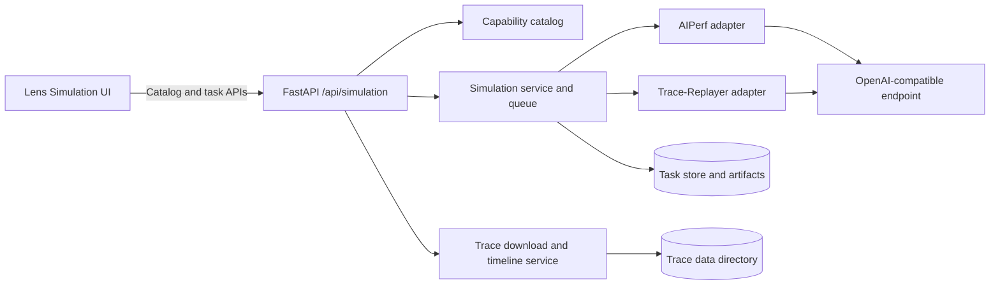
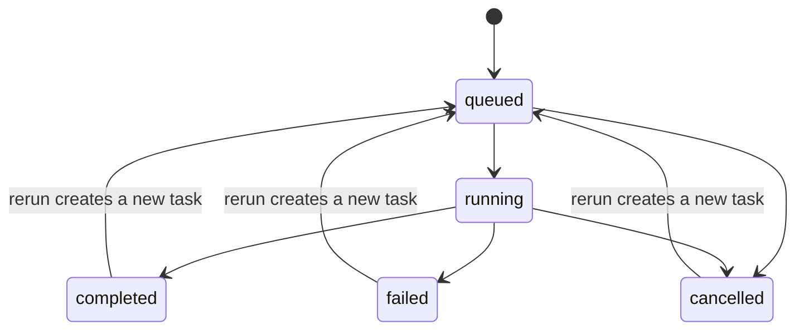
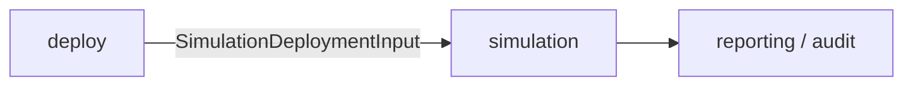

# Simulation Design

Simulation owns trace-replay tasks, backend capabilities, lifecycle and normalized results. The execution/API design and typed domain contract are maintained together; endpoint examples and backend details remain in their corresponding parts rather than being forced into one incompatible schema.

This is the single canonical design for this module. Section numbers retain their
original part-local context; use the links below for unambiguous navigation.

| Part | Scope and status |
| --- | --- |
| [Execution and REST contract](#lens-simulation-design-and-api-contract) | Runner, native capability matrix, lifecycle and endpoint contracts. |
| [Typed domain contract](#simulation-module-contracts) | Discovery, request/result models, Python API and Deploy projection. |

<!-- design-part: execution -->

## Lens Simulation Design and API Contract

> Implementation contract for the current `/api/simulation` service. This document
> describes deployed behavior, not the future unified Run/TCO target architecture.

### 1. Scope and design principles

Simulation replays registered LLM request traces against an OpenAI-compatible
inference endpoint. The browser does not construct backend commands. It reads the
backend and dataset catalogs, submits a capability-valid task, and renders the
normalized result returned by OptimalBench.

The implementation follows these rules:

1. **Native capability only.** A dataset is supported only when the selected
   benchmark backend natively loads its trace format. OptimalBench does not convert
   an unsupported format to claim backend support.
2. **Server-authoritative capabilities.** Backend, dataset, range, scale, and
   advanced-option compatibility are enforced by the API even when the UI has
   already hidden an invalid combination.
3. **Backend-neutral results.** AIPerf and Trace-Replayer outputs are normalized
   into the same `SimulationSummary` shape. Backend-native data remains available
   in `backend_metrics`.
4. **Durable tasks.** Each task and its artifacts are persisted below
   `SIMULATION_TASK_ROOT`; queued tasks resume after service restart.
5. **Safe trace access.** Local trace paths must resolve inside
   `TRACE_REPLAY_DATA_DIR`.

### 2. Component model



#### 2.1 Ownership

| Component | Responsibility |
|---|---|
| Router | HTTP validation, status-code mapping, live-result enrichment |
| Simulation service | task state machine, persistence, queueing, restart recovery |
| Backend adapter | backend-specific validation, command construction, result parsing |
| Trace catalog | native dataset registration, secure download, checksums |
| Timeline service | bounded density index, replay-range validation |
| Lens UI | capability-driven controls and normalized-result presentation |

### 3. Task lifecycle



- Task IDs are eight lowercase hexadecimal characters.
- `POST /tasks` persists the task before returning `202`.
- Stop is asynchronous and initially returns `cancelling`; persisted terminal
  state is `cancelled`.
- Rerun never mutates the source task. It creates a new task with copied immutable
  configuration.
- `GET /tasks/{id}` derives missing normalized timelines from persisted artifacts
  for older completed tasks.

### 4. Native capability matrix

| Trace format | AIPerf | Trace-Replayer | Start/end | Scale factor |
|---|---:|---:|---|---|
| `mooncake_trace` | Yes | Yes | AIPerf: start/end; Trace-Replayer: end only, start fixed at 0 | Trace-Replayer only |
| `bailian_trace` | Yes | Yes | AIPerf: start/end; Trace-Replayer: end only, start fixed at 0 | Trace-Replayer only |
| `baseten_trace` | Yes | No | AIPerf | AIPerf |
| `burst_gpt_trace` | Yes | No | AIPerf | No |
| `weka_public_dataset` | Yes | No | No | No |

Registered datasets:

| Dataset | Scenario | Format | Native backends |
|---|---|---|---|
| `mooncake-arxiv` | `chat` | `mooncake_trace` | both |
| `mooncake-conversation` | `chat` | `mooncake_trace` | both |
| `mooncake-synthetic` | `chat` | `mooncake_trace` | both |
| `mooncake-toolagent` | `api-calling` | `mooncake_trace` | both |
| `bailian-trace-a` | `chat` | `bailian_trace` | both |
| `bailian-trace-b` | `api-calling` | `bailian_trace` | both |
| `bailian-thinking` | `chat` | `bailian_trace` | both |
| `bailian-coder` | `coding` | `bailian_trace` | both |
| `baseten-synthetic` | `chat` | `baseten_trace` | AIPerf |
| `burstgpt-conversation` | `chat` | `burst_gpt_trace` | AIPerf |
| `burstgpt-api` | `api-calling` | `burst_gpt_trace` | AIPerf |
| `weka-claude-code` | `coding` | `weka_public_dataset` | AIPerf |
| `weka-claude-code-subagents-256k` | `coding` | `weka_public_dataset` | AIPerf |

Azure Conversation/Coder are intentionally absent because neither backend
natively supports the Azure trace format.

### 5. Configuration rules

#### 5.1 Common SLA metadata

SLA values are stored in `simulation.backend_options`. They control result
presentation and do not become AIPerf CLI flags.

| Key | Type/unit | Constraint |
|---|---|---|
| `ttft_slo` | number, seconds | `>= 0` |
| `tpot_slo` | number, seconds | `>= 0` |
| `error_rate_slo` | number, percent | `0..100` |

#### 5.2 AIPerf options

| Key | Type | Constraint/applicability |
|---|---|---|
| `random_seed` | integer | `>= 0` |
| `num_profile_runs` | integer | `1..10`, default `1` |
| `profile_run_cooldown_seconds` | number | `>= 0`; only when runs > 1 |
| `concurrency` | integer | `>= 1`; Weka only |
| `max_context_length` | integer | `>= 1`; Weka only |
| `trace_idle_gap_cap_seconds` | number | `>= 0`; Weka only |

#### 5.3 Trace-Replayer options

| Key | Type/unit |
|---|---|
| `num_producer` | integer |
| `channel_capacity` | integer |
| `threads` | integer |
| `early_stop_error_threshold` | number |
| `metric_percentiles` | non-empty number array |
| `tokenizer_config` | server-managed path |

### 6. API conventions

- Base path: `/api/simulation`
- Media type: `application/json`
- Timestamps: ISO 8601 strings, normally UTC with `Z`
- Percent values: `0..100`, not fractions
- Latency values in normalized results: milliseconds
- Throughput: requests/second or tokens/second
- Unknown request fields are rejected with `422`

#### 6.1 Error schema

All route errors use FastAPI's standard envelope:

```ts
type ErrorResponse = {
  detail: string | ValidationIssue[];
};

type ValidationIssue = {
  loc: Array<string | number>;
  msg: string;
  type: string;
  input?: unknown;
  ctx?: Record<string, unknown>;
};
```

### 7. Reusable response schemas

```ts
type BackendName = "aiperf" | "trace-replayer";
type ScenarioName = "chat" | "api-calling" | "coding";
type TaskStatus = "queued" | "running" | "completed" | "failed" | "cancelled";
type TraceFormat =
  | "mooncake_trace"
  | "bailian_trace"
  | "baseten_trace"
  | "burst_gpt_trace"
  | "weka_public_dataset";

type Scenario = {
  name: ScenarioName;
  display_name: string;
  description: string;
  supported_backends?: BackendName[];
};

type AdvancedOption = {
  name: string;
  label: string;
  minimum?: number;
  maximum?: number;
  default?: number;
  trace_formats?: TraceFormat[];
};

type TraceFormatCapability = {
  supports_trace_range: boolean;
  trace_range_mode?: "start_end" | "duration" | "none";
  supports_scale_factor: boolean;
};

type BackendCapabilities = {
  prompt_kinds: ["trace"];
  arrival_patterns: string[];
  supports_duration: boolean;
  supports_request_count: boolean;
  supports_request_rate: boolean;
  supports_streaming: boolean;
  supports_per_request_results: boolean;
  supports_cancellation: boolean;
  supports_trace_range: boolean;
  scale_factor_trace_formats: TraceFormat[];
  trace_format_capabilities: Partial<
    Record<TraceFormat, TraceFormatCapability>
  >;
  advanced_options?: AdvancedOption[];
  default_tokenizer_configured?: boolean;
  managed_tokenizer?: boolean;
  trace_formats: TraceFormat[];
};

type BackendDescriptor = {
  name: BackendName;
  display_name: string;
  api_version: 1;
  available: boolean;
  version: string | null;
  unavailable_reason: string | null;
  managed_installation: boolean;
  scenarios: Scenario[];
  capabilities: BackendCapabilities;
};

type DatasetPreset = {
  name: string;
  supported_backends: BackendName[];
  filename: string;
  trace_format: TraceFormat;
  scenario: ScenarioName;
  license?: string;
  source_repository?: string;
  description: string;
  downloaded: boolean;
  path: string;
  size_bytes: number | null;
  source_type?: "aiperf_public_dataset";
  public_dataset?: string;
  url?: string;
  sha256?: string;
  generator?: string;
  transform?: {
    type: string;
    value?: string;
  };
};

type SimulationConfig = {
  backend: BackendName;
  backend_options: Record<string, unknown>;
  duration_seconds: number;
  num_requests: null;
  stream: boolean;
  warmup_enabled: false;
  grace_period_seconds: number;
};

type DatasetRef = {
  name: string | null;
  scenario: ScenarioName | null;
  tokenizer: string | null;
};

type TraceRef = {
  path: string;
  format: TraceFormat;
  fixed_schedule: boolean;
  timeout_seconds: number;
  synthesis_speedup_ratio: number;
  start_seconds: number;
  end_seconds: number | null;
};

type Artifact = {
  kind: string;
  path: string;
  media_type: string;
};

type Distribution = {
  mean_ms: number;
  p50_ms?: number;
  p90_ms?: number;
  p95_ms?: number;
  p99_ms?: number;
  min_ms?: number;
  max_ms?: number;
  std_ms?: number;
  count?: number;
  sum_ms?: number;
  unit?: string;
};

type CompletionTimelinePoint = {
  start_seconds: number;
  end_seconds: number;
  arrived_requests: number;
  completed_requests: number;
  successful_requests: number;
  failed_requests: number;
  cumulative_arrived: number;
  cumulative_completed: number;
};

type LatencyTimelinePoint = {
  start_seconds: number;
  end_seconds: number;
  request_count: number;
  request_arrival_rps: number;
  average_latency_ms: number | null;
  p95_latency_ms: number | null;
};

type ThroughputTimelinePoint = {
  start_seconds: number;
  end_seconds: number;
  arrived_requests: number;
  completed_requests: number;
  output_tokens: number;
  request_arrival_rps: number;
  request_completion_rps: number;
  token_throughput_tps: number;
};

type ErrorTimelinePoint = {
  start_seconds: number;
  end_seconds: number;
  failed_requests: number;
  error_rate_percent: number;
  cumulative_failures: number;
};

type StatusCodeBucket = {
  status_code: number | null;
  count: number;
  percentage: number;
};

type SimulationSummary = {
  total_requests: number;
  successful_requests: number;
  failed_requests: number;
  success_rate: number;
  duration_seconds: number;
  throughput_rps: number;
  throughput_tps: number;
  total_input_tokens: number;
  total_output_tokens: number;
  input_throughput_tps?: number;
  total_throughput_tps?: number;
  request_error_rate?: number;
  effective_concurrency?: number;
  latency: Distribution | null;
  ttft: Distribution | null;
  tpot: Distribution | null;
  drift?: Distribution | {
    p50_ms?: number;
    p90_ms?: number;
    p99_ms?: number;
  } | null;
  completion_timeline: CompletionTimelinePoint[];
  latency_timeline: LatencyTimelinePoint[];
  ttft_timeline: LatencyTimelinePoint[];
  tpot_timeline: LatencyTimelinePoint[];
  throughput_timeline: ThroughputTimelinePoint[];
  error_timeline: ErrorTimelinePoint[];
  status_code_breakdown: StatusCodeBucket[];
};

type SimulationResult = {
  run_id: string;
  backend: BackendName;
  backend_version: string | null;
  summary: SimulationSummary;
  artifacts: Artifact[];
  per_request: Record<string, unknown>[];
  backend_metrics: Record<string, unknown>;
  warnings: string[];
};

type SimulationTask = {
  id: string;
  name: string;
  description: string;
  scenario: ScenarioName;
  status: TaskStatus;
  endpoint_mode: "external" | "in-cluster";
  endpoint_namespace: string | null;
  endpoint_service: string | null;
  endpoint_url: string;
  model_name: string;
  simulation: SimulationConfig;
  prompt: {
    type: "trace";
    dataset: DatasetRef;
    trace: TraceRef;
  };
  task_dir: string;
  progress_percent: number;
  progress_message: string;
  logs: string[];
  result: SimulationResult | null;
  error_message: string | null;
  created_at: string;
  started_at: string | null;
  completed_at: string | null;
  owner_pid: number | null;
  owner_instance_id: string | null;
  live_summary?: SimulationSummary;
};
```

`ttft` and `tpot` are `null` when AIPerf runs without streaming. The result
contains a warning explaining how to enable these metrics.

### 8. Endpoint contracts

#### 8.1 `GET /backends`

Returns the authoritative backend capability catalog.

Request: no body or query parameters.

```ts
type BackendsResponse = {
  backends: BackendDescriptor[];
};
```

Status codes: `200`.

#### 8.2 `POST /models/discover`

Queries the endpoint's OpenAI-compatible `/v1/models` API. Redirects are not
followed; timeout is 10 seconds; maximum response size is 1 MiB.

```ts
type ModelDiscoveryRequest = {
  endpoint_url: string; // 1..2000 chars, absolute HTTP(S) URL
};

type ModelDiscoveryResponse = {
  endpoint: string;
  models: string[]; // unique, sorted, non-empty model IDs
};
```

Status codes:

- `200`: models discovered.
- `400`: connection, HTTP, size, JSON, or response-shape failure.
- `422`: request-schema failure.

#### 8.3 `GET /scenarios`

Request: no body or query parameters.

```ts
type ScenariosResponse = {
  scenarios: Array<Scenario & { supported_backends: BackendName[] }>;
};
```

Status codes: `200`.

#### 8.4 `GET /trace-datasets`

Returns all registered native dataset presets and their local availability.

```ts
type TraceDatasetsResponse = {
  data_dir: string;
  presets: DatasetPreset[];
};
```

Status codes: `200`.

#### 8.5 `POST /trace-datasets/download`

```ts
type DownloadTraceRequest = {
  preset: string; // non-empty registered preset name
  force?: boolean; // default false
};

type DownloadTraceResponse = {
  path: string;
  trace_format: TraceFormat;
  sha256: string;
  metadata_path: string;
  size_bytes: number;
};
```

Status codes:

- `200`: trace is available and validated.
- `400`: unknown preset, download, checksum, format, or filesystem failure.
- `429`: concurrent trace-download limit reached.
- `422`: request-schema failure.

Weka public datasets are managed by AIPerf and are already reported as
`downloaded`; this endpoint is for locally stored presets.

#### 8.6 `GET /trace-datasets/{dataset_name}/timeline`

Path:

- `dataset_name: string` — registered preset name.

Query:

- `bins: integer` — default `800`, range `50..2000`.

```ts
type TimelineBin = {
  start_seconds: number; // relative to the first source record
  end_seconds: number;
  request_count: number;
};

type TraceTimelineResponse = {
  dataset: string;
  trace_format: TraceFormat;
  request_count: number;
  duration_seconds: number;
  source_size_bytes: number;
  bin_width_seconds: number;
  bins: TimelineBin[];
};
```

Status codes:

- `200`: timeline returned.
- `404`: unknown preset.
- `409`: trace is unavailable or does not support timeline selection.
- `422`: invalid `bins`.
- `500`: timeline/index construction failure.

`weka_public_dataset` is managed remotely by AIPerf and has no local timeline;
its timeline request returns `409` even though the catalog marks it as
`downloaded`.

#### 8.7 `GET /tasks`

Query parameters:

| Name | Type/default | Rule |
|---|---|---|
| `status` | `TaskStatus?` | exact match |
| `scenario` | `ScenarioName?` | exact match |
| `search` | `string?` | max 200; trimmed, non-empty |
| `backend` | `BackendName?` | exact match |
| `model` | `string?` | max 200, exact match |
| `dataset` | `string?` | max 200, exact match |
| `trace_format` | `TraceFormat?` | exact match |
| `endpoint` | `string?` | max 500, case-insensitive substring |
| `created_after` | ISO datetime? | inclusive |
| `created_before` | ISO datetime? | inclusive |
| `offset` | integer, `0` | `>= 0` |
| `limit` | integer, `10` | `1..100` |

```ts
type TaskCounts = Record<TaskStatus, number>;

type TaskFacets = {
  backends: BackendName[];
  models: string[];
  datasets: string[];
  trace_formats: TraceFormat[];
  endpoints: string[];
};

type TaskListResponse = {
  tasks: SimulationTask[];
  total: number;
  offset: number;
  limit: number;
  counts: TaskCounts; // counts before filtering
  facets: TaskFacets; // facets before filtering
};
```

List entries intentionally omit heavy content:

- `logs` is `[]`.
- `result.artifacts`, `result.per_request` are `[]`.
- `result.backend_metrics` is `{}`.
- Running entries may include `live_summary`.

Status codes: `200`, `422`, `500`.

#### 8.8 `POST /tasks`

```ts
type CreateSimulationTaskRequest = {
  name?: string; // default "Trace simulation"
  description?: string; // default ""
  scenario: ScenarioName;
  backend?: BackendName; // default "trace-replayer"
  endpoint_mode?: "external" | "in-cluster"; // default "external"
  endpoint_namespace?: string | null;
  endpoint_service?: string | null;
  endpoint_url: string; // absolute HTTP(S)
  model_name: string; // non-empty
  trace_dataset: string; // registered preset, non-empty
  trace_path: string; // exact preset path/public-dataset key, non-empty
  duration_seconds?: number; // integer >= 1, default 60
  scale_factor?: number; // > 0, default 1
  trace_start_seconds?: number; // >= 0, default 0
  trace_end_seconds?: number | null; // > 0 when present
  trace_timeout_seconds?: number; // integer >= 1, default 3600
  fixed_schedule?: boolean; // default true
  stream?: boolean; // default true
  backend_options?: Record<string, unknown>; // default {}
};

type CreateSimulationTaskResponse = {
  task_id: string;
  status: "queued";
  task: SimulationTask;
};
```

Server-side semantic validation includes:

- backend availability and native dataset/format support;
- scenario-to-dataset binding;
- registered filename/public-dataset key and trace-root containment;
- range and scale capability;
- `trace_start_seconds == 0` when `trace_range_mode` is `duration`;
- non-empty selected range;
- backend-specific options and SLA ranges.

When `trace_end_seconds` is present, `duration_seconds` is normalized to
`ceil((end - start) / scale_factor)`, minimum one second.

Status codes:

- `202`: task persisted and queued.
- `400`: semantic/capability/configuration failure.
- `422`: request-schema failure.
- `500`: unexpected task creation failure.

#### 8.9 `GET /tasks/{task_id}`

Path:

- `task_id: string` — persisted task ID.

Response: `SimulationTask`. A running task additionally contains
`live_summary`. Completed results can be enriched and re-persisted with timelines
or detected backend version.

Status codes: `200`, `404`.

#### 8.10 `GET /tasks/{task_id}/response-code-issues`

Query:

| Name | Type/default | Rule |
|---|---|---|
| `status_code` | required string | `"unknown"` or integer `100..599` |
| `offset` | integer, `0` | `>= 0` |
| `limit` | integer, `100` | `1..500` |

```ts
type ResponseCodeIssue = {
  request_number: number;
  request_id: string | null;
  status_code: number | null;
  error: string | null;
  started_at_seconds: number | null;
  latency_ms: number | null;
  input_tokens: number | null;
  output_tokens: number | null;
};

type ResponseCodeIssuesResponse = {
  task_id: string;
  status_code: number | null;
  total: number;
  issues: ResponseCodeIssue[];
};
```

Status codes: `200`, `404`, `422`.

#### 8.11 `POST /tasks/{task_id}/stop`

Request: no body.

```ts
type StopTaskResponse = {
  task_id: string;
  status: "cancelling";
};
```

Status codes:

- `200`: cancellation requested.
- `400`: task cannot be stopped in its current state.
- `404`: task not found.
- `500`: unexpected stop failure.

#### 8.12 `POST /tasks/{task_id}/rerun`

Request: no body. The new task copies endpoint, workload, range, streaming, SLA,
and backend options from the source.

```ts
type RerunTaskResponse = {
  task_id: string; // new task ID
  status: "queued";
  task: SimulationTask;
};
```

Status codes:

- `202`: new task persisted and queued.
- `400`: source task is active or copied configuration is no longer valid.
- `404`: source task not found.
- `500`: unexpected rerun failure.

#### 8.13 `DELETE /tasks/{task_id}`

Request: no body.

```ts
type DeleteTaskResponse = {
  task_id: string;
  status: "deleted";
};
```

Status codes:

- `200`: task metadata and task directory deleted.
- `404`: task not found.
- `409`: active task cannot be deleted.
- `500`: unexpected deletion failure.

### 9. Persistence and operational configuration

| Environment variable | Purpose |
|---|---|
| `SIMULATION_TASK_ROOT` | task JSON and artifacts |
| `TRACE_REPLAY_DATA_DIR` | approved local trace root |
| `AIPERF_EXECUTABLE` | AIPerf command |
| `TRACE_REPLAYER_EXECUTABLE` | Trace-Replayer command |
| `TRACE_REPLAYER_TOKENIZER` | default Trace-Replayer tokenizer |
| `SIMULATION_BACKEND_CACHE_DIR` | managed backend installations |
| `SIMULATION_MAX_CONCURRENT_DOWNLOADS` | trace download concurrency |
| `SIMULATION_MAX_TASK_LOG_LINES` | retained task log lines |

The current store is filesystem-backed and intended for the Lens-managed
single-service deployment. The future unified Run architecture may replace this
storage implementation without changing the capability and normalized-result
semantics documented here.

<!-- /design-part: execution -->

<!-- design-part: domain-contract -->

## Simulation Module Contracts

### Purpose

The `simulation` module accepts immutable deployment evidence from `deploy`
and discovery metadata from `configuration`, runs trace-based load simulations
against an LLM serving endpoint, and produces latency, throughput, and error
results for audit, reporting, and future `benchmark` consumers.

It does not manage deployments, select workloads, or interpret model
capabilities. Those are `deploy`, `benchmark`, and `configuration`
responsibilities.



### Architecture

Simulation is a long-running service with equivalent REST and Python APIs. The
REST router serializes the same domain objects returned by the Python API; it
does not implement a separate business path. Simulation persists task state on
disk and manages a bounded pool of concurrent backend subprocesses. Two
backends are supported:

| Backend | Display Name | Trace Formats |
|---|---|---|
| `aiperf` | AIPerf | mooncake_trace, bailian_trace, baseten_trace, burst_gpt_trace, weka_public_dataset |
| `trace-replayer` | Trace Replayer | mooncake_trace, bailian_trace |

The `Backend` base validates the common trace replay and SLO contract. Each
current backend is a `CommandBackend` responsible for its additional
validation, CLI invocation, subprocess execution, and result parsing.

Finalization drains queued progress and log saves while the task is still
`running`, then sets its terminal status, verifies the saved serving and routing
snapshot, and performs the final save and benchmark evidence ingestion. This
ordering prevents an earlier save from replacing the snapshot while verification
is awaiting cluster metadata and losing its `verified_at` marker.

Backend components import the public Python API from
`llm_d_lens.simulation`. Python calls return typed domain objects where a
model exists and raise `SimulationConfigurationError` for domain errors. REST
routes translate the same errors into HTTP responses and serialize the objects
to JSON.

### Scenarios

Three scenarios classify the simulation workload:

| Scenario | Display Name | Description |
|---|---|---|
| `chat` | Chat | Conversational and general assistant traffic |
| `api-calling` | Tool & API Use | Tool-use, agent, and business API traffic |
| `coding` | Code Generation | Code generation and software engineering traffic |

Trace datasets are assigned to exactly one scenario. A task's scenario must
match its dataset's scenario.

### Discovery

Discovery endpoints are read-only and do not mutate simulation state.

#### Backend Discovery

##### Endpoint

```
GET /api/simulation/backends
```

##### Python

```python
from llm_d_lens.simulation import list_backends

backends: list[BackendDescriptor] = list_backends()
```

Returns the descriptor for every registered backend:

```python
BackendDescriptor(
    name: str,
    display_name: str,
    api_version: int,
    available: bool,
    version: str | None,
    unavailable_reason: str | None,
    scenarios: list[dict],
    capabilities: dict,
)
```

`capabilities` includes `trace_formats` and per-format capabilities such as
`supports_scale_factor`, `supports_trace_range`, and `trace_range_mode`.
Callers use this to determine valid backend/dataset/scenario combinations
before creating a task.

#### Scenario Discovery

##### Endpoint

```
GET /api/simulation/scenarios
```

##### Python

```python
from llm_d_lens.simulation import list_scenarios

scenarios: list[ScenarioDescriptor] = list_scenarios()
```

Returns the union of all scenarios across all backends. Each scenario entry
carries its `supported_backends`.

```python
ScenarioDescriptor(
    name: str,
    display_name: str,
    description: str,
    supported_backends: list[str],
)
```

#### Trace Dataset Discovery

##### Endpoint

```
GET /api/simulation/trace-datasets
```

##### Python

```python
from llm_d_lens.simulation import trace_registry

catalog: list[dict[str, Any]] = trace_registry.list()
```

Returns the catalog of known trace datasets. Each dataset carries its name,
supported backends, trace format, scenario, download URL, SHA-256 checksum,
license, source repository, and description.

```python
TraceDatasetDescriptor(
    name: str,
    supported_backends: list[str],
    trace_format: str,
    scenario: str,
    url: str,
    sha256: str,
    license: str,
    source_repository: str,
    description: str,
)
```

#### Trace Dataset Download

##### Endpoint

```
POST /api/simulation/trace-datasets/download
```

##### Python

```python
from llm_d_lens.simulation import BaseTrace

download: dict[str, Any] = await BaseTrace.download(dataset, force=False)
```

Downloads a trace dataset file to the local trace root. Accepts an optional
`force` flag to re-download an existing file.

```python
TraceDatasetDownloadRequest(
    dataset: str,
    force: bool = False,
)
```

#### Trace Dataset Timeline

##### Endpoint

```
GET /api/simulation/trace-datasets/{dataset_name}/timeline
```

##### Python

```python
from llm_d_lens.simulation import get_trace_timeline

timeline: dict[str, Any] = await get_trace_timeline(dataset_name, bins=800)
```

Returns a pre-computed density histogram of trace request timestamps for
visualization. Accepts an optional `bins` parameter (50–2000, default 800).

#### Model Discovery

##### Endpoint

```
POST /api/simulation/models/discover
```

##### Python

```python
from llm_d_lens.simulation import discover_models

models: dict[str, Any] = await discover_models(endpoint_url)
```

Probes an OpenAI-compatible `/v1/models` endpoint and returns the list of
available model IDs.

```python
ModelDiscoveryRequest(
    endpoint_url: str,
)
```

### Task Creation

`SimulationTaskCreateRequest` is the create command that enqueues a new
simulation task:

#### Endpoint

```
POST /api/simulation/tasks
```

#### Python

```python
from llm_d_lens.simulation import create_task

task: SimulationTask = await create_task(request)
```

```python
SimulationTaskCreateRequest(
    name: str,
    description: str,
    scenario: Literal["chat", "api-calling", "coding"],
    backend: Literal["aiperf", "trace-replayer"],
    endpoint_mode: Literal["external", "in-cluster"],
    endpoint_namespace: str | None,
    endpoint_service: str | None,
    endpoint_url: str,
    model_name: str,
    trace_dataset: str,
    trace_path: str,
    duration_seconds: int,
    scale_factor: float,
    trace_start_seconds: float,
    trace_end_seconds: float | None,
    trace_timeout_seconds: int,
    fixed_schedule: bool,
    stream: bool,
    backend_options: dict[str, Any],
)
```

| Field | Meaning |
|---|---|
| `scenario` | Must match the selected trace dataset's scenario. |
| `backend` | Must be `aiperf` or `trace-replayer`. |
| `endpoint_mode` | `external` for user-provided URLs; `in-cluster` for Kubernetes service endpoints resolved via `endpoint_namespace` and `endpoint_service`. |
| `endpoint_url` | Required HTTP or HTTPS URL of the OpenAI-compatible chat completions endpoint. |
| `model_name` | The model to pass in each request's `model` field. |
| `trace_dataset` | A dataset name from the trace datasets catalog (e.g. `mooncake-arxiv`). |
| `trace_path` | Filesystem path to the trace file, resolved via the trace catalog. |
| `duration_seconds` | Request issuance window. Overridden when `trace_end_seconds` is set: the duration is computed as `(trace_end - trace_start) / scale_factor`. After this window closes, the backend waits for issued requests to complete before producing the result. |
| `scale_factor` | Synthesis speedup ratio (> 0). Only supported when the backend declares per-format `supports_scale_factor`. |
| `trace_start_seconds` / `trace_end_seconds` | Optional trace time range. Only supported when the backend declares `supports_trace_range`. |
| `trace_timeout_seconds` | Maximum subprocess wall-clock time before the runner kills it. |
| `fixed_schedule` | If true, the backend replays trace inter-arrival gaps faithfully. If false, it issues requests as fast as concurrency allows. Must be `False` for `aiperf_public_dataset` sources. |
| `stream` | Whether to request streaming responses (`stream: true`). |
| `backend_options` | Backend-specific key-value overrides such as `error_rate_slo`, `ttft_slo`, `tpot_slo`, or `concurrency`. |

Trace-Replayer defaults to 16 token producers, a channel capacity of 32, and 32
worker threads so
prompt generation does not throttle the recorded request schedule. Explicit
`num_producer`, `channel_capacity`, and `threads` options override these defaults.

Validation is performed by the selected `CommandBackend` and may reject
incompatible combinations of dataset, backend, scale factor, and trace range.
The response is HTTP 202 with the new task's ID and initial state. The task
enters `queued` status and is scheduled against a per-target lock. Tasks that
target the same deployment, Model Service, or endpoint URL wait for one another;
tasks with different targets run concurrently.

### Task Stop

Stops a running or queued task:

#### Endpoint

```
POST /api/simulation/tasks/{task_id}/stop
```

#### Python

```python
from llm_d_lens.simulation import stop_task

await stop_task(task_id)
```

No request body is required. The task transitions to `cancelled` (if running,
the backend subprocess receives a termination signal). Idempotent: calling
stop on an already-cancelled or completed task is a no-op.

### Task Rerun

Creates a new task from an existing completed, failed, or cancelled task:

#### Endpoint

```
POST /api/simulation/tasks/{task_id}/rerun
```

#### Python

```python
from llm_d_lens.simulation import rerun_task

task: SimulationTask = await rerun_task(task_id)
```

No request body is required. The new task copies all configuration from the
original. Its name is suffixed with ` · rerun <new_task_id>`. The original
task is not modified. Returns HTTP 202.

### Task Deletion

Deletes a completed, failed, or cancelled task and its on-disk artifacts:

#### Endpoint

```
DELETE /api/simulation/tasks/{task_id}
```

#### Python

```python
from llm_d_lens.simulation import delete_task

await delete_task(task_id)
```

The task must not be `queued` or `running`. Deleting an active task is
rejected with HTTP 409. On success the task directory is removed from disk.

### Task Observation

#### Task Detail

##### Endpoint

```
GET /api/simulation/tasks/{task_id}
```

##### Python

```python
from llm_d_lens.simulation import get_task

task: SimulationTask | None = await get_task(task_id)
```

Returns the full `SimulationTask` for the given ID. While a task is `running`,
the response includes a `live_summary` field with real-time metrics computed
from the backend's partial output artifacts.

On first retrieval of a `completed` task, the response lazily computes and
persists derived timelines (completion timeline, latency timeline, throughput
timeline, error timeline, status code breakdown) into the result's `summary`.
Subsequent queries return the cached timelines.

Returns HTTP 404 if the task does not exist.

#### Task Listing

##### Endpoint

```
GET /api/simulation/tasks
```

##### Python

```python
from llm_d_lens.simulation import list_tasks

page: SimulationTaskListPage = await list_tasks(
    status=status,
    scenario=scenario,
    backend=backend,
    offset=offset,
    limit=limit,
)
```

Supports filtering by `status`, `scenario`, `backend`, `model`, `dataset`,
`trace_format`, `endpoint`, `created_after`, `created_before`, and free-text
`search`. Returns a paginated response:

```python
SimulationTaskListPage(
    tasks: list[SimulationTask],
    total: int,
    offset: int,
    limit: int,
    counts: dict[str, int],
    facets: dict[str, list[str]],
)
```

`counts` provides status breakdowns (`queued`, `running`, `completed`,
`failed`, `cancelled`). `facets` enumerates known backends, models, datasets,
trace formats, and endpoints across all tasks.

Tasks are returned newest-first with large fields elided: `logs`, `artifacts`,
`per_request`, and `backend_metrics` are stripped from list results. Running
tasks in the list include a `live_summary`.

### Main Output: SimulationTask

`SimulationTask` is the lifecycle object persisted to disk and returned by all
task endpoints. It corresponds to `TaskModel` in the implementation.

```python
SimulationTask(
    id: str,
    name: str,
    description: str,
    scenario: Literal["chat", "api-calling", "coding"],
    status: SimulationTaskStatus,
    endpoint_mode: Literal["external", "in-cluster"],
    endpoint_namespace: str | None,
    endpoint_service: str | None,
    endpoint_url: str,
    model_name: str,
    simulation: SimulationConfig,
    prompt: SimulationPrompt,
    task_dir: str,
    progress_percent: float,
    progress_message: str,
    logs: list[str],
    result: SimulationResult | None,
    error_message: str | None,
    created_at: str,
    started_at: str | None,
    completed_at: str | None,
    owner_pid: int | None,
    owner_instance_id: str | None,
)
```

Supported lifecycle states:

```text
queued -> running -> completed
                  -> failed
                  -> cancelled
```

| Field | Meaning |
|---|---|
| `id` | 8-character lowercase hexadecimal, generated by the service. |
| `status` | Current lifecycle state. |
| `endpoint_mode` | `external` for a user-provided URL; `in-cluster` for a Kubernetes service reference. |
| `endpoint_url` | The resolved OpenAI-compatible endpoint URL used by the backend. |
| `model_name` | The model name sent in each request. |
| `simulation` | Immutable simulation configuration (see `SimulationConfig`). |
| `prompt` | Immutable trace and dataset reference (see `SimulationPrompt`). |
| `task_dir` | Absolute path to the task's on-disk directory under `SIMULATION_TASK_ROOT`. |
| `progress_percent` | 0–100 progress indicator updated by the backend runner. |
| `progress_message` | Human-readable phase description. |
| `logs` | Up to `SIMULATION_MAX_TASK_LOG_LINES` (default 500) timestamped log lines. |
| `result` | Populated only when `status` is `completed`. |
| `error_message` | Populated only when `status` is `failed`. |
| `owner_pid` / `owner_instance_id` | Process and service instance ownership for detecting stale `running` tasks after a restart. |

#### SimulationConfig

```python
SimulationConfig(
    backend: Literal["aiperf", "trace-replayer"],
    backend_options: dict[str, Any],
    duration_seconds: float,
    num_requests: None,
    stream: bool,
    warmup_enabled: Literal[False],
    grace_period_seconds: float,
)
```

`num_requests` and `warmup_enabled` are reserved for future use and always
`None` and `False` respectively.

#### SimulationPrompt

```python
SimulationPrompt(
    type: Literal["trace"],
    dataset: SimulationDataset,
    trace: SimulationTrace,
)

SimulationDataset(
    name: str | None,
    scenario: Literal["chat", "api-calling", "coding"] | None,
    tokenizer: str | None,
)

SimulationTrace(
    path: str,
    format: Literal[
        "mooncake_trace",
        "bailian_trace",
        "baseten_trace",
        "burst_gpt_trace",
        "weka_public_dataset",
    ],
    fixed_schedule: bool,
    timeout_seconds: float,
    synthesis_speedup_ratio: float,
    start_seconds: float,
    end_seconds: float | None,
)
```

### Result Output: SimulationResult

`SimulationResult` is the parsed backend output, populated when the task
reaches `completed` status.

```python
SimulationResult(
    run_id: str,
    backend: Literal["aiperf", "trace-replayer"],
    backend_version: str | None,
    summary: dict[str, Any],
    artifacts: list[SimulationArtifact],
    per_request: list[SimulationRequestResult],
    backend_metrics: dict[str, Any],
    warnings: list[str],
)
```

| Field | Meaning |
|---|---|
| `run_id` | Unique run identifier, distinct from `task.id`. |
| `backend_version` | Detected backend version string. |
| `summary` | Aggregated metrics dictionary. Includes key-value pairs for latency distributions (`ttft_ms`, `tpot_ms`, `e2e_latency_ms`), throughput (`throughput_rps`, `output_tokens_per_second`), success/failure counts, and SLO compliance. After lazy enrichment it also includes `completion_timeline`, `latency_timeline`, `ttft_timeline`, `tpot_timeline`, `throughput_timeline`, `error_timeline`, `status_code_breakdown`, and optional `status_code_issues`. |
| `artifacts` | References to on-disk stdout, stderr, and backend-specific output files. |
| `per_request` | Per-request records with latency, token counts, status codes, and metadata. |
| `backend_metrics` | Backend-specific operational metrics (e.g., AIPerf profile phase metrics). |
| `warnings` | Non-fatal issues encountered during parsing. |

#### SimulationRequestResult

`SimulationRequestResult` is the backend-independent shape used when normalized
per-request records are included in a result. Full native request streams remain
available through `per_request` artifacts; additional backend-specific values
may be retained as extension fields.

```python
SimulationRequestResult(
    request_id: str | int | None,
    status_code: int | None,
    successful: bool | None,
    error: str | None,
    started_at_seconds: float | None,
    completed_at_seconds: float | None,
    latency_ms: float | None,
    ttft_ms: float | None,
    tpot_ms: float | None,
    input_tokens: float | None,
    output_tokens: float | None,
    metadata: dict[str, Any],
)
```

#### SimulationArtifact

```python
SimulationArtifact(
    kind: str,
    path: str,
    media_type: str,
)
```

Each artifact references an on-disk file within the task's artifact directory.

### Response Code Issue Detail

#### Endpoint

```
GET /api/simulation/tasks/{task_id}/response-code-issues
```

#### Python

```python
from llm_d_lens.simulation import get_response_code_issues

page: SimulationResponseCodeIssuePage = await get_response_code_issues(
    task_id,
    status_code,  # int, or None for failures without an HTTP status
    offset=0,
    limit=100,
)
```

Returns paginated per-request records that match a specific HTTP status code.
Accepts `status_code` (100–599, or `unknown` for non-HTTP failures), `offset`,
and `limit` query parameters. Each issue entry includes the request's
timestamp, latency, token counts, and error metadata.

```python
SimulationResponseCodeIssuePage(
    task_id: str,
    status_code: int | None,
    items: list[dict[str, Any]],
    total: int,
    offset: int,
    limit: int,
)
```

### Public Projection for Deploy

`simulation` consumes `SimulationDeploymentInput` from `deploy` (defined in
the deploy module contract). Simulation uses the deployment's execution ID,
artifact, endpoint, namespace, and resource snapshot to construct a
`SimulationTaskCreateRequest`. Simulation must not substitute current mutable
cluster state for these deployment execution snapshots.

### Lifecycle Invariants

1. A task ID is immutable once assigned and never reused.
2. A `running` task discovered after a service restart is marked `failed`
   with an appropriate error message.
3. Only one task per ID may run at a time. Tasks targeting the same deployment,
   Model Service, or endpoint URL are serialized by a per-target lock; different
   targets may run concurrently.
4. Cancelling a task sends a termination signal to the backend subprocess
   with a configurable grace period. If the subprocess does not exit, it is
   force-killed.
5. Task data on disk is written atomically via a temporary file and `os.replace`.
6. Deleting a task removes its entire task directory. This operation is
   irreversible.

### REST and Python API Compatibility

The Lens dashboard consumes the REST API. Other backend components consume
the Python API from `llm_d_lens.simulation`. Both surfaces execute the same
catalog, lifecycle, observation, and trace functions. REST responses may add a
transport envelope such as `{"task_id": ..., "status": ..., "task": ...}`;
the Python API returns the typed domain object directly.

The public Python surface is:

```python
from llm_d_lens.simulation import (
    BaseTrace,
    create_task,
    delete_task,
    discover_models,
    get_response_code_issues,
    get_task,
    get_trace_timeline,
    list_backends,
    list_scenarios,
    list_tasks,
    rerun_task,
    stop_task,
    trace_registry,
)
```

Simulation and benchmark remain parallel consumers of deploy output. The
existing Evaluate API and Guide adapter are not consumers of these contracts.

<!-- /design-part: domain-contract -->
